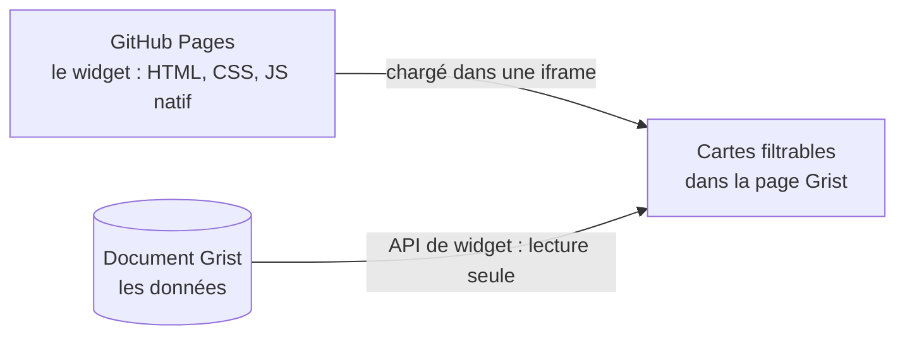

<div align="center">

# Annuaire PUI Bordeaux

**Le widget Grist qui retrouve, en quelques clics, le bon interlocuteur du Pôle universitaire d'innovation (PUI) de Bordeaux.**

*Pas de mauvaise porte, toujours le bon interlocuteur.*

[](https://github.com/lombre33/Annuaire_PUI_Bordeaux/actions/workflows/tests.yml)


<sub>Toutes les captures de ce dépôt utilisent des données fictives.</sub>

</div>

## Ce que fait le widget

L'annuaire affiche les accompagnateurs de l'innovation du PUI sous forme de **cartes** : on retrouve chaque personne par son nom ou par ce qu'elle fait.

- 🔎 **Recherche** par nom ou prénom, sans souci d'accents ni de majuscules.
- 🎛️ **Filtres** : chaque menu liste les valeurs d'une catégorie, avec le nombre de cartes qui portent chacune. Les valeurs d'un même menu s'additionnent (« ou »), les menus se cumulent entre eux (« et »).
- 🏛️ **Fondateurs et Partenaires** : deux interrupteurs permettent de choisir les établissements affichés, fondateurs du PUI ou partenaires. Seuls les établissements qui ont validé leur apparition sont montrés.
- 📇 **Cartes de contact** : identité, fonction, e-mail, téléphone, établissement et participations. Un clic sur une étiquette filtre sur sa valeur.
- 🛡️ **Fiable** : si Grist ne répond pas, si une table est illisible ou si une colonne indispensable manque, un bandeau le dit. Un annuaire vide alors que la table contient des lignes est toujours expliqué.
- 🔒 **Lecture seule**, sans dépendance à l'exécution : le widget n'écrit rien dans Grist et ne stocke rien dans le navigateur.

## En images

<table>
  <tr>
    <td width="50%"><br><sub><b>Un filtre</b> : champ de recherche, options à cocher, nombre de cartes par option.</sub></td>
    <td width="50%"><br><sub><b>Des filtres combinés</b> : les critères se cumulent.</sub></td>
  </tr>
  <tr>
    <td width="50%"><br><sub><b>La recherche</b> ignore accents et majuscules : « elise » trouve « Élise ».</sub></td>
    <td width="50%"><br><sub><b>Fondateurs et Partenaires</b> : on choisit les établissements affichés.</sub></td>
  </tr>
  <tr>
    <td width="50%"><br><sub><b>Une carte</b> : identité, coordonnées, participations (<a href="docs/utilisateurs.md#lire-une-carte">légende</a>).</sub></td>
    <td width="50%"><br><sub><b>Un bandeau d'état</b> prévient quand une lecture Grist échoue.</sub></td>
  </tr>
</table>

## Installer dans Grist

Prérequis : un document Grist qui contient les tables décrites dans [`grist_structure.txt`](grist_structure.txt), avec exactement ces noms de tables et de colonnes.

1. Dans le document, ajoutez un widget : **Add New**, puis **Add Widget to Page**, puis, dans **Select Widget**, choisissez **Custom**.
2. Pour **Select Data**, choisissez la table des contacts, `BDD` : Grist ne prévient le widget que des changements de cette table.
3. Ouvrez **Widget options** et saisissez l'adresse du widget dans **Enter Custom URL** :
   ```
   https://lombre33.github.io/Annuaire_PUI_Bordeaux/index.html
   ```
4. Accordez l'accès **Full document access** quand Grist le demande : le widget lit plusieurs tables, pas seulement celle de sa section.

Les libellés ci-dessus sont ceux de l'interface anglaise de Grist ; ils peuvent différer dans une autre langue. Le widget est déclaré dans [`manifest.yml`](manifest.yml) (nom, adresse, niveau d'accès).

> **Accès complet, un choix assumé.** Le widget demande l'accès complet au document : il lit plusieurs tables et les évolutions prévues y écriront. Selon la documentation de Grist, un tel widget peut lire et modifier tout le document ; aujourd'hui, celui-ci ne fait que lire. Trois garde-fous sont à mettre en place ou à vérifier : des règles d'accès Grist, une branche `main` protégée et des tables sensibles sorties du document ou protégées. Lisez la page [Sécurité et confidentialité](docs/securite.md) avant d'installer le widget.

## Essayer sans Grist

Le dossier [`docs/demo/`](docs/demo) fait tourner le vrai widget avec une API Grist simulée et des données **entièrement fictives**. Il suffit de Node 18 ou plus :

```bash
git clone https://github.com/lombre33/Annuaire_PUI_Bordeaux.git
cd Annuaire_PUI_Bordeaux
node docs/demo/serveur-demo.mjs
# puis ouvrir http://127.0.0.1:8080
```

Ajoutez `?panne=Actions` à l'adresse pour simuler une table de référence illisible et voir le bandeau d'état.

## Comment ça marche



Le widget est une page statique : pas de compilation, pas de dépendance npm à l'exécution. Il lit les tables du document Grist, applique les règles d'affichage (périmètre, établissement validé, fondateur ou partenaire), puis construit les cartes et les menus de filtre. Les détails sont dans la [documentation développeur](docs/developpeurs.md).

## Documentation

| Pour… | Lire |
|---|---|
| **Utiliser l'annuaire** : rechercher, filtrer, comprendre un message, vocabulaire du PUI | [Guide utilisateur](docs/utilisateurs.md) |
| **Comprendre et modifier le code** : architecture, chargement des données, règles, tests, recettes | [Documentation développeur](docs/developpeurs.md) |
| **Évaluer les risques** : accès demandé à Grist, données personnelles, recommandations | [Sécurité et confidentialité](docs/securite.md) |
| **Faire vivre l'annuaire** : règles de visibilité, diagnostic, publication, retour arrière | [Maintenance](docs/maintenance.md) |
| **Consulter le cahier des charges** | [`specs.md`](specs.md) |
| **Tester à la main avant un déploiement** | [`TESTING.md`](TESTING.md) |
| **Retrouver l'historique des versions** | [`CHANGELOG.md`](CHANGELOG.md), [`VERSION.md`](VERSION.md) |

## Structure du dépôt

```
.
├── index.html            Page du widget et modèle de carte
├── style.css             Feuille de style
├── main.js               Point d'entrée : état, événements, câblage Grist
├── grist-data.js         Lecture et enrichissement des données Grist
├── filters.js            Filtrage et compteurs (fonctions pures)
├── render.js             Construction du DOM : menus et cartes
├── constants.js          Taxonomie : catégories, couleurs, tables
├── manifest.yml          Déclaration du widget : adresse, niveau d'accès
├── grist_structure.txt   Schéma Grist réduit aux tables et colonnes utiles
├── specs.md              Cahier des charges
├── CHANGELOG.md          Historique des versions
├── VERSION.md            Version courante
├── TESTING.md            Protocole de test manuel
├── tests/                Tests unitaires et tests navigateur
├── docs/                 Documentation, images, démonstration fictive
└── .github/workflows/    Intégration continue
```

## Tests

```bash
node --test
```

Sans rien installer (Node 22.7 ou plus, ou 20.19 ou plus ; la CI utilise Node 22), cette commande exécute les tests unitaires, un fichier par module. Avec Playwright, elle exécute aussi des scénarios de bout en bout dans un vrai navigateur, sur une API Grist simulée :

```bash
npm install --no-save playwright
npx playwright install chromium
node --test
```

Ces tests ne remplacent pas un essai dans un vrai document Grist : voir [`TESTING.md`](TESTING.md).

## Limites connues

- **Une modification d'une table de référence n'apparaît pas toute seule.** Grist ne prévient le widget que des changements de la table des contacts (`BDD`). Après avoir modifié `Etablissements` (par exemple `ok_pour_apparaitre`) ou une table de valeurs de filtre, rechargez la page.
- **Mise en page éprouvée dans Chromium seulement** : le widget s'adapte à la largeur de son cadre, d'un téléphone à un grand écran, mais les tests automatiques couvrent Chromium (écran tactile émulé compris), pas Safari, Firefox ni un vrai Grist sur téléphone. Le protocole de [`TESTING.md`](TESTING.md) (section 12) couvre ce reste.
- **Script de l'API Grist** : `index.html` charge `grist-plugin-api.js` depuis `docs.getgrist.com`, sans version figée ([Sécurité et confidentialité](docs/securite.md#risques-et-protections)).
- **Pas de test contre un vrai Grist** : les tests simulent l'API, et seul le protocole de [`TESTING.md`](TESTING.md) valide le comportement dans Grist.

Le détail, avec les cas que le bandeau ne signale pas, est dans [Maintenance](docs/maintenance.md#limites-connues).

## Règles du projet

- **La fiabilité passe avant les nouvelles fonctionnalités.** Chaque correction s'accompagne d'un test de non-régression.
- **L'établissement d'un contact vient de sa référence `Etablissement`** (une ligne de la table `Etablissements`), jamais de la colonne `nom_de_domaine`, qui n'est pas utilisée. Un test le garantit.
- **Aucune vraie donnée dans ce dépôt public** : ni captures de l'annuaire réel, ni schéma complet du document Grist. Les captures et la démonstration utilisent des données inventées.
- **Un push sur `main` met le widget à jour en production** pour tous les documents Grist qui l'utilisent : passer de préférence par une pull request dont la CI est verte (un push direct publie aussitôt, sans attendre la CI : lancer `node --test` en local d'abord).
