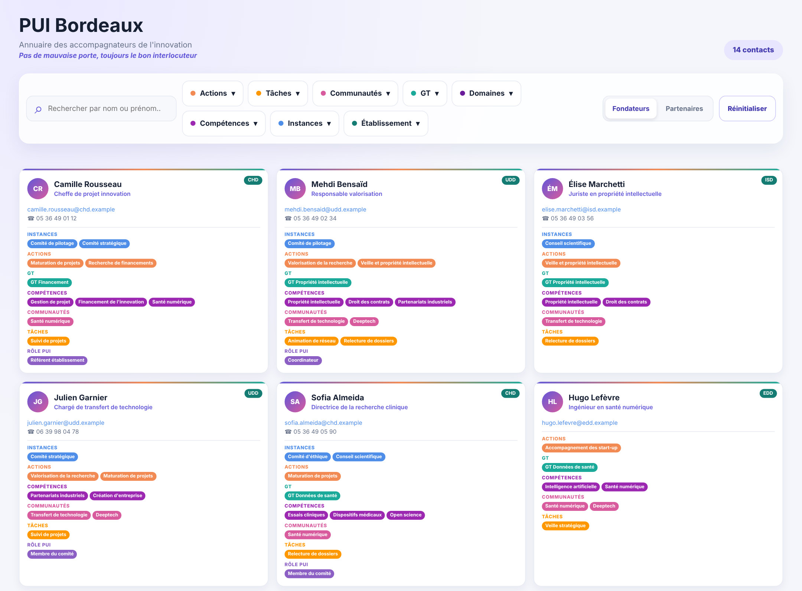
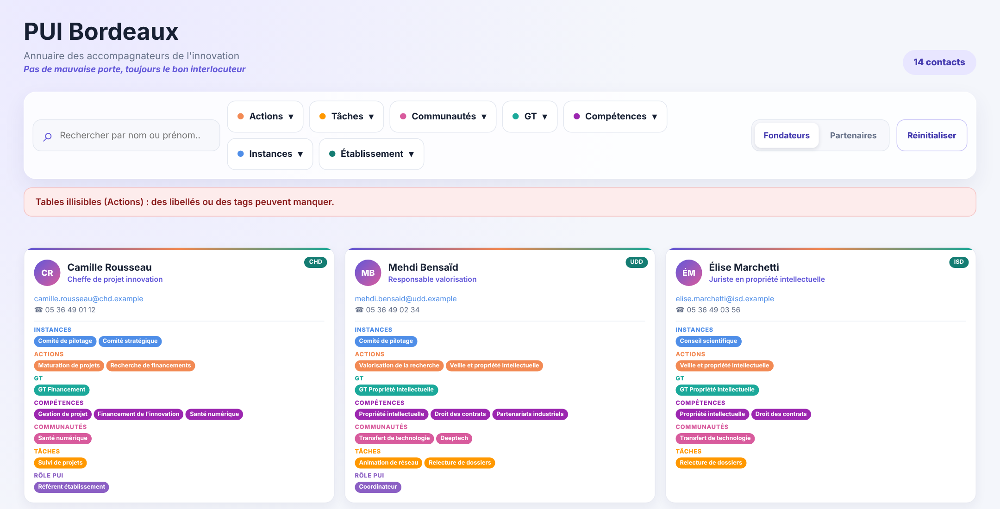
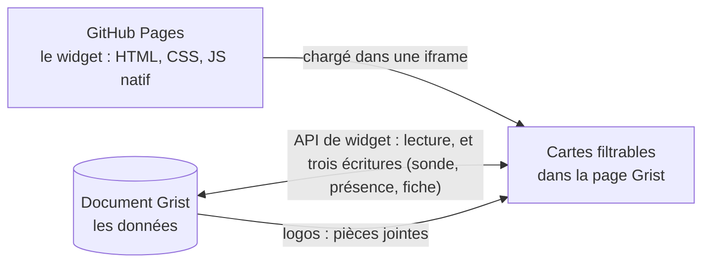

<div align="center">

# Annuaire PUI Bordeaux

**Le widget Grist qui retrouve, en quelques clics, le bon interlocuteur du Pôle universitaire d'innovation (PUI) de Bordeaux.**

*Pas de mauvaise porte, toujours le bon interlocuteur.*

[](https://github.com/lombre33/Annuaire_PUI_Bordeaux/actions/workflows/tests.yml)




<sub>Toutes les captures de ce dépôt utilisent des données fictives.</sub>

</div>

## Ce que fait le widget

L'annuaire affiche les accompagnateurs de l'innovation du PUI sous forme de **cartes** : on retrouve chaque personne par son nom ou par ce qu'elle fait.

- 🔎 **Recherche** par nom ou prénom, sans souci d'accents ni de majuscules.
- 🎛️ **Filtres** : chaque menu liste les valeurs d'une catégorie, avec le nombre de cartes qui portent chacune. Les valeurs d'un même menu s'additionnent (« ou »), les menus se cumulent entre eux (« et »).
- 🏛️ **Fondateurs et Partenaires** : deux interrupteurs permettent de choisir les établissements affichés, fondateurs du PUI ou partenaires. Seuls les établissements qui ont validé leur apparition sont montrés.
- 🙋 **Chacun décide s'il apparaît** : une personne n'est affichée que si elle a accepté d'apparaître. Connectée à Grist, elle voit un bandeau « Ma présence » et active ou retire son accord d'un clic.
- 📇 **Cartes de contact** : identité, fonction, e-mail, téléphone, établissement et participations. Un clic sur une étiquette filtre sur sa valeur.
- ✏️ **Chacun peut modifier sa fiche** : une personne connectée corrige sa propre fiche ; un administrateur qui allume le « mode admin » corrige celle de toute personne affichée dans l'annuaire, adresse e-mail et établissement compris. Avant d'enregistrer, une fenêtre de relecture montre la carte « Avant » et la carte « Après », avec ce qui change repéré. Les modifications s'appliquent ensuite tout de suite, sans validation par un administrateur. Le périmètre ne se modifie pas depuis le widget.
- 🖼️ **Habillé aux couleurs du consortium** : le logo de chaque établissement sur ses cartes, les financeurs au centre de l'en-tête et les établissements fondateurs dans un bandeau en bas de page. Les logos sont des pièces jointes du document Grist (facultatives : sans elles, les noms s'affichent à leur place).
- 🛡️ **Fiable** : si Grist ne répond pas, si une table est illisible ou si une colonne indispensable manque, un bandeau le dit. Un annuaire vide alors que la table contient des lignes est toujours expliqué.
- 🔒 **Sobre et encadré** : aucune dépendance à l'exécution, rien de stocké dans le navigateur, aucune requête réseau émise par le widget lui-même (le navigateur télécharge seulement les logos, des pièces jointes du document Grist, avec un jeton de lecture seule que Grist donne au widget). Le widget n'écrit dans Grist que trois choses : une ligne de service, qui lui fait connaître la personne connectée, le choix d'apparaître de celle qui actionne son interrupteur, et la modification d'une fiche que la personne valide après relecture.

## En images

<table>
  <tr>
    <td width="50%"><br><sub><b>Un filtre</b> : champ de recherche, options à cocher, nombre de cartes par option.</sub></td>
    <td width="50%"><br><sub><b>Des filtres combinés</b> : les critères se cumulent.</sub></td>
  </tr>
  <tr>
    <td width="50%"><br><sub><b>La recherche</b> ignore accents et majuscules : « elise » trouve « Élise ».</sub></td>
    <td width="50%"><br><sub><b>Fondateurs et Partenaires</b> : on choisit les établissements affichés.</sub></td>
  </tr>
  <tr>
    <td width="50%"><br><sub><b>Une carte</b> : identité, coordonnées, participations (<a href="docs/utilisateurs.md#lire-une-carte">légende</a>).</sub></td>
    <td width="50%"><br><sub><b>Un bandeau d'état</b> prévient quand une lecture Grist échoue.</sub></td>
  </tr>
</table>

<p align="center"><br><sub><b>Ma présence</b> : la personne connectée choisit d'apparaître ou non (<a href="docs/utilisateurs.md#ma-présence--apparaître-ou-non">guide utilisateur</a>).</sub></p>

<p align="center"><br><sub><b>Le bandeau des fondateurs</b> : les logos des établissements, dans l'ordre choisi dans Grist (logos fictifs ; <a href="docs/utilisateurs.md#les-logos-et-le-bandeau-du-bas">guide utilisateur</a>).</sub></p>

<p align="center"><br><sub><b>Modifier sa fiche</b> : une relecture de la carte avant et après, puis l'enregistrement direct, sans validation (<a href="docs/utilisateurs.md#modifier-ma-fiche">guide utilisateur</a>).</sub></p>

## Installer dans Grist

Prérequis : un document Grist qui contient les tables décrites dans [`grist_structure.txt`](grist_structure.txt), avec exactement ces noms de tables et de colonnes. La colonne `Accepte_apparaitre` de `BDD` (une case à cocher) est obligatoire : sans elle, le widget affiche une erreur plutôt que l'annuaire de tout le monde.

1. Dans le document, ajoutez un widget : **Add New**, puis **Add Widget to Page**, puis, dans **Select Widget**, choisissez **Custom**.
2. Pour **Select Data**, choisissez la table des contacts, `BDD` : Grist ne prévient le widget que des changements de cette table.
3. Ouvrez **Widget options** et saisissez l'adresse du widget dans **Enter Custom URL** :
   ```
   https://lombre33.github.io/Annuaire_PUI_Bordeaux/index.html
   ```
4. Accordez l'accès **Full document access** quand Grist le demande : le widget lit plusieurs tables, pas seulement celle de sa section, et il écrit dans le document.
5. Pour que chaque personne puisse gérer sa présence et modifier sa fiche, suivez [`GRIST_SETUP.md`](GRIST_SETUP.md) : la case `Accepte_apparaitre` en colonne de données, la table `Annuaire_Sonde`, les administrateurs, les règles d'accès. Sans la table-sonde, l'annuaire s'affiche normalement, mais personne n'est identifié : ni bandeau ni bouton « Modifier ».
6. Pour afficher les logos (facultatif), suivez l'étape 5 de [`GRIST_SETUP.md`](GRIST_SETUP.md) : les colonnes `logo` et `ordre_bandeau` d'`Etablissements` et la table `Financeurs`. Sans elles, le widget affiche les noms à la place des logos.

Les libellés ci-dessus sont ceux de l'interface anglaise de Grist ; ils peuvent différer dans une autre langue. Le widget est déclaré dans [`manifest.yml`](manifest.yml) (nom, adresse, niveau d'accès).

> **Accès complet, un choix assumé.** Le widget demande l'accès complet au document : il lit plusieurs tables et il y écrit. Selon la documentation de Grist, un tel widget peut lire et modifier tout le document ; celui-ci n'écrit que les trois choses décrites plus haut, mais c'est la confiance dans le code publié et les règles d'accès de Grist qui protègent vraiment le document. Trois garde-fous sont à mettre en place ou à vérifier : des règles d'accès Grist, une branche `main` protégée et des tables sensibles sorties du document ou protégées. Lisez la page [Sécurité et confidentialité](docs/securite.md) avant d'installer le widget.

## Essayer sans Grist

Le dossier [`docs/demo/`](docs/demo) fait tourner le vrai widget avec une API Grist simulée et des données **entièrement fictives**. Il suffit de Node 18 ou plus :

```bash
git clone https://github.com/lombre33/Annuaire_PUI_Bordeaux.git
cd Annuaire_PUI_Bordeaux
node docs/demo/serveur-demo.mjs
# puis ouvrir http://127.0.0.1:8080
```

Ajoutez `?panne=Actions` à l'adresse pour simuler une table de référence illisible et voir le bandeau d'état, ou `?connecte=camille.rousseau@chd.example` pour ouvrir le widget comme cette personne fictive : le bandeau « Ma présence » apparaît, son interrupteur fonctionne, et le bouton « Modifier » de sa carte ouvre la modification de sa fiche, avec sa relecture avant/après (en mémoire, rien n'est enregistré). Avec `?connecte=mehdi.bensaid@udd.example`, le widget s'ouvre comme un administrateur fictif, qui peut modifier toutes les fiches affichées une fois son « mode admin » allumé. Les logos de la démonstration sont des dessins inventés ; `?sanslogos` simule un Grist qui refuse de les donner, et montre les noms à leur place.

## Comment ça marche



Le widget est une page statique : pas de compilation, pas de dépendance npm à l'exécution. Il lit les tables du document Grist, applique les règles d'affichage (accord de la personne, périmètre, établissement validé, fondateur ou partenaire), puis construit les cartes et les menus de filtre. Il n'écrit dans le document que trois choses : une ligne de service, ajoutée puis supprimée à chaque ouverture, qui lui fait connaître la personne connectée ; le choix d'apparaître de cette personne quand elle actionne l'interrupteur « Ma présence » ; et la modification d'une fiche, quand la personne la valide après avoir relu la carte avant et après. Le widget ne crée aucune table et ne tient aucun historique. Les logos sont lus comme des pièces jointes : le widget demande à Grist un jeton de lecture seule et le navigateur télécharge les images. Les détails sont dans la [documentation développeur](docs/developpeurs.md).

## Documentation

| Pour… | Lire |
|---|---|
| **Utiliser l'annuaire** : rechercher, filtrer, modifier sa fiche, comprendre un message, vocabulaire du PUI | [Guide utilisateur](docs/utilisateurs.md) |
| **Comprendre et modifier le code** : architecture, chargement des données, règles, tests, recettes | [Documentation développeur](docs/developpeurs.md) |
| **Régler le document Grist** : colonne de consentement, table-sonde, administrateurs, règles d'accès, logos | [`GRIST_SETUP.md`](GRIST_SETUP.md) |
| **Évaluer les risques** : accès demandé à Grist, écritures, usage de l'IA, données personnelles, recommandations | [Sécurité et confidentialité](docs/securite.md) |
| **Faire vivre l'annuaire** : règles de visibilité, diagnostic, publication, retour arrière, continuité (départs, absence d'administrateur), hébergement | [Maintenance](docs/maintenance.md) |
| **Consulter le cahier des charges** | [`specs.md`](specs.md) |
| **Tester à la main avant un déploiement** | [`TESTING.md`](TESTING.md) |
| **Retrouver l'historique des versions** | [`CHANGELOG.md`](CHANGELOG.md), [`VERSION.md`](VERSION.md) |

## Structure du dépôt

```
.
├── index.html            Page du widget : en-tête, cartes, bandeau des fondateurs, modèle de carte, fenêtre de modification
├── style.css             Feuille de style
├── dialogs.css           Feuille de style de la fenêtre de modification
├── main.js               Point d'entrée : état, événements, câblage Grist
├── grist-data.js         Lecture et enrichissement des données Grist
├── filters.js            Filtrage et compteurs (fonctions pures)
├── render.js             Construction du DOM : menus, cartes (logo de l'établissement), bouton « Modifier »
├── identity.js           Qui est connecté ? (table-sonde dont Grist calcule l'adresse)
├── presence.js           « Ma présence » : message à la personne et écriture de son choix
├── account-ui.js         Bandeau « Ma présence » (dans l'en-tête), boutons « Modifier mon profil » et « Mode admin »
├── profile.js            Modifier une fiche : droits, formulaire, changements (sans DOM)
├── profile-save.js       Relire puis écrire une fiche, en une seule action Grist
├── preview.js            Cartes « avant » et « après » d'une modification
├── schema.js             Type des colonnes de BDD, lu dans les métadonnées de Grist
├── profile-ui.js         Fenêtre de modification : formulaire, relecture, confirmation
├── changes-ui.js         Liste des changements (formulaire, relecture, confirmation)
├── branding.js           Habillage : fondateurs, financeurs, logo de chaque établissement (sans DOM)
├── attachments.js        Pièces jointes de Grist : jeton en lecture seule et adresse des logos
├── branding-ui.js        Images des logos, financeurs de l'en-tête, bandeau des fondateurs
├── dom.js                Petit outil partagé : créer un élément avec son texte
├── constants.js          Taxonomie : catégories, couleurs, tables
├── manifest.yml          Déclaration du widget : adresse, niveau d'accès
├── grist_structure.txt   Schéma Grist réduit aux tables et colonnes utiles
├── GRIST_SETUP.md        Réglages à faire dans Grist : colonne, sonde, administrateurs, règles d'accès
├── specs.md              Cahier des charges
├── CHANGELOG.md          Historique des versions
├── VERSION.md            Version courante
├── TESTING.md            Protocole de test manuel
├── tests/                Tests unitaires et tests navigateur
├── docs/                 Documentation, images, démonstration fictive
└── .github/workflows/    Intégration continue
```

## Tests

```bash
node --test
```

Sans rien installer (Node 22.7 ou plus, ou 20.19 ou plus ; la CI utilise Node 22), cette commande exécute les tests unitaires, un fichier par module. Avec Playwright, elle exécute aussi des scénarios de bout en bout dans un vrai navigateur, sur une API Grist simulée :

```bash
npm install --no-save playwright
npx playwright install chromium
node --test
```

Ces tests ne remplacent pas un essai dans un vrai document Grist : voir [`TESTING.md`](TESTING.md).

## Limites connues

- **Une modification d'une table de référence n'apparaît pas toute seule.** Grist ne prévient le widget que des changements de la table des contacts (`BDD`). Après avoir modifié `Etablissements` (par exemple `ok_pour_apparaitre`) ou une table de valeurs de filtre, rechargez la page.
- **Mise en page éprouvée dans Chromium seulement** : le widget s'adapte à la largeur de son cadre, d'un téléphone à un grand écran, mais les tests automatiques couvrent Chromium (écran tactile émulé compris), pas Safari, Firefox ni un vrai Grist sur téléphone. Le protocole de [`TESTING.md`](TESTING.md) (section 12) couvre ce reste.
- **La modification d'une fiche est immédiate, sans validation ni historique du widget.** Dès que la personne valide la relecture, la fiche change dans Grist : aucun administrateur ne la valide et le widget ne garde aucune trace de qui a changé quoi (seul le journal du document Grist en garde sans doute une). Un administrateur ne modifie pas, depuis le widget, les fiches que l'annuaire masque, ni le périmètre d'une fiche : cela se fait dans Grist.
- **Les écritures sont encadrées par l'interface, pas par le serveur.** « Ma présence » n'agit que sur la fiche de la personne connectée, et la modification de fiche que sur la sienne (ou, pour un administrateur qui a allumé le « mode admin », sur celle d'une personne affichée), mais seules les règles d'accès de Grist empêchent vraiment une écriture indue : celles que propose [`GRIST_SETUP.md`](GRIST_SETUP.md) n'ont pas été essayées dans un vrai document. Chaque ouverture laisse en outre sans doute une trace dans l'historique du document ([Sécurité et confidentialité](docs/securite.md#écritures-et-règles-daccès)).
- **Les logos n'ont pas été essayés dans un vrai Grist** : le widget suit la méthode que documente Grist pour afficher une pièce jointe (un jeton en lecture seule, valable quelques minutes, dans l'adresse de l'image), mais les tests simulent sa réponse. Section 14 de [`TESTING.md`](TESTING.md) ; ce que permet le jeton est expliqué dans [Sécurité et confidentialité](docs/securite.md#les-logos-et-le-jeton-daccès-aux-pièces-jointes).
- **Script de l'API Grist** : `index.html` charge `grist-plugin-api.js` depuis `docs.getgrist.com`, sans version figée ([Sécurité et confidentialité](docs/securite.md#risques-et-protections)).
- **Pas de test contre un vrai Grist** : les tests simulent l'API, et seul le protocole de [`TESTING.md`](TESTING.md) valide le comportement dans Grist.

Le détail, avec les cas que le bandeau ne signale pas, est dans [Maintenance](docs/maintenance.md#limites-connues).

## Usage de l'IA et hébergement

- **Aucune IA en temps réel.** Le widget n'appelle aucun service d'IA, et le PUI indique qu'aucune IA ne traite le document Grist en temps réel ni n'y a d'accès MCP (Model Context Protocol).
- **Les compétences passent par une IA à l'export seulement**, au moment de leur export depuis Résana, via [Mammouth AI](https://mammouth.ai) avec le modèle Claude Opus 5.0. D'après le PUI, aucune donnée personnelle n'est transmise et la conversation est supprimée après usage (mode « no log ») ; selon la [politique de confidentialité de Mammouth AI](https://info.mammouth.ai/docs/privacy-policy/), des données supprimées peuvent être conservées jusqu'à 30 jours.
- **Le code est co-créé avec Claude Code**, un assistant de programmation fondé sur l'IA. Les tests automatiques sont son filet de sécurité.
- **Un hébergement fragile à ce jour.** Le dépôt et le site GitHub Pages appartiennent au compte personnel de la personne qui a créé le widget ; une migration vers le GitLab UB est impossible, faute de module « Pages », et la piste proposée est un GitHub DIESE. Dans Grist, les administrateurs sont uniquement des agents en poste.

Le détail est dans [Sécurité et confidentialité](docs/securite.md#lintelligence-artificielle-dans-ce-projet) et dans [Maintenance](docs/maintenance.md#hébergement-et-risques-à-ce-jour).

## Règles du projet

- **La fiabilité passe avant les nouvelles fonctionnalités.** Chaque correction s'accompagne d'un test de non-régression.
- **Une personne n'apparaît que si elle a accepté et si son établissement a validé**, jamais l'un sans l'autre ni dans le doute. On ne coche `Accepte_apparaitre` qu'avec l'accord de la personne.
- **L'établissement d'un contact vient de sa référence `Etablissement`** (une ligne de la table `Etablissements`), jamais de la colonne `nom_de_domaine`, qui n'est pas utilisée. Un test le garantit.
- **Aucune vraie donnée dans ce dépôt public** : ni captures de l'annuaire réel, ni schéma complet du document Grist. Les captures et la démonstration utilisent des données inventées.
- **Un push sur `main` met le widget à jour en production** pour tous les documents Grist qui l'utilisent : passer de préférence par une pull request dont la CI est verte (un push direct publie aussitôt, sans attendre la CI : lancer `node --test` en local d'abord).
