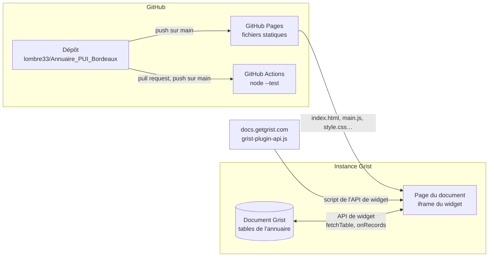
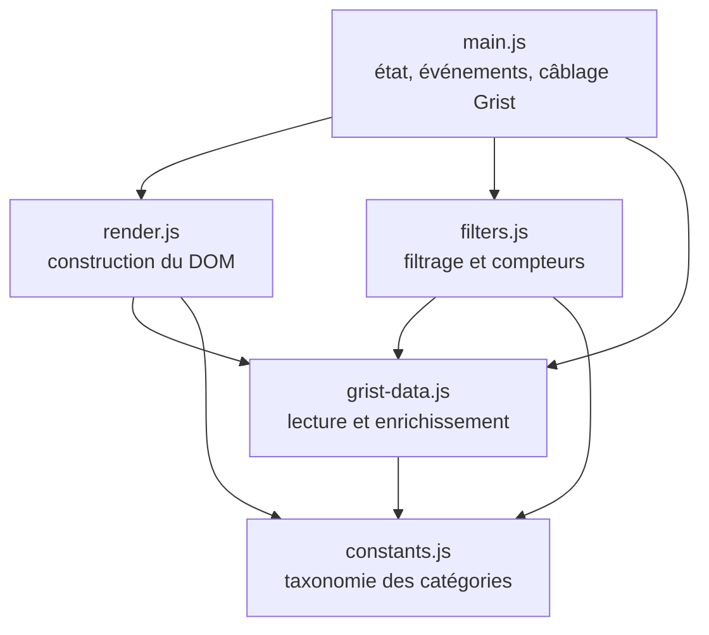
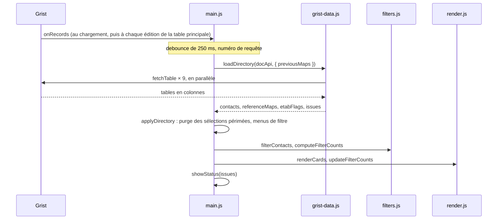
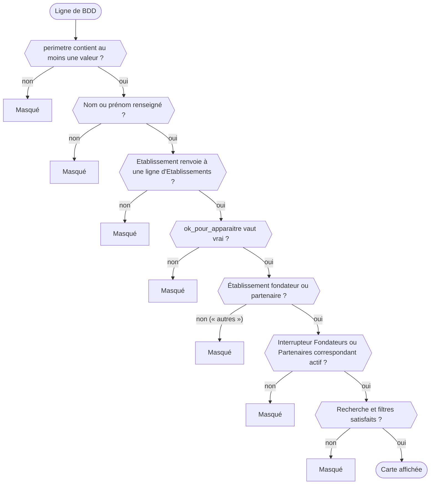

# Documentation développeur

Cette page explique comment le widget est construit et comment le modifier sans le casser : infrastructure, chargement des données, règles d'affichage, tests, déploiement. Elle suppose de savoir lire du JavaScript ; aucune connaissance de Grist n'est requise, les notions utiles sont rappelées au fil du texte.

Pages liées : [README](../README.md) (présentation et installation), [guide utilisateur](utilisateurs.md), [sécurité](securite.md), [maintenance](maintenance.md).

> **Cette page décrit la version 1.9.1** : le widget lit la table `BDD` (1.8.0), propose le filtre « Domaines » (1.9.0) et s'adapte à la largeur de son cadre (1.9.1). D'autres évolutions vont encore en modifier une partie (consentement individuel, identité de la personne connectée, édition de fiche). Elles sont résumées dans [Chantiers en cours](#chantiers-en-cours) et la page sera mise à jour à chaque fusion.

## Sommaire

- [Vue d'ensemble](#vue-densemble)
- [Organisation du code](#organisation-du-code)
- [Chargement des données](#chargement-des-données)
- [Données Grist : structure et encodages](#données-grist--structure-et-encodages)
- [Règles d'affichage](#règles-daffichage)
- [Filtres, compteurs et recherche](#filtres-compteurs-et-recherche)
- [Rendu des cartes et des menus](#rendu-des-cartes-et-des-menus)
- [Fiabilité : que se passe-t-il en cas de panne ?](#fiabilité--que-se-passe-t-il-en-cas-de-panne-)
- [Tests](#tests)
- [Données et captures de démonstration](#données-et-captures-de-démonstration)
- [Recettes](#recettes)
- [Conventions](#conventions)
- [Versions, déploiement et CI](#versions-déploiement-et-ci)
- [Chantiers en cours](#chantiers-en-cours)

## Vue d'ensemble

Le widget est une page web statique : HTML, CSS et JavaScript natif en modules ES. Il n'y a ni compilation, ni bundler, ni dépendance npm à l'exécution. Grist l'affiche dans une iframe sur une page de document et lui fournit son API de widget (`grist-plugin-api.js`) pour lire les tables du document.



| Élément | Rôle | Où |
|---|---|---|
| Document Grist | Source unique des données : il sert de base de données et d'API back-end (voir [`specs.md`](../specs.md)) | Instance Grist de l'organisation |
| Dépôt GitHub | Code du widget, tests, documentation | <https://github.com/lombre33/Annuaire_PUI_Bordeaux> |
| GitHub Pages | Sert les fichiers à l'URL déclarée dans [`manifest.yml`](../manifest.yml) | <https://lombre33.github.io/Annuaire_PUI_Bordeaux/> |
| `grist-plugin-api.js` | API de widget de Grist. `index.html` la charge depuis `docs.getgrist.com`, sans version figée | `index.html` |
| GitHub Actions | Exécute `node --test` à chaque pull request et à chaque push sur `main` | `.github/workflows/tests.yml` |

Ce que le widget fait, dans la version 1.9.1 :

- il **lit** les tables du document Grist (neuf lectures `fetchTable` par chargement) ;
- il n'**écrit** rien dans Grist, ne stocke rien dans le navigateur et n'émet lui-même aucune requête réseau ;
- il demande l'accès `full` (`grist.ready({ requiredAccess: 'full' })` dans `main.js`, `accessLevel: full` dans `manifest.yml`), un choix assumé : il lit plusieurs tables autres que celle de sa section et les fonctionnalités prévues écriront dans le document. Les conséquences et les garde-fous sont détaillés dans [sécurité](securite.md#niveau-daccès-demandé-à-grist).

## Organisation du code



Une flèche signifie « importe ».

| Fichier | Rôle |
|---|---|
| `index.html` | Squelette de la page, `<template id="cardTemplate">` d'une carte, chargement de l'API Grist puis de `main.js` |
| `style.css` | Feuille de style unique (variables de couleur en tête de fichier) |
| `constants.js` | Nom de la table principale (`MAIN_TABLE`, soit `BDD`) et taxonomie : `CATEGORIES` donne, pour chaque catégorie, son libellé, sa couleur, sa table de référence, ses colonnes de libellé et, sauf pour l'établissement et le rôle (des Références simples), sa colonne de liste dans la table principale. `FILTERS`, `TAG_GROUPS`, `REFERENCE_TABLES`, `REFERENCE_SOURCES` et `LIST_CATEGORIES` en sont dérivés |
| `grist-data.js` | Lecture des tables (`loadDirectory()`), décodage des formats Grist, enrichissement des contacts, règles d'éligibilité |
| `filters.js` | Forme de l'état des filtres (`createEmptyFilterState()`), `filterContacts()`, `computeFilterCounts()`, `pruneStaleFilters()` |
| `render.js` | Construction du DOM : menus de filtre (`createFilterUI()`) et cartes (`renderCards()`) |
| `main.js` | Point d'entrée : détient l'état de l'application, relie `window.grist` et les événements du DOM aux autres modules |

Règles de répartition, à respecter pour que les tests restent possibles sans navigateur :

1. `constants.js`, `grist-data.js` et `filters.js` n'utilisent jamais le DOM.
2. Seule `loadDirectory()` lit Grist, par le `docApi` qu'on lui passe : les tests lui fournissent un faux `docApi`.
3. `render.js` ne contient aucune règle métier : il reçoit des contacts déjà filtrés et une fonction de rappel `onToggle`.
4. `filters.js` n'a pas d'effet de bord : `pruneStaleFilters()` renvoie un nouvel état au lieu de modifier son argument.
5. Seul `main.js` détient l'état (`state`).

## Chargement des données



1. `main.js` déclare l'accès avec `grist.ready({ requiredAccess: 'full' })` puis s'abonne à `grist.onRecords`.
2. `onRecords` ne sert que de **déclencheur** : son contenu est ignoré. Il ne porte pas forcément toutes les colonnes de `BDD` (selon la vue branchée) et résout les Références en texte, alors que `fetchTable()` renvoie la table complète, les Références en identifiants de ligne. Grist ne rappelle `onRecords` que pour les changements de la table liée à la section du widget : modifier une table de référence ne rafraîchit pas le widget (voir [Limites connues](maintenance.md#limites-connues)).
3. Le rappel est temporisé (anti-rebond : `debounce()`, 250 ms) : une rafale d'éditions ne déclenche qu'une lecture. Chaque lecture reçoit un numéro (`createRequestSequencer()`) et seule la plus récente applique son résultat.
4. `loadDirectory()` enchaîne :
   - `readAllTables()` lit les neuf tables en parallèle avec `Promise.allSettled` : une table illisible ne fait pas échouer les autres ;
   - `requireReadable()` puis `requireColumns()` lèvent une `DirectoryLoadError` si une donnée indispensable manque : table `BDD` ou `Etablissements` illisible, colonne obligatoire absente (voir [Fiabilité](#fiabilité--que-se-passe-t-il-en-cas-de-panne-)) ;
   - `readReferenceMaps()` construit, pour chaque **catégorie** (`REFERENCE_SOURCES`), la correspondance id → libellé : le libellé corrigé s'il est rempli, le libellé brut sinon. Une table illisible garde les libellés précédents de ses catégories (`previousMaps`). Un regroupement comme « Domaines » est complété ensuite par `completeGroupMap()` ;
   - `etablissementFlagsFromRows()` indexe les indicateurs de chaque établissement (fondateur, partenaire, validé) par identifiant de ligne, et par libellé en repli ;
   - `isInScope()` écarte les lignes sans périmètre ; `buildContacts()` enrichit les autres avec `enrich()`, puis ne garde que celles qui ont un nom ou un prénom et un établissement éligible (voir [Règles d'affichage](#règles-daffichage)) ;
   - `describeEmptyDirectory()` explique pourquoi l'annuaire est vide quand c'est anormal.
5. `applyDirectory()` (dans `main.js`) restreint le menu Établissement aux établissements validés (`filterVisibleEstablishments()`), retire des filtres actifs les valeurs qui n'existent plus (`pruneStaleFilters()`), reconstruit les menus **seulement si les libellés ont changé** (`referenceMapsEqual()`, car reconstruire ferme les menus ouverts), puis rafraîchit les cartes.
6. `showStatus()` affiche ou masque le bandeau d'état avec les messages de `issues`.

`loadDirectory()` renvoie `{ contacts, referenceMaps, etabFlags, issues }` : les contacts éligibles et enrichis, les libellés de chaque catégorie (`referenceMaps`, rangés par **clé de catégorie** et non par table, parce que « Compétences » et « Domaines » lisent la même table `Competences`), les indicateurs des établissements et les messages français destinés au bandeau d'état.

Un contact enrichi garde toutes ses colonnes d'origine et reçoit :

- `labels` : un objet `{ clé de catégorie → liste de libellés }`, lu par `labelsOf(contact, clé)`. Établissement et rôle, qui n'ont qu'une valeur, prennent la même forme de liste pour que les filtres et les tags n'aient aucun cas particulier (la pastille de la carte lit `etablissement_label`) ;
- `etablissement_label` : le texte du badge de la carte ;
- `etablissement_fondateur`, `etablissement_partenaire`, `etablissement_ok_pour_apparaitre` : les indicateurs de son établissement.

## Données Grist : structure et encodages

Les noms de tables et de colonnes lus par le widget sont listés dans [`grist_structure.txt`](../grist_structure.txt), un schéma volontairement **réduit** aux tables et colonnes utiles au widget. Ne jamais y copier le schéma complet du document Grist (voir [sécurité](securite.md#données-dans-le-dépôt)). Le widget lit la table principale `BDD` (une ligne par personne, nommée par `MAIN_TABLE`) et les tables de référence de `CATEGORIES` dans `constants.js` : `Actions`, `Taches`, `Communautes`, `GT`, `Competences`, `INSTANCES` (en majuscules), `Etablissements` et `Role_Dans_le_PUI`. La table `Competences` alimente deux catégories, « Compétences » et « Domaines », et n'est lue qu'une fois par chargement. Les colonnes obligatoires sont `nom`, `prenom`, `Etablissement` et `perimetre` ; `email`, `Fonction`, `numero_de_telephone` et `Role_dans_le_PUI` sont facultatives : absentes, la carte ne les affiche simplement pas.

Grist ne renvoie pas toujours les valeurs sous la forme qu'on attendrait. Les encodages ci-dessous ont presque tous provoqué un bug en production (voir le [CHANGELOG](../CHANGELOG.md)) :

| Ce que Grist envoie | Exemple | Fonction qui le décode |
|---|---|---|
| Table en colonnes | `{ id: [1, 2], nom: ['Ana', 'Bob'] }` | `tableToRows()` |
| Liste (ReferenceList) | `['L', 3, 7]` ; une liste vide vaut `['L']`, pas `[]` | `safeValues()`, `resolveListItem()` |
| Référence simple | identifiant de ligne (`3`, ou `0` quand elle est vide) avec `fetchTable()` ; parfois texte déjà résolu (`'UBM'`) ou `['R', 'Table', 3]` selon la configuration de la table liée | `refId()`, `refLabel()` |
| Colonne numérique | un téléphone `556789012` : le 0 initial est perdu | `formatPhone()` |
| Cellule non renseignée | `''`, `null` ou `0` | `isBlank()` |

Règles à respecter :

- Ne jamais supposer une seule forme pour une Référence ni pour un élément de liste. Un id sans libellé est ignoré, jamais affiché tel quel (« 47 » n'aide personne).
- `BDD.Etablissement` est une Référence **directe** vers la ligne d'`Etablissements`, résolue par identifiant de ligne : c'est la seule source de l'établissement d'un contact (`etablissementFlags()`). Chaque contact garde ainsi le statut de sa propre ligne, même si deux établissements portent le même acronyme. Si Grist envoie la Référence déjà résolue en texte, on se replie sur le libellé (l'acronyme, sinon le nom complet).
- Ne jamais lire la colonne `nom_de_domaine`, ni celle de `BDD` ni celle d'`Etablissements` : règle du projet. `tests/rules.test.mjs` échoue si un fichier `.js`, `.mjs`, `.html` ou `.css` du dépôt la cite.
- `perimetre` ne sert qu'à savoir si elle contient au moins une valeur ([`specs.md`](../specs.md)) ; le widget ne lit pas sa table de référence. L'ancienne table `Annuaire` et ses colonnes `perimetre_*` ne sont plus lues.
- Chaque table de référence porte un libellé brut (celui de l'import) et un libellé corrigé : le corrigé est affiché quand il est rempli, le brut sinon (`field` de chaque entrée de `CATEGORIES`).
- Les compétences sont une liste de références (`BDD.Competences`) vers la table `Competences`. Le domaine d'une compétence est sa colonne `Macro_competences` : celui d'un contact se déduit de ses compétences (la colonne `Comptetences_macr` de `BDD` n'est pas lue).
- `Accepte_apparaitre` (le consentement individuel de la personne) existe dans `BDD` mais le widget ne la lit pas encore : voir [Chantiers en cours](#chantiers-en-cours).

## Règles d'affichage

Le cahier des charges est [`specs.md`](../specs.md) ; en cas d'écart avec le code, le code et le [CHANGELOG](../CHANGELOG.md) font foi. Une ligne de la table principale (`BDD`) devient une carte si elle franchit toutes les étapes suivantes :



| Étape | Code |
|---|---|
| `perimetre` non vide | `isInScope()` |
| Nom ou prénom renseigné | `buildContacts()` |
| Établissement identifié, validé, fondateur ou partenaire | `etablissementFlags()` puis `isEtablissementEligible()` |
| Interrupteurs Fondateurs et Partenaires | `matchesScope()` (`filters.js`) |
| Recherche et filtres | `filterContacts()` |

À savoir :

- Parmi les sept étapes du schéma, les cinq premières sont appliquées une fois par chargement, dans `loadDirectory()`. Les deux dernières le sont à chaque action de l'utilisateur, dans `main.js` : `refreshCards()` appelle `filterContacts()` sur la liste des contacts éligibles.
- Un établissement « autres » (une structure extérieure au PUI qui a collaboré à certaines tâches, à la différence des établissements fondateurs et des partenaires) n'est jamais affiché : aucune branche du code ne le rend éligible.
- Un établissement inconnu (`Etablissement` vide, ou sans ligne correspondante dans `Etablissements`) n'a aucun indicateur : le contact est exclu plutôt qu'affiché sans validation.
- La Référence `Etablissement` désigne une ligne par son identifiant : deux lignes de même acronyme ne se mélangent pas. Seul le repli par libellé, quand Grist envoie la Référence déjà résolue en texte, ne peut pas les départager : `etablissementFlagsFromRows()` retient alors le statut le plus strict (vrai seulement s'il l'est partout) et signale le libellé dans `conflicts` : les contacts de ce libellé sont masqués si ce statut ne les rend plus éligibles.
- Par défaut, l'interrupteur Fondateurs est actif et Partenaires ne l'est pas (`state.scope` dans `main.js`, changement de la version 1.7.0). « Réinitialiser » ne les modifie pas. Si les deux sont désactivés, aucune carte ne s'affiche.

## Filtres, compteurs et recherche

`filterContacts(contacts, activeFilters, searchTerm, scope, excludeKey)` combine trois prédicats : `matchesSearch()` (nom ou prénom), `matchesScope()` (interrupteurs) et `matchesSelections()` (menus).

- **OU dans une catégorie, ET entre catégories** : cocher deux instances montre les contacts qui ont l'une ou l'autre ; ajouter un établissement ne garde que ceux qui ont en plus cet établissement.
- **Comparaisons normalisées** : `normalize()` retire les accents et la casse (`NFD`, `toLocaleLowerCase('fr-FR')`). « ecole » trouve « École », et deux écritures d'un même libellé (« Cancérologie », « cancerologie ») ne forment qu'une valeur. Cette fonction sert à la recherche principale, à la recherche interne des menus, aux sélections, aux compteurs et à la suppression des doublons (`uniqueLabels()`) : un contact qui a deux libellés équivalents dans une catégorie n'y compte qu'une fois.
- **Domaines : un regroupement de la table `Competences`.** « Domaines » (clé `macro`) lit une autre colonne de la table que « Compétences », `Macro_competences`, et se déclare dans `CATEGORIES` par `groups: 'competences'` : le domaine d'un contact se déduit de ses `BDD.Competences` (`resolveGroupItem()`). Une compétence sans domaine renseigné prend le libellé `fallback` (« Autres »), pour qu'aucun contact ne devienne introuvable ; la console liste ses identifiants de ligne. Deux écritures d'un même domaine n'en font qu'un (`groupLabelMap()`). Si la colonne `Macro_competences` n'existe pas, le filtre reste vide au lieu de tout classer sous « Autres ». Pour `filters.js`, « Domaines » est une catégorie comme une autre : le OU, le ET et les compteurs lui sont appliqués sans code particulier. Les cartes n'affichent pas de domaine (`TAG_KEYS` ne le liste pas).
- **Compteurs par option** : `computeFilterCounts()` calcule, pour chaque catégorie, le nombre de cartes qui portent chaque valeur. Chaque catégorie est comptée avec **tous les autres filtres** (recherche, interrupteurs, autres menus) mais sans le sien (`excludeKey`) : sinon cocher « Santé numérique » ferait tomber à zéro les autres options de la même catégorie, alors qu'elles s'ajoutent (OU). Le nombre affiché est donc celui de l'option seule : cocher une valeur de plus ajoute ses cartes à celles déjà affichées.
- **Ordre des menus** : tri alphabétique français (`compareLabels()`, `localeCompare` en `fr-FR`), valeurs cochées d'abord (`sortWithCheckedFirst()`).
- **Rôle PUI** s'affiche sur les cartes mais n'a ni menu ni filtre ([`specs.md`](../specs.md)) : ses tags ne sont pas cliquables.

## Rendu des cartes et des menus

- `renderCards()` vide la grille puis ajoute une carte par contact (`buildCard()`), clonée depuis `<template id="cardTemplate">`. Les lignes facultatives (fonction, e-mail, téléphone, badge d'établissement) sont remplies par `reveal()`, qui leur ajoute la classe `visible` : le CSS masque l'e-mail, le téléphone et le badge tant qu'ils ne l'ont pas ; une fonction vide reste dans la page sans occuper de hauteur.
- **Aucune donnée Grist n'est insérée comme HTML** : tout passe par `textContent`. `innerHTML` n'est utilisé que pour vider un conteneur. Un prénom contenant `` s'affiche en texte (scénario de `tests/e2e.test.mjs`).
- Le lien `mailto:` n'est créé que pour une adresse simple (`mailtoHref()`, expression régulière `SAFE_EMAIL`) : une adresse saisie avec `?cc=…`, plusieurs destinataires ou des espaces reste du texte.
- Les tags d'une catégorie filtrable sont des `<button>` ; ceux de « Rôle PUI » sont des `<span>` non cliquables (`buildTag()`).
- `createFilterUI()` construit tous les menus (`buildFilter()` → `buildFilterMenu()` → `buildOption()`). Chaque option porte sa valeur dans `data-value` : le texte affiché n'est pas la source. Un bouton de filtre peut porter une infobulle (`hint` dans `CATEGORIES`, utilisée par « Domaines »).
- `updateFilterUI()` met à jour **un seul menu** (cases, ordre, compteur du bouton) après un clic sur une case, un tag de carte ou un badge d'établissement ; `updateFilterCounts()` rafraîchit les compteurs de tous les menus. Aucun des deux ne reconstruit les menus : cela fermerait un menu ouvert et effacerait la saisie en cours dans sa recherche interne. Les menus ne sont reconstruits (`rebuildFilterUI()`) que par « Réinitialiser », précisément pour vider ces champs, et quand un rechargement apporte des libellés différents.
- Mise en page : le widget s'adapte à la largeur de son cadre Grist, sans largeur minimale (`.widget-shell` garde `max-width: 1480px`). Les seuils de `style.css` sont ceux du cadre, pas de l'écran : sous 1400px les filtres passent sous la recherche, sous 840px les cartes se mettent sur deux colonnes, sous 600px sur une seule avec une barre d'outils empilée et un texte plus grand. Un écran tactile (`pointer: coarse`) reçoit en plus des cibles d'au moins 28px et des champs à 16px, et le survol n'y reste pas collé (`hover: none`). À partir de 1400px, la mise en page est celle de départ. `keepMenuInView()` (`render.js`) décale un menu de filtre qui sortirait du cadre à droite. Tests : `tests/responsive.test.mjs` ; protocole manuel : [`TESTING.md`](../TESTING.md), section 12 ; exigence : [`specs.md`](../specs.md).

## Fiabilité : que se passe-t-il en cas de panne ?

Principe : une panne de lecture ou une donnée indispensable manquante ne doit jamais passer pour un annuaire vide. Les situations ci-dessous produisent un message dans le bandeau d'état (`#statusBanner`, `role="alert"`). Deux cas restent muets : un contact dont l'établissement désigne une ligne qui n'existe pas (masqué, sans message sauf si la colonne est vide) et une colonne facultative supprimée de `BDD` (l'information n'est plus affichée) ; voir [Limites connues](maintenance.md#limites-connues).

| Situation | Ce que voit l'utilisateur | Où c'est géré |
|---|---|---|
| La table `BDD` ou `Etablissements` est illisible | Bandeau « Impossible de charger l'annuaire depuis Grist (table “…” illisible) ». Les cartes déjà affichées restent ; le compteur indique « Chargement impossible » s'il n'y avait encore aucun contact chargé | `requireReadable()`, `DirectoryLoadError`, `showLoadError()` |
| Une colonne indispensable manque : `nom`, `prenom`, `Etablissement` ou `perimetre` dans `BDD` ; `fondateur`, `partenaire` ou `ok_pour_apparaitre` dans `Etablissements` | Même bandeau, avec le nom de la colonne et de la table (« colonne “…” absente de la table BDD ») | `requireColumns()` |
| Une table de référence est illisible (Actions, GT, Instances…) | Les cartes restent, avec les libellés du chargement précédent s'il y en a un (au premier chargement, le filtre et les tags concernés restent vides) ; bandeau « Tables illisibles (…) : des libellés ou des tags peuvent manquer. » | `readReferenceMaps()`, `directoryIssues()` |
| Aucune colonne de libellé n'existe dans une table de référence (par exemple ni `Actions_corrigees` ni `Actions`, ou `Macro_competences` pour « Domaines ») | Bandeau « Colonne de libellé introuvable : … Les tags et le filtre correspondants restent vides. » Si seule la colonne corrigée manque, le libellé brut est utilisé et seule la console avertit | `readReferenceMap()`, `directoryIssues()` |
| Deux établissements de même acronyme et de statuts différents, avec une Référence envoyée en texte | Leurs contacts sont masqués ; bandeau « Acronymes en double dans Etablissements (…) » | `etablissementFlagsFromRows()` |
| La table contient des lignes mais aucun contact n'est affichable | Bandeau qui dit où chercher (colonne `perimetre` ou `Etablissement` vide partout, ou rappel des conditions d'affichage) au lieu d'un « 0 contact » muet | `describeEmptyDirectory()` |
| Rafale d'éditions dans Grist | Une seule lecture, 250 ms après la dernière ; une lecture lente n'écrase pas un affichage plus récent | `debounce()`, `createRequestSequencer()` |
| Un libellé coché est renommé ou supprimé dans Grist | La sélection périmée disparaît d'elle-même, sans grille bloquée à zéro | `pruneStaleFilters()` |
| Adresse e-mail non standard | Texte affiché sans lien | `mailtoHref()` |

La console du navigateur garde le détail, avec trois préfixes (plus l'erreur brute d'un chargement raté, sans préfixe) :

- `[GRIST]` : nombre d'enregistrements reçus et de contacts affichables ;
- `[REFS]` : entrées chargées par catégorie, lectures échouées, colonnes de libellé introuvables et compétences que `Macro_competences` ne classe pas ;
- `[ETABLISSEMENT]` : contacts qui ont un périmètre mais pas d'`Etablissement` renseigné (vingt identifiants au plus). **Seuls les identifiants de ligne sont journalisés** (jamais un nom ni une adresse) : la console peut être partagée pendant une démonstration.

Le tableau des symptômes et des actions à mener côté Grist est dans [maintenance](maintenance.md#diagnostiquer-un-problème).

## Tests

```bash
node --test                              # tous les tests (Node 22.7 ou plus, ou 20.19 ou plus ; la CI utilise Node 22)
node --test tests/filters.test.mjs       # un seul fichier

npm install --no-save playwright        # active les tests navigateur (pas une dépendance du projet)
npx playwright install chromium         # ou CHROMIUM_PATH=/chemin/vers/chromium
```

| Fichier | Ce qu'il vérifie |
|---|---|
| `tests/grist-data.test.mjs` | Décodage des formats Grist, normalisation, téléphone, lien `mailto`, libellés des regroupements, séquenceur de requêtes |
| `tests/enrich.test.mjs` | `enrich()` : établissement dans ses trois encodages, rôle, catégories en liste dont compétences et domaines, libellés sans doublon, indicateurs |
| `tests/etablissements.test.mjs` | Indicateurs d'établissement (par identifiant de ligne, repli sur le libellé), doublons, éligibilité, menu Établissement |
| `tests/filters.test.mjs` | Filtrage, purge des sélections périmées, compteurs (dont « Domaines ») |
| `tests/load-directory.test.mjs` | `loadDirectory()` avec un faux `docApi` : une lecture par table, libellé corrigé prioritaire, pannes, colonnes obligatoires, facultatives ou introuvables, annuaire vide expliqué, domaines des compétences |
| `tests/constants.test.mjs` | Cohérence de la taxonomie, table principale `BDD`, libellé corrigé avant le libellé brut |
| `tests/rules.test.mjs` | Règle du projet : aucun fichier de code ne cite la colonne `nom_de_domaine` |
| `tests/e2e.test.mjs` | Le vrai `index.html` dans Chromium avec une API Grist simulée : cartes, badge d'établissement, filtres, compteurs, interrupteurs, pannes |
| `tests/responsive.test.mjs` | Le même `index.html` de 280 à 1920px de large, sur un jeu de données chargé (`tests/fixtures-responsive.mjs`) : pas de défilement horizontal, texte contenu dans les cartes, colonnes, barre d'outils, menus de filtres dans le cadre, cibles tactiles, tailles de texte |
| `tests/docs.test.mjs` | La documentation ne se périme pas : liens, noms de fonctions cités, jeu de données fictif |

- **Version de Node.** Le dépôt n'a pas de `package.json` : Node ne reconnaît les modules ES écrits en `.js` que grâce à la détection automatique de la syntaxe, activée par défaut depuis Node 20.19 et 22.7. En dessous (Node 18, 21, 22.6…), les tests échouent avec « Named export … not found » : c'est l'environnement qui est en cause, pas le code. Le serveur de démonstration, en `.mjs`, démarre dès Node 18.
- Les tests unitaires n'ont aucune dépendance. `tests/e2e.test.mjs` et `tests/responsive.test.mjs` ont besoin de Playwright et de Chromium ; sans eux leurs scénarios sont ignorés et `node --test` reste vert. La CI définit `REQUIRE_E2E=1` : un navigateur absent y est un échec, pas un « tout vert » sur des tests ignorés.
- Le test navigateur est isolé du réseau : seuls le serveur local et l'API Grist simulée répondent, tout le reste est bloqué.
- Limite assumée : l'API Grist est simulée, avec des données aux encodages observés en production. Ces tests garantissent que le vrai `main.js` et le vrai `render.js` réagissent correctement à ces encodages et à ces pannes ; ils ne garantissent pas que Grist les envoie toujours. D'où le protocole manuel de [`TESTING.md`](../TESTING.md), à jouer dans un vrai document avant un déploiement qui touche `main.js`, `render.js`, `index.html` ou `style.css`.
- Chaque correction s'accompagne d'un test de non-régression, dans le fichier du module concerné. Une fonction ajoutée à `grist-data.js` ou `filters.js` a son test ; un changement d'affichage adapte ou ajoute un scénario de `tests/e2e.test.mjs`, et un changement de mise en page (`style.css`) un scénario de `tests/responsive.test.mjs`.

## Données et captures de démonstration

Le dossier `docs/demo/` permet d'essayer le vrai widget **sans document Grist** et de régénérer les captures d'écran de la documentation, sur des données entièrement fictives.

| Fichier | Rôle |
|---|---|
| `docs/demo/donnees-fictives.mjs` | Jeu de données inventé (personnes, établissements, tables de référence, domaines de compétences) à la structure de [`grist_structure.txt`](../grist_structure.txt) et au format que renvoie `fetchTable()`. `tablesFictives()` le construit, `CARTES_ATTENDUES` donne le nombre de cartes qu'il doit produire |
| `docs/demo/serveur-demo.mjs` | Sert le dépôt avec une API Grist simulée. `index.html` n'est pas dupliqué : il est lu à chaque requête, et seule la balise qui charge `grist-plugin-api.js` est remplacée |
| `docs/demo/capturer.mjs` | Régénère les images de `docs/images/` avec Playwright ; chaque capture est précédée d'une vérification (nombre de cartes, bandeau) |

```bash
node docs/demo/serveur-demo.mjs                # puis http://127.0.0.1:8080  (PORT=9000 pour changer de port)
# http://127.0.0.1:8080/?panne=Actions,GT      simule des tables de référence illisibles

npm install --no-save playwright && npx playwright install chromium
node docs/demo/capturer.mjs                    # réécrit docs/images/*.png
```

Règles :

- **Rien de réel dans le dépôt.** Les personnes et établissements sont inventés, les adresses se terminent par `.example` (domaine réservé à la documentation, RFC 2606) et les numéros appartiennent au plan réservé à la fiction (`05 36 49 xx xx`, `06 39 98 xx xx`, décision ARCEP n° 2018-0881). `tests/docs.test.mjs` le vérifie.
- Après toute modification de l'interface, relancer `docs/demo/capturer.mjs`, regarder les images et les committer avec le changement.
- Quand la structure Grist change, adapter `docs/demo/donnees-fictives.mjs` : `tests/docs.test.mjs` échoue tant que le jeu fictif n'est pas lu sans erreur par le vrai `loadDirectory()`. Le jeu contient déjà la colonne `Accepte_apparaitre` (que le widget ne lit pas encore), avec la valeur vraie pour tout le monde : il continue ainsi à donner les mêmes cartes quand cette colonne deviendra obligatoire.
- Dette connue : le simulateur de l'API Grist existe en deux exemplaires, dans `tests/e2e.test.mjs` et dans `docs/demo/serveur-demo.mjs`. Il sera à fusionner quand les chantiers en cours auront stabilisé les tests navigateur.

## Recettes

**Ajouter une catégorie de filtre ou de tag**

1. Dans Grist : créer la table de référence et la colonne de liste dans la table principale.
2. Dans `constants.js` : ajouter l'entrée dans `CATEGORIES` (libellé, couleur, table, colonnes de libellé dans l'ordre corrigé puis brut, colonne de liste), puis sa clé dans `FILTER_KEYS` (menu de filtre) et/ou `TAG_KEYS` (tags de carte, dans l'ordre d'affichage). Une catégorie qui a une `column` est lue automatiquement (`LIST_CATEGORIES` → `listLabels()`) ; sinon il faut du code dédié dans `enrich()`. Pour un **regroupement** d'une catégorie existante (comme « Domaines » sur `Competences`), lire une autre colonne de la même table : ajouter `groups` (clé de la catégorie regroupée) et `fallback` (libellé des lignes non classées).
3. Adapter `tests/constants.test.mjs` (il fixe les listes attendues), `tests/fixtures.mjs` et un scénario de `tests/e2e.test.mjs`.
4. Mettre à jour `grist_structure.txt`, `TESTING.md` (nombre de filtres), `docs/demo/donnees-fictives.mjs` et [le guide utilisateur](utilisateurs.md), puis régénérer les captures.

**Afficher une nouvelle information sur la carte**

1. Ajouter l'élément dans `<template id="cardTemplate">` (`index.html`) et sa mise en forme dans `style.css`.
2. Le remplir dans `buildCard()` (`render.js`), avec `reveal()` s'il est facultatif et `textContent` pour tout texte venu de Grist.
3. Ajouter un scénario à `tests/e2e.test.mjs`, régénérer les captures (en particulier `docs/images/carte-anatomie.png`, dont la légende se trouve dans [le guide utilisateur](utilisateurs.md#lire-une-carte)).

**Changer une règle d'éligibilité**

1. Modifier la règle dans `grist-data.js` et ses tests (`tests/etablissements.test.mjs`, `tests/load-directory.test.mjs`).
2. Mettre à jour [`specs.md`](../specs.md), le schéma de [Règles d'affichage](#règles-daffichage), le guide utilisateur (« Pourquoi une personne n'apparaît-elle pas ? ») et la [page de maintenance](maintenance.md).

**Renommer une table ou une colonne Grist**

1. La table principale (`MAIN_TABLE`), les tables de référence, leurs colonnes de libellé et les colonnes de liste de `BDD` sont dans `constants.js`. Les autres noms sont écrits en dur : dans `grist-data.js`, le nom de la table `Etablissements`, les colonnes obligatoires de `BDD` (`REQUIRED_COLUMNS`) et d'`Etablissements` (`REQUIRED_ETABLISSEMENT_COLUMNS`), `Etablissement`, `perimetre`, `Role_dans_le_PUI` et les indicateurs d'établissement ; et, pour les colonnes d'identité, dans `grist-data.js`, `filters.js` et `render.js` (`nom`, `prenom`, `email`, `Fonction`, `numero_de_telephone`).
2. Mettre à jour `grist_structure.txt`, `tests/fixtures.mjs` et `docs/demo/donnees-fictives.mjs`.
3. Lancer `node --test`, puis jouer [`TESTING.md`](../TESTING.md) dans une copie du document.

## Conventions

- **Pas de dépendance à l'exécution.** Toute nouvelle dépendance se discute d'abord.
- **JavaScript** : modules ES, point-virgule, apostrophes simples, indentation de deux espaces ; des fonctions courtes et nommées plutôt que de longs blocs.
- **Commentaires** : ils disent *pourquoi* le code est ainsi. L'histoire détaillée des bugs vit dans le [CHANGELOG](../CHANGELOG.md) et les messages de commit ; un commentaire peut y renvoyer, sans la raconter.
- **Langue** : identifiants en anglais (sauf les noms de colonnes Grist et les fichiers de `docs/demo/`, en français), commentaires et textes affichés en français.
- **Une correction = un test de non-régression**, écrit avec la correction.
- **Jamais** de vraies données dans le dépôt (captures, jeux de test, schéma complet du document Grist) ni de colonne `nom_de_domaine` dans le code.
- Tout changement visible ajoute une entrée au [CHANGELOG](../CHANGELOG.md) et met à jour [`VERSION.md`](../VERSION.md).

## Versions, déploiement et CI

- Une modification passe de préférence par une branche et une pull request vers `main`. La CI (`.github/workflows/tests.yml`) exécute `node --test` sous Node 22 avec `playwright@1.64.0` et `REQUIRE_E2E=1`, avec le seul droit `contents: read`. Elle s'exécute aussi à chaque push sur `main`, mais elle ne bloque pas la publication : avant un push direct, lancer `node --test` en local.
- **Un push sur `main` met le widget à jour en production** pour tous les documents Grist qui l'utilisent, via GitHub Pages (`https://lombre33.github.io/Annuaire_PUI_Bordeaux/`), sans retour arrière automatique. Taguer les versions stables (`git tag vX.Y.Z`) permet de savoir où revenir ; la procédure de retour en arrière est dans [maintenance](maintenance.md#revenir-en-arrière).
- Le numéro de version est dans le titre de [`VERSION.md`](../VERSION.md) et dans les en-têtes du [CHANGELOG](../CHANGELOG.md), la version la plus récente en premier.
- En local, les modules ES ne se chargent pas via `file://`. Servir le dossier avec `python3 -m http.server 8080` ; pour un essai complet avec un vrai document, ajouter un widget personnalisé qui pointe vers `http://localhost:8080` (voir la préparation de [`TESTING.md`](../TESTING.md)). Le serveur de démonstration (`node docs/demo/serveur-demo.mjs`) remplace l'API Grist par un simulateur : il ne sert qu'à essayer le widget sans Grist.

## Chantiers en cours

Au 12 octobre 2026, `main` est en version 1.9.1. Cette documentation décrit `main` et sera mise à jour à chaque fusion.

**Déjà fusionné**

1. **Nouvelle structure Grist** (1.8.0) : la table principale est `BDD`, avec des références directes (établissement, compétences, instances, actions…) et des tables de référence renommées. Le [CHANGELOG](../CHANGELOG.md) liste chaque changement.
2. **Filtre « Domaines »** (1.9.0) : la recherche par compétences macro, décrite dans [Filtres, compteurs et recherche](#filtres-compteurs-et-recherche).
3. **Mise en page adaptative** (1.9.1) : le widget s'adapte à la largeur de son cadre, d'un téléphone à un grand écran, comme le décrit [Rendu des cartes et des menus](#rendu-des-cartes-et-des-menus).

**À venir**

4. **Consentement individuel** (1.10.0) : seules les personnes dont `BDD.Accepte_apparaitre` est coché apparaîtraient, en plus de la validation de leur établissement. La colonne deviendrait obligatoire et un annuaire vide serait expliqué par le bandeau. Les [règles d'affichage](#règles-daffichage), le guide utilisateur et la page de maintenance changeront en conséquence.
5. **Édition de fiche par la personne connectée** : identité de la personne connectée, interrupteur de présence, modale d'édition de sa fiche. Les modifications s'appliqueront directement : aucune validation par un administrateur n'est prévue. Le widget ne sera plus en lecture seule : ce changement modifie le modèle de sécurité décrit dans [sécurité](securite.md), et un guide de configuration côté Grist accompagnera ce chantier.
