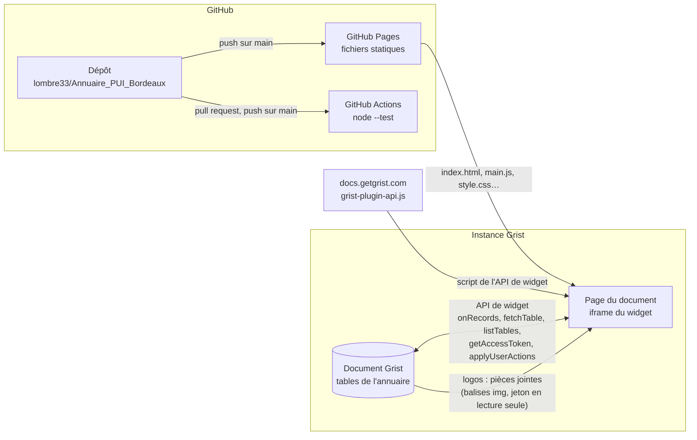
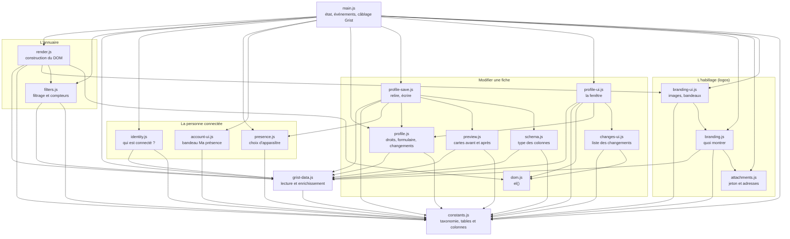
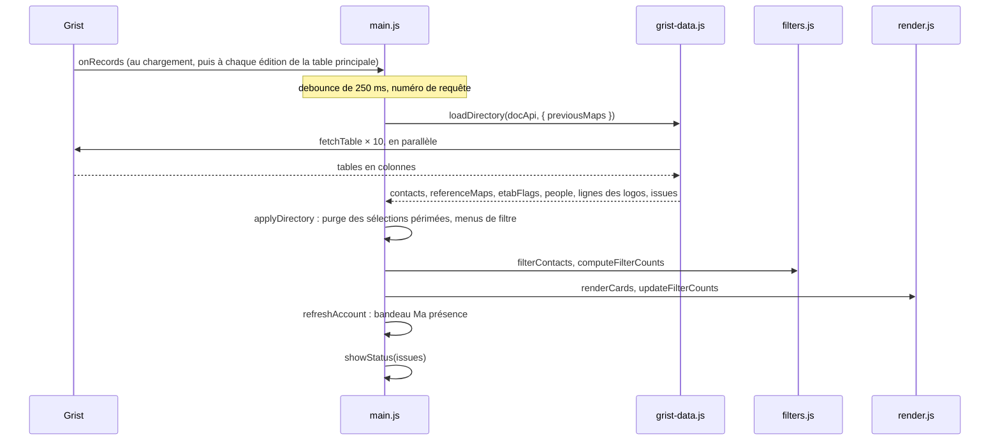
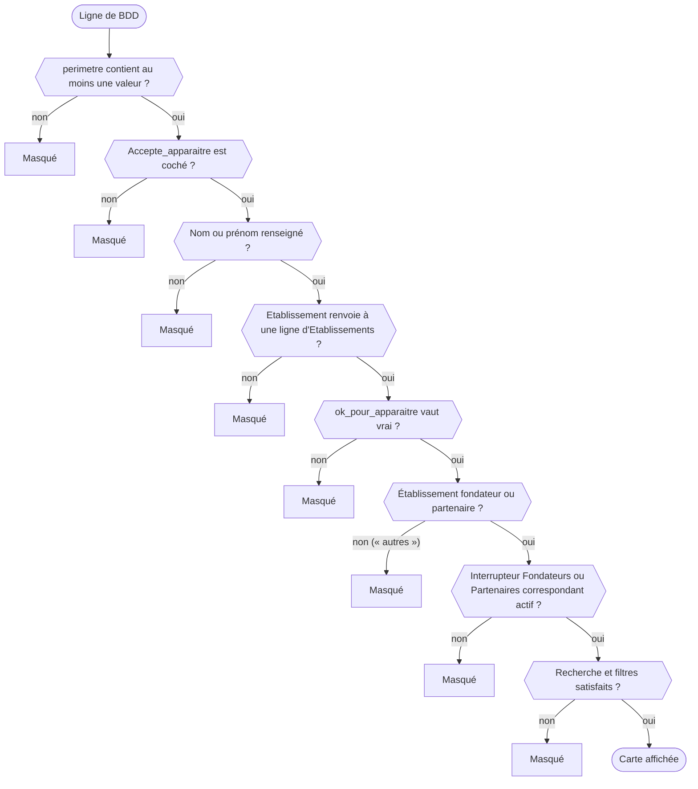
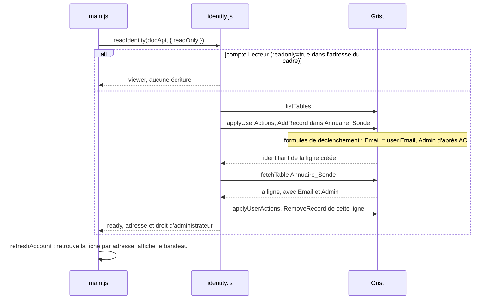
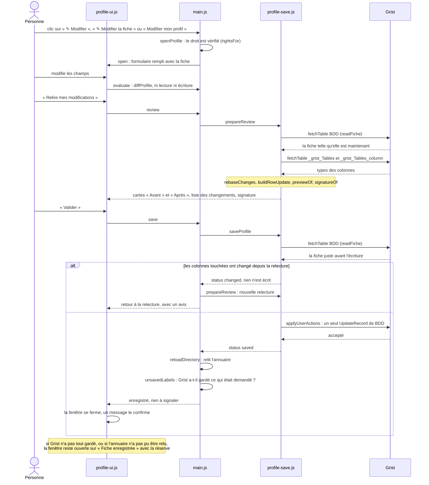

# Documentation développeur

Cette page explique comment le widget est construit et comment le modifier sans le casser : infrastructure, chargement des données, règles d'affichage, tests, déploiement. Elle suppose de savoir lire du JavaScript ; aucune connaissance de Grist n'est requise, les notions utiles sont rappelées au fil du texte.

Pages liées : [README](../README.md) (présentation et installation), [guide utilisateur](utilisateurs.md), [sécurité](securite.md), [maintenance](maintenance.md).

> **Cette page décrit la version 1.16.0** : le widget lit la table `BDD` (1.8.0), range les compétences par domaine (un filtre « Domaines » en 1.9.0, intégré depuis au menu Compétences, 1.13.0), s'adapte à la largeur de son cadre (1.9.1), n'affiche que les personnes qui ont accepté d'apparaître (1.10.0), laisse la personne connectée choisir d'apparaître ou non, « Ma présence » (1.11.0), puis modifier sa fiche après une relecture de la carte avant et après (1.12.0), puis affiche les logos des établissements, des financeurs et des fondateurs, lus comme des pièces jointes du document, dans un en-tête et un bandeau du bas remaniés (1.14.0). Depuis la 1.15.0, un administrateur allume un « mode admin » qui lui permet de modifier la fiche de toute personne affichée, adresse e-mail et établissement compris, dans une fenêtre qui suit la maquette validée. Depuis la 1.16.0, le menu Tâches range les tâches par action d'après leur numéro. Ces modifications s'appliquent directement : il n'y a ni validation par un administrateur ni historique tenu par le widget. Ce qui n'est pas encore là est résumé dans [Chantiers en cours](#chantiers-en-cours).

## Sommaire

- [Vue d'ensemble](#vue-densemble)
- [Organisation du code](#organisation-du-code)
- [Chargement des données](#chargement-des-données)
- [Données Grist : structure et encodages](#données-grist--structure-et-encodages)
- [Règles d'affichage](#règles-daffichage)
- [Identité et « Ma présence »](#identité-et--ma-présence-)
- [Modifier une fiche](#modifier-une-fiche)
- [Habillage : logos et pièces jointes](#habillage--logos-et-pièces-jointes)
- [Filtres, compteurs et recherche](#filtres-compteurs-et-recherche)
- [Rendu des cartes et des menus](#rendu-des-cartes-et-des-menus)
- [Accessibilité : noms, focus et contrastes](#accessibilité--noms-focus-et-contrastes)
- [Fiabilité : que se passe-t-il en cas de panne ?](#fiabilité--que-se-passe-t-il-en-cas-de-panne-)
- [Tests](#tests)
- [Données et captures de démonstration](#données-et-captures-de-démonstration)
- [Recettes](#recettes)
- [Conventions](#conventions)
- [Versions, déploiement et CI](#versions-déploiement-et-ci)
- [Chantiers en cours](#chantiers-en-cours)

## Vue d'ensemble

Le widget est une page web statique : HTML, CSS et JavaScript natif en modules ES. Il n'y a ni compilation, ni bundler, ni dépendance npm à l'exécution. Grist l'affiche dans une iframe sur une page de document et lui fournit son API de widget (`grist-plugin-api.js`) pour lire les tables du document et, dans trois cas précis, y écrire.



| Élément | Rôle | Où |
|---|---|---|
| Document Grist | Source unique des données : il sert de base de données et d'API back-end (voir [`specs.md`](../specs.md)) | Instance Grist de l'organisation |
| Dépôt GitHub | Code du widget, tests, documentation | <https://github.com/lombre33/Annuaire_PUI_Bordeaux> |
| GitHub Pages | Sert les fichiers à l'URL déclarée dans [`manifest.yml`](../manifest.yml) | <https://lombre33.github.io/Annuaire_PUI_Bordeaux/> |
| `grist-plugin-api.js` | API de widget de Grist. `index.html` la charge depuis `docs.getgrist.com`, sans version figée | `index.html` |
| GitHub Actions | Exécute `node --test` à chaque pull request et à chaque push sur `main` | `.github/workflows/tests.yml` |

Ce que le widget fait, dans la version 1.16.0 :

- il **lit** les tables du document Grist : dix lectures `fetchTable` par chargement de l'annuaire (neuf tables, plus la table facultative `Financeurs` des logos du haut de page) et, pour savoir qui est connecté, la liste des tables (`listTables`) puis la table-sonde. Quand une personne prépare la relecture d'une modification, il relit aussi `BDD` (puis une dernière fois juste avant d'écrire) et lit les tables de métadonnées `_grist_Tables` et `_grist_Tables_column` (`schema.js`). Pour afficher les logos, il demande à Grist un **jeton d'accès en lecture seule** (`getAccessToken`, dans `attachments.js`) : ce sont les images, demandées par le navigateur, qui le portent (voir [Habillage](#habillage--logos-et-pièces-jointes)) ;
- il **écrit** dans trois cas seulement, toujours à l'initiative d'un chargement ou d'un clic, jamais en tâche de fond :
  1. à chaque chargement, il ajoute puis supprime une ligne de la table-sonde `Annuaire_Sonde` (`identity.js`), sauf pour un compte Lecteur ou quand la table n'existe pas ;
  2. quand la personne connectée actionne l'interrupteur « Ma présence », il écrit la case `Accepte_apparaitre` de sa ou de ses lignes de `BDD` (`presence.js`), en une seule action atomique ;
  3. quand une personne valide la relecture de la modification de sa fiche (un administrateur en mode admin : de la fiche d'une autre personne affichée), il écrit les colonnes modifiées de cette seule ligne de `BDD` (`profile-save.js`), en une seule action atomique, sans validation ni historique tenu par le widget.

  Il ne crée ni ne modifie jamais la structure du document (tables, colonnes) ;
- il ne stocke rien dans le navigateur et n'émet lui-même aucune requête réseau (aucun `fetch` : les logos sont téléchargés par le navigateur, par des balises ``) ;
- il demande l'accès `full` (`grist.ready({ requiredAccess: 'full' })` dans `main.js`, `accessLevel: full` dans `manifest.yml`), un choix assumé : il lit plusieurs tables autres que celle de sa section et écrit dans le document. Les conséquences et les garde-fous sont détaillés dans [sécurité](securite.md#niveau-daccès-demandé-à-grist).

## Organisation du code



Une flèche signifie « importe » ; tous les `import` des fichiers à la racine y figurent.

| Fichier | Rôle |
|---|---|
| `index.html` | Squelette de la page : l'en-tête (titre et compteur, financeurs, zone « Ma présence »), les cartes, le bandeau des fondateurs du pied de page, `<template id="cardTemplate">` d'une carte, `<dialog id="profileDialog">` de la fenêtre de modification, chargement de l'API Grist puis de `main.js` |
| `style.css` | Feuille de style de la page (variables de couleur en tête de fichier) ; `dialogs.css`, plus bas, couvre la fenêtre de modification |
| `constants.js` | Noms de la table principale (`MAIN_TABLE`, soit `BDD`), de la case de consentement (`CONSENT_COLUMN`, soit `Accepte_apparaitre`) et de la table-sonde (`PROBE_TABLE`, soit `Annuaire_Sonde`), puis taxonomie : `CATEGORIES` donne, pour chaque catégorie, son libellé, sa couleur, sa table de référence, ses colonnes de libellé et, sauf pour l'établissement et le rôle (des Références simples), sa colonne de liste dans la table principale ; un regroupement (`macro`, `macroTaches`) y est déclaré par `groups`, et se déduit des numéros par `numberedIn` quand il n'a pas de colonne. `FILTERS`, `TAG_GROUPS`, `REFERENCE_TABLES`, `REFERENCE_SOURCES` et `LIST_CATEGORIES` en sont dérivés. `PROFILE_FIELDS` liste ce qu'on peut modifier sur une fiche (colonne, libellé, nature : texte, e-mail, téléphone, référence ou liste), dont l'e-mail et l'établissement réservés à un administrateur (`admin: true`) ; `fieldsFor()` en tire les champs du formulaire. `ETABLISSEMENT_NAMES` désigne, parmi les libellés lus de Grist, les noms complets des établissements. `BRANDING` nomme les colonnes et la table des logos (`logo`, `ordre_bandeau`, `Financeurs`) et le financeur du rond (`France 2030`) ; `BAND_LOGO`, `FUNDER_LOGO` et `CARD_LOGO` donnent la surface et les bornes des logos ; `PUI_URL` est la page du projet |
| `grist-data.js` | Lecture des tables (`loadDirectory()`), décodage des formats Grist, enrichissement des contacts, règles d'éligibilité et de consentement (`hasAccepted()`, `buildContacts()`), l'index des personnes par adresse e-mail ou par identifiant de ligne (`createPeopleIndex()`, dont `findByEmail()` et `findById()`), `describeVisibility()` et `displayName()` (le nom d'un contact tel que les cartes l'affichent), et le rangement des tâches par action d'après leur numéro (`taskActionNumber()`, `actionNumber()`). `loadDirectory()` renvoie aussi les lignes brutes d'`Etablissements` et de `Financeurs`, que lit `branding.js` |
| `filters.js` | Forme de l'état des filtres (`createEmptyFilterState()`), `filterContacts()`, `computeFilterCounts()`, `pruneStaleFilters()`, et le menu rangé par groupe (les compétences par domaine, les tâches par action) : `menuGroups()`, `groupState()`, `toggleGroup()`, `selectionCount()` |
| `render.js` | Construction du DOM : menus de filtre (`createFilterUI()`, dont le menu Compétences, rangé par domaine, et le menu Tâches, rangé par action) et cartes (`renderCards()`, avec, sous la fonction, le bouton « Modifier » des fiches que la personne peut modifier : « ✎ Modifier » sur la sienne, « ✎ Modifier la fiche » sur celles des autres en mode admin) ; cartes de relecture sans interaction (`renderPreviewCard()`), où ce qui change est repéré ; `initials()` sert aussi au bandeau « Ma présence ». Le logo de l'établissement remplace la pastille quand Grist en a un (`fillEtablissement()`) |
| `identity.js` | `readIdentity()` : qui est connecté ? Ajoute une ligne dans la table-sonde `Annuaire_Sonde` (dont Grist calcule l'adresse par une formule `user.Email`), la relit par son identifiant puis la supprime. Renvoie l'adresse et la case administrateur, ou « personne » au moindre doute ; ne bloque jamais l'annuaire |
| `presence.js` | « Ma présence » : `describePresence()` dit à la personne si elle apparaît et pourquoi, `setPresence()` écrit son accord (`Accepte_apparaitre`) sur sa ou ses lignes en une seule action atomique. `describeUnknownAccount()` dit à une personne connectée dont l'adresse ne figure pas dans `BDD` qu'il n'y a pas de fiche à modifier (un administrateur y trouve son mode admin) ; `describeHiddenFiche()` dit, à la relecture d'une modification, pourquoi la fiche modifiée ne figurerait pas dans l'annuaire ; `classifyWriteError()` range un refus de Grist (règle d'accès, colonne à formule, autre) et sert aussi à `profile-save.js` |
| `account-ui.js` | Le bandeau « Ma présence » dans l'en-tête, à droite du titre et des financeurs, avec le bouton « Modifier mon profil » et, pour un administrateur, le bouton « Mode admin » (`setActions()`) : construit le DOM à partir de ce que décrit `describePresence()`, sans règle métier |
| `profile.js` | Modifier une fiche, sans DOM ni Grist : `rightsFor()` (qui peut modifier quelle fiche : la sienne, ou toutes pour un administrateur qui a allumé le mode admin ; fermé par défaut), `profileFormModel()` et `draftOf()` (ce que le formulaire propose), `diffProfile()` (ce que la personne a changé, sous forme de delta, et pourquoi une saisie serait refusée, dont une adresse e-mail déjà prise), `rebaseChanges()` (ramener ces changements sur la fiche telle qu'elle est maintenant dans Grist) et `describeChanges()` (la liste des changements) |
| `profile-save.js` | Relire puis écrire une fiche : `prepareReview()` relit la fiche dans Grist et prépare les cartes avant et après, `saveProfile()` écrit en une seule action atomique (`UpdateRecord`), et seulement si les champs touchés n'ont pas changé depuis la relecture (`signatureOf()`) ; l'e-mail et l'établissement ne s'écrivent que pour une relecture préparée par un administrateur qui modifie la fiche d'une autre personne. `buildRowUpdate()` calcule les valeurs à écrire sur la fiche telle qu'elle est au moment d'écrire, `readFiche()` (non exportée) relit `BDD` : la ligne, et les autres pour vérifier qu'aucune ne porte déjà la nouvelle adresse ; `unsavedLabels()` dit ce que Grist n'a pas gardé |
| `preview.js` | `previewOf()` : la carte « avant » et la carte « après » (la ligne avec les valeurs qui seront écrites, enrichie comme l'annuaire) ; `diffContacts()` : ce qui les distingue, y compris l'établissement et l'adresse e-mail |
| `schema.js` | `readColumnTypes()` : le type des colonnes de `BDD` d'après les métadonnées de Grist, pour écrire le téléphone dans la forme de sa colonne |
| `profile-ui.js` | La fenêtre de modification (`createProfileDialog()`) : formulaire, relecture avant/après (légende, cartes côte à côte, détail des changements), puis fermeture et message de confirmation, ou la fenêtre « Fiche enregistrée » quand il reste une réserve à lire. DOM seulement |
| `changes-ui.js` | `renderChangeList()` : la liste des changements, titrée « Ce qui va changer » sous le formulaire, « Détail des changements » à la relecture et « Ce qui a changé » à la confirmation. DOM seulement |
| `branding.js` | L'habillage, sans DOM ni Grist : `buildBranding()` (les fondateurs du bandeau du bas, les financeurs, le rond, le logo de chaque établissement), `logoForContact()` (le logo d'une carte) et `logoSize()` (la taille d'un logo d'après ses proportions) |
| `attachments.js` | Les pièces jointes de Grist : `attachmentIds()` lit une cellule « Pièces jointes », `createAttachments()` détient le jeton d'accès en lecture seule (`getAccessToken`) et donne l'adresse de chaque fichier ; il parle à Grist par le `docApi` qu'on lui passe, sans toucher au DOM |
| `branding-ui.js` | Le DOM de l'habillage : `createLogoImage()` (une image qui se charge à l'écran, ou le nom en texte), `sizeLogo()`, `createBrandingUI()` (les financeurs de l'en-tête, le bandeau des fondateurs et son rond) |
| `dom.js` | `el()` : crée un élément avec sa classe et son texte (jamais du HTML : ce qui vient de Grist reste du texte) |
| `dialogs.css` | Feuille de style de la fenêtre de modification (formulaire, relecture, confirmation) et du message de confirmation |
| `main.js` | Point d'entrée : détient l'état de l'application (dont le mode admin), relie `window.grist` et les événements du DOM aux autres modules, affiche le message de confirmation d'un enregistrement (`showToast()`) et donne à la fenêtre de modification le logo de l'établissement de la fiche, ou son nom en pastille (`etablissementBadge()`) |

Règles de répartition, à respecter pour que les tests restent possibles sans navigateur :

1. `constants.js`, `grist-data.js`, `filters.js`, `identity.js`, `presence.js`, `profile.js`, `profile-save.js`, `preview.js`, `schema.js`, `branding.js` et `attachments.js` n'utilisent jamais le DOM.
2. Seules `loadDirectory()` et `readColumnTypes()` (lectures), `createAttachments()` (il demande un jeton), `readIdentity()`, `setPresence()` et les fonctions de `profile-save.js` (`prepareReview()` lit, `saveProfile()` écrit) parlent à Grist, par le `docApi` qu'on leur passe : les tests leur fournissent un faux `docApi` (`tests/support/fake-grist.js`). `profile.js` et `preview.js` ne l'utilisent jamais.
3. `render.js` ne contient aucune règle métier : il reçoit des contacts déjà filtrés et des fonctions de rappel (`onToggle`, et `onToggleGroup` pour la case d'un domaine ou d'une action). Ce qu'il sait d'un menu rangé par groupe (les groupes, l'état d'une case de domaine ou d'action, le chiffre du bouton) vient des fonctions pures de `filters.js`, d'où la flèche `render.js` → `filters.js` du schéma.

4. `filters.js` n'a pas d'effet de bord : `pruneStaleFilters()` renvoie un nouvel état au lieu de modifier son argument.
5. `branding-ui.js` et `render.js` ne contiennent aucune règle sur ce qu'on montre : `branding.js` l'a décidé. Les images ne sont jamais construites avec du HTML (`textContent` et propriétés du DOM seulement).
6. Seul `main.js` détient l'état de l'application (`state`). La fenêtre de modification ne garde que l'état de sa propre session (étape, brouillon), jeté à sa fermeture ; `profile-ui.js`, `changes-ui.js` et `dom.js` ne définissent aucune règle métier : `main.js` leur donne ce que les autres modules ont calculé, et `profile-ui.js` n'appelle que les règles de `profile.js` et de `grist-data.js` (flèches du schéma).

## Chargement des données



1. `main.js` déclare l'accès avec `grist.ready({ requiredAccess: 'full' })` puis s'abonne à `grist.onRecords`.
2. `onRecords` ne sert que de **déclencheur** : son contenu est ignoré. Il ne porte pas forcément toutes les colonnes de `BDD` (selon la vue branchée) et résout les Références en texte, alors que `fetchTable()` renvoie la table complète, les Références en identifiants de ligne. Grist ne rappelle `onRecords` que pour les changements de la table liée à la section du widget : modifier une table de référence ne rafraîchit pas le widget (voir [Limites connues](maintenance.md#limites-connues)).
3. Le rappel est temporisé (anti-rebond : `debounce()`, 250 ms) : une rafale d'éditions ne déclenche qu'une lecture. Chaque lecture reçoit un numéro (`createRequestSequencer()`) et seule la plus récente applique son résultat.
4. `loadDirectory()` enchaîne :
   - `readAllTables()` lit les dix tables en parallèle avec `Promise.allSettled` : une table illisible ne fait pas échouer les autres, et `Financeurs`, facultative (`OPTIONAL_TABLES`), est lue sans qu'aucun message ne signale son absence ;
   - `requireReadable()` puis `requireColumns()` lèvent une `DirectoryLoadError` si une donnée indispensable manque : table `BDD` ou `Etablissements` illisible, colonne obligatoire absente, y compris `Accepte_apparaitre` (voir [Fiabilité](#fiabilité--que-se-passe-t-il-en-cas-de-panne-)) ;
   - `readReferenceMaps()` construit, pour chaque **catégorie** (`REFERENCE_SOURCES`), la correspondance id → libellé : le libellé corrigé s'il est rempli, le libellé brut sinon. Une table illisible garde les libellés précédents de ses catégories (`previousMaps`). Un regroupement comme « Domaines » est complété ensuite par `completeGroupMap()`, qui déduit « Actions des tâches » des numéros des libellés déjà lus au lieu de relire une table ;
   - `etablissementFlagsFromRows()` indexe les indicateurs de chaque établissement (fondateur, partenaire, validé) par identifiant de ligne, et par libellé en repli ;
   - `isInScope()` écarte les lignes sans périmètre ; `buildContacts()` ne garde ensuite que les personnes qui ont accepté d'apparaître (`hasAccepted()`), les enrichit avec `enrich()`, puis ne garde que celles qui ont un nom ou un prénom et un établissement éligible (voir [Règles d'affichage](#règles-daffichage)) ;
   - `createPeopleIndex()` indexe **toutes** les lignes de `BDD`, affichées ou non, par adresse e-mail : c'est ce qui permet à « Ma présence » de retrouver la fiche de la personne connectée et de lui dire pourquoi elle n'apparaît pas (voir [Identité et « Ma présence »](#identité-et--ma-présence-)) ;
   - `describeEmptyDirectory()` explique pourquoi l'annuaire est vide quand c'est anormal, y compris quand personne n'a accepté d'apparaître.
5. `applyDirectory()` (dans `main.js`) restreint le menu Établissement aux établissements validés (`filterVisibleEstablishments()`), retire des filtres actifs les valeurs qui n'existent plus (`pruneStaleFilters()`), reconstruit les menus **seulement si les libellés ont changé** (`referenceMapsEqual()`, car reconstruire ferme les menus ouverts), met à jour l'habillage (`applyBranding()`, [voir plus bas](#habillage--logos-et-pièces-jointes)), puis rafraîchit les cartes (`refreshCards()`) et le bandeau « Ma présence » (`refreshAccount()`).
6. `showStatus()` affiche ou masque le bandeau d'état avec les messages de `issues`.

Cette suite est enveloppée dans `reloadDirectory()` (`main.js`), qui renvoie `'applied'`, `'stale'` (une lecture plus récente a pris le relais) ou `'failed'` (le bandeau d'état le dit). `onRecords` l'appelle après le délai d'anti-rebond ; l'interrupteur « Ma présence » et l'enregistrement d'une fiche (`saveReviewed()`) l'appellent directement après leur écriture, pour que l'écran montre ce que Grist a enregistré.

`loadDirectory()` renvoie `{ contacts, referenceMaps, etabFlags, people, etablissementRows, financeurRows, issues }` : les contacts éligibles et enrichis, les libellés de chaque catégorie (`referenceMaps`, rangés par **clé de catégorie** et non par table, parce que « Compétences » et « Domaines » lisent la même table `Competences`, plus `etablissementNom`, qui n'est pas une catégorie : l'identifiant de chaque établissement y donne son nom complet, que lisent les fenêtres), les indicateurs des établissements, l'index des personnes par adresse e-mail (`people`), les lignes brutes d'`Etablissements` et de `Financeurs` (`financeurRows` vaut `null` quand cette table manque), dont `branding.js` tire les logos, et les messages français destinés au bandeau d'état.

Un contact enrichi garde toutes ses colonnes d'origine et reçoit :

- `labels` : un objet `{ clé de catégorie → liste de libellés }`, lu par `labelsOf(contact, clé)`. Établissement et rôle, qui n'ont qu'une valeur, prennent la même forme de liste pour que les filtres et les tags n'aient aucun cas particulier (la pastille de la carte lit `etablissement_label`) ;
- `etablissement_label` : le texte du badge de la carte ;
- `etablissement_fondateur`, `etablissement_partenaire`, `etablissement_ok_pour_apparaitre` : les indicateurs de son établissement.

## Données Grist : structure et encodages

Les noms de tables et de colonnes lus par le widget sont listés dans [`grist_structure.txt`](../grist_structure.txt), un schéma volontairement **réduit** aux tables et colonnes utiles au widget. Ne jamais y copier le schéma complet du document Grist (voir [sécurité](securite.md#données-dans-le-dépôt)). Le widget lit la table principale `BDD` (une ligne par personne, nommée par `MAIN_TABLE`) et les tables de référence de `CATEGORIES` dans `constants.js` : `Actions`, `Taches`, `Communautes`, `GT`, `Competences`, `INSTANCES` (en majuscules), `Etablissements` et `Role_Dans_le_PUI`. La table `Competences` alimente deux catégories, « Compétences » et « Domaines », et n'est lue qu'une fois par chargement. Les colonnes obligatoires sont `nom`, `prenom`, `Etablissement`, `perimetre` et `Accepte_apparaitre` ; `email`, `Fonction`, `numero_de_telephone` et `Role_dans_le_PUI` sont facultatives : absentes, la carte ne les affiche simplement pas. Sans `email`, en revanche, « Ma présence » ne peut pas retrouver la fiche de la personne connectée. Deux autres tables ne font pas partie de l'annuaire proprement dit : la table-sonde `Annuaire_Sonde`, où `identity.js` ajoute, relit puis supprime une ligne, et `ACL`, que lit la formule de la sonde (jamais le widget) pour savoir qui est administrateur. Leur création est décrite dans [`GRIST_SETUP.md`](../GRIST_SETUP.md).

Grist ne renvoie pas toujours les valeurs sous la forme qu'on attendrait. Les encodages ci-dessous ont presque tous provoqué un bug en production (voir le [CHANGELOG](../CHANGELOG.md)) :

| Ce que Grist envoie | Exemple | Fonction qui le décode |
|---|---|---|
| Table en colonnes | `{ id: [1, 2], nom: ['Ana', 'Bob'] }` | `tableToRows()` |
| Liste (ReferenceList) | `['L', 3, 7]` ; une liste vide vaut `['L']`, pas `[]` | `safeValues()`, `resolveListItem()` |
| Référence simple | identifiant de ligne (`3`, ou `0` quand elle est vide) avec `fetchTable()` ; parfois texte déjà résolu (`'UBM'`) ou `['R', 'Table', 3]` selon la configuration de la table liée | `refId()`, `refLabel()` |
| Colonne numérique | un téléphone `556789012` : le 0 initial est perdu | `formatPhone()` |
| Cellule non renseignée | `''`, `null` ou `0` | `isBlank()` |

Règles à respecter :

- Ne jamais supposer une seule forme pour une Référence ni pour un élément de liste. Un id sans libellé est ignoré, jamais affiché tel quel (« 47 » n'aide personne).
- `BDD.Etablissement` est une Référence **directe** vers la ligne d'`Etablissements`, résolue par identifiant de ligne : c'est la seule source de l'établissement d'un contact (`etablissementFlags()`). Chaque contact garde ainsi le statut de sa propre ligne, même si deux établissements portent le même acronyme. Si Grist envoie la Référence déjà résolue en texte, on se replie sur le libellé (l'acronyme, sinon le nom complet).
- Ne jamais lire la colonne `nom_de_domaine`, ni celle de `BDD` ni celle d'`Etablissements` : règle du projet. `tests/rules.test.mjs` échoue si un fichier `.js`, `.mjs`, `.html` ou `.css` du dépôt la cite.
- `perimetre` ne sert qu'à savoir si elle contient au moins une valeur ([`specs.md`](../specs.md)) ; le widget ne lit pas sa table de référence. L'ancienne table `Annuaire` et ses colonnes `perimetre_*` ne sont plus lues.
- Chaque table de référence porte un libellé brut (celui de l'import) et un libellé corrigé : le corrigé est affiché quand il est rempli, le brut sinon (`field` de chaque entrée de `CATEGORIES`).
- Les compétences sont une liste de références (`BDD.Competences`) vers la table `Competences`. Le domaine d'une compétence est sa colonne `Macro_competences` : celui d'un contact se déduit de ses compétences (la colonne `Comptetences_macr` de `BDD` n'est pas lue).
- Les tâches sont une liste de références (`BDD.Taches`) vers la table `Taches`. L'action d'une tâche n'est **pas une colonne** : c'est le numéro avant le point de son libellé (« 1.3 Animer le réseau » → l'action dont le libellé commence par « Action 1 »). Voir [Filtres, compteurs et recherche](#filtres-compteurs-et-recherche).
- `Accepte_apparaitre` (le consentement individuel de la personne) est une colonne de **données** de type case à cocher, pas une formule : Grist refuse d'écrire dans une colonne à formule. Seul `true` vaut accord (`hasAccepted()`) : une case vide, décochée, `0` ou un texte masquent la personne. La colonne est obligatoire, parce que, dans le doute, afficher tout le monde serait pire qu'afficher personne : sans elle, le widget affiche une erreur et aucune carte. Il la lit pour décider qui apparaît (1.10.0) et l'écrit quand la personne actionne l'interrupteur « Ma présence » (1.11.0). La procédure côté Grist est dans [`GRIST_SETUP.md`](../GRIST_SETUP.md).

## Règles d'affichage

Le cahier des charges est [`specs.md`](../specs.md) ; en cas d'écart avec le code, le code et le [CHANGELOG](../CHANGELOG.md) font foi. Une ligne de la table principale (`BDD`) devient une carte si elle franchit toutes les étapes suivantes :



| Étape | Code |
|---|---|
| `perimetre` non vide | `isInScope()` |
| Accord de la personne (`Accepte_apparaitre` coché) | `hasAccepted()`, appelée par `buildContacts()` |
| Nom ou prénom renseigné | `buildContacts()` |
| Établissement identifié, validé, fondateur ou partenaire | `etablissementFlags()` puis `isEtablissementEligible()` |
| Interrupteurs Fondateurs et Partenaires | `matchesScope()` (`filters.js`) |
| Recherche et filtres | `filterContacts()` |

À savoir :

- Parmi les huit étapes du schéma, les six premières sont appliquées une fois par chargement, dans `loadDirectory()`. Les deux dernières le sont à chaque action de l'utilisateur, dans `main.js` : `refreshCards()` appelle `filterContacts()` sur la liste des contacts éligibles.
- **Les deux accords sont indépendants.** Celui de l'établissement (`ok_pour_apparaitre`, que décident ceux qui valident les établissements) ne remplace pas celui de la personne (`Accepte_apparaitre`, que la personne donne elle-même), et celui de la personne ne contourne pas l'établissement. Seul `true` vaut accord : une case vide, décochée, `0` ou un texte ne suffisent pas.
- `describeVisibility()` reprend ces critères un à un pour une ligne de `BDD` et dit pourquoi elle apparaît ou non. `tests/people.test.mjs` vérifie qu'elle concorde avec `buildContacts()` pour chaque ligne du jeu de test : « Ma présence » ne peut donc pas dire autre chose que l'annuaire. `describeHiddenFiche()` (`presence.js`) reprend le même verdict pour la relecture d'une modification, sans ajouter de règle. Quand l'établissement n'a pas validé sa présence (la fiche ayant un nom et un périmètre), c'est ce qu'elle dit d'abord : « Votre établissement n’a pas validé sa présence : votre fiche reste masquée dans l’annuaire. » pour la personne concernée, « <Établissement> n’a pas validé sa présence : après cette modification, la fiche ne sera plus visible dans l’annuaire. » pour un administrateur. Sinon, si la personne n'a pas accepté d'apparaître : « Votre fiche est masquée de l’annuaire : vous n’avez pas accepté d’apparaître (interrupteur en haut de page). » ou « Cette fiche est masquée de l’annuaire : la personne n’a pas accepté d’apparaître. » ; et, si elle a accepté mais reste masquée, « Votre fiche reste masquée de l'annuaire : … » ou « Cette fiche reste masquée de l'annuaire : … » suivi de la ou des raisons.
- Un établissement « autres » (une structure extérieure au PUI qui a collaboré à certaines tâches, à la différence des établissements fondateurs et des partenaires) n'est jamais affiché : aucune branche du code ne le rend éligible.
- Un établissement inconnu (`Etablissement` vide, ou sans ligne correspondante dans `Etablissements`) n'a aucun indicateur : le contact est exclu plutôt qu'affiché sans validation.
- La Référence `Etablissement` désigne une ligne par son identifiant : deux lignes de même acronyme ne se mélangent pas. Seul le repli par libellé, quand Grist envoie la Référence déjà résolue en texte, ne peut pas les départager : `etablissementFlagsFromRows()` retient alors le statut le plus strict (vrai seulement s'il l'est partout) et signale le libellé dans `conflicts` : les contacts de ce libellé sont masqués si ce statut ne les rend plus éligibles.
- Par défaut, l'interrupteur Fondateurs est actif et Partenaires ne l'est pas (`state.scope` dans `main.js`, changement de la version 1.7.0). « Réinitialiser » ne les modifie pas. Si les deux sont désactivés, aucune carte ne s'affiche.

## Identité et « Ma présence »

Depuis la version 1.11.0, la personne connectée voit en haut de l'annuaire un bandeau qui lui dit si elle apparaît, et lui laisse l'activer ou la retirer d'un clic. Le widget doit pour cela savoir **qui** est connecté, puis **écrire** son choix. Les réglages à faire dans Grist sont dans [`GRIST_SETUP.md`](../GRIST_SETUP.md) ; le protocole d'essai manuel est la [section 11 de `TESTING.md`](../TESTING.md#11-ma-présence-1110).

### Qui est connecté ?

L'API de widget de Grist ne donne ni l'adresse e-mail ni le nom de la personne : le jeton d'accès du widget est celui du document, pas celui de la session. La seule voie est une **table-sonde**, `Annuaire_Sonde`, dont une colonne a pour formule de déclenchement `user.Email` : Grist la calcule à la création d'une ligne, avec l'identité de la personne qui l'a créée. Une seconde colonne, `Admin`, se calcule de la même façon d'après la table `ACL`.



- `readIdentity()` ne lève jamais d'exception et **échoue en sécurité** : sans table-sonde, sans adresse renvoyée par la formule, si Grist refuse l'écriture ou la relecture, ou pour un compte Lecteur, la personne n'est pas identifiée, aucun bandeau n'apparaît et rien d'autre ne change.
- L'identité est lue **à côté** de l'annuaire (`readIdentity(…).then(…)` dans `main.js`) : elle ne retarde ni ne casse jamais l'affichage des cartes.
- La ligne créée est relue par son **identifiant**, celui que renvoie `applyUserActions`, jamais « la dernière ligne » : deux personnes qui ouvrent le widget au même moment se reconnaissent chacune. Elle est ensuite supprimée au mieux : une ligne orpheline ne gêne personne, la table peut être vidée.
- L'adresse doit avoir la forme d'une adresse e-mail. `admin` n'est vrai que si la formule de Grist renvoie exactement `true` : le droit vient de Grist, jamais d'une valeur que le navigateur déclarerait.
- Un compte Lecteur ouvre le widget avec `readonly=true` dans l'adresse du cadre (`isReadOnlyAddress()`, la dernière valeur l'emporte) : il ne peut rien écrire, pas même la ligne de la sonde, donc le widget n'essaie pas.
- La console dit pourquoi personne n'est identifié (`[IDENTITE] …`), **sans jamais écrire d'adresse** : un test le vérifie.

### Retrouver la fiche et décrire la situation

`refreshAccount()` (`main.js`) retrouve les lignes de `BDD` de la personne par son adresse (`people.findByEmail()`, sans tenir compte de la casse ni des espaces), puis `describePresence()` (`presence.js`) décrit sa situation à partir du verdict de `describeVisibility()` :

| Situation | Ton | Message |
|---|---|---|
| Elle apparaît | `ok` | « Vous apparaissez dans l'annuaire. » Pour un établissement partenaire : « … (visible avec l'interrupteur « Partenaires »). » |
| Elle n'a pas accepté | `off` | « Vous n'apparaissez pas dans l'annuaire. » |
| Elle a accepté, mais reste masquée | `warn` | « Vous avez accepté d'apparaître, mais votre fiche reste masquée : … Contactez un administrateur. » suivi de la ou des raisons : ni prénom ni nom, pas de périmètre, pas d'établissement, établissement non reconnu, non validé, ni fondateur ni partenaire |
| Plusieurs fiches, accord sur une partie seulement | `warn` | « Vous n'avez accepté d'apparaître que sur une partie de vos fiches. » |

`account-ui.js` ne contient aucune règle : `createAccountBar()` reçoit trois rappels (l'interrupteur, « Modifier mon profil », « Mode admin ») et construit le DOM ; elle expose `show(vue)`, qui reçoit la vue à afficher (nom, initiales, état de l'interrupteur, ton et message de `describePresence()` ou de `describeUnknownAccount()`, avec `switchable: false` quand il n'y a pas d'interrupteur à montrer), `hide()`, `setActions()` (les boutons « Modifier mon profil » et « Mode admin »), `focusEdit()`, `setBusy()`, `setStatus()` et `announce()`.

Quand plusieurs lignes portent la même adresse, la personne en est informée (« N fiches portent votre adresse : votre choix s'applique à toutes. ») et la console le signale, avec des identifiants de ligne et jamais d'adresse. Si aucune ligne ne porte l'adresse, ou si `BDD` n'a pas de colonne `email`, un bandeau le dit, sans interrupteur (« Compte absent de l'annuaire », « Administrateur » pour un administrateur, ou « Fiche introuvable » quand c'est `BDD` qui n'a pas de colonne `email`), et la console l'explique, une seule fois.

### Écrire le choix

`togglePresence()` (`main.js`) met l'interrupteur hors service (`setBusy()` : un double clic n'écrit qu'une fois ; le bouton reçoit `aria-disabled` et non `disabled`, car un bouton désactivé perd le focus du clavier), puis `setPresence()` envoie **une seule** action atomique à `applyUserActions` : un `UpdateRecord` de `BDD` par ligne de la personne, qui ne porte que `Accepte_apparaitre`, en vrai booléen. Un lot refusé ne change rien : jamais une ligne changée et l'autre non. `reloadDirectory()` relit ensuite tout, si bien que l'interrupteur et les cartes montrent ce que Grist a **vraiment** enregistré, pas ce qu'on espérait. Si la relecture échoue alors que l'écriture a réussi, le bandeau le dit (« Modification enregistrée ; l'annuaire n'a pas pu être rechargé. »). Quand tout a réussi, `announce()` dit le résultat dans la région d'état du bandeau (« Modification enregistrée. Vous avez accepté d'apparaître dans l'annuaire. » ou « Modification enregistrée. Vous n'apparaissez plus dans l'annuaire. ») : les lecteurs d'écran la lisent, elle reste invisible à l'écran (ton `done`, classe `.sr-only`) et s'efface au bout de `PRESENCE_ANNOUNCE_MS` (`constants.js`) ou au message suivant.

Une écriture refusée devient une `PresenceError` dont le message est une phrase française (`explainWriteError()`) : règle d'accès (« Grist a refusé la modification… »), colonne à formule (avec renvoi à `GRIST_SETUP.md`) ou message générique. L'erreur d'origine reste dans la console (`[PRESENCE]`).

### Un verrou d'interface, pas une sécurité

Tout ce qui précède est du JavaScript qui tourne dans le navigateur de la personne : il décide quoi **proposer**, il ne protège rien. Quelqu'un qui ouvre la console de son navigateur peut appeler lui-même `grist.docApi.applyUserActions`. Ce sont les **règles d'accès de Grist** qui décident de ce qui est vraiment permis : voir [sécurité](securite.md#écritures-et-règles-daccès).

### Tests

`identity.js`, `presence.js` et l'index des personnes se testent sans navigateur grâce au faux document Grist de `tests/support/fake-grist.js` : `tests/identity.test.mjs`, `tests/people.test.mjs` et `tests/presence.test.mjs`. Ce faux document reproduit ce dont le widget dépend : lectures, écritures atomiques qui renvoient `retValues` comme Grist, formules de déclenchement de la sonde, pannes de lecture, écritures refusées. Les tests navigateur (`tests/support/browser.mjs`, utilisé par `tests/e2e.test.mjs`, `tests/e2e-profile.test.mjs`, `tests/branding-e2e.test.mjs` et `tests/accessibility.test.mjs`) et le serveur de démonstration en injectent le texte tel quel dans la page, `export` retiré : ce fichier ne doit donc rien importer.

## Modifier une fiche

Depuis la version 1.12.0, une personne connectée modifie sa propre fiche et un administrateur celle de toute personne affichée dans l'annuaire ; depuis la 1.15.0, l'administrateur doit pour cela avoir allumé le **mode admin**. Les modifications s'appliquent **directement** : il n'y a ni validation par un administrateur, ni historique tenu par le widget, ni table créée par lui. Avant d'enregistrer, une fenêtre de relecture montre la carte « Avant » et la carte « Après », avec ce qui change repéré ; l'aspect de la fenêtre, de la relecture, des repères et du message de confirmation est celui de la maquette v5 validée le 12 octobre 2026 (elle n'est pas dans le dépôt : les écarts voulus sont listés dans le [CHANGELOG](../CHANGELOG.md), version 1.15.0). Les réglages à faire dans Grist (colonnes de données, règles d'accès) sont dans [`GRIST_SETUP.md`](../GRIST_SETUP.md) ; le protocole d'essai manuel est la [section 13 de `TESTING.md`](../TESTING.md#13-modifier-sa-fiche-1120-reprise-en-1150) (et la [section 16](../TESTING.md#16-mode-admin-e-mail-et-établissement-1150) pour le mode admin).

### Qui peut modifier quoi

`rightsFor()` (`profile.js`) reçoit l'identité de la personne connectée (voir [Qui est connecté ?](#qui-est-connecté-)) et renvoie une fonction qui dit, pour une ligne de `BDD`, ce que la personne peut en faire. Elle est **fermée par défaut** : sans identité fiable (pas de table-sonde, compte Lecteur…), personne ne peut rien modifier.

| Droit | Quand | Ce que la personne voit |
|---|---|---|
| `'own'` | `email` de la ligne est l'adresse de la personne connectée (casse et espaces ignorés) | « ✎ Modifier » et « Votre fiche » sur sa carte, « Modifier mon profil » dans le bandeau ; fenêtre « Modifier mon profil » |
| `'admin'` | `identity.admin` vaut exactement `true` (case `admin` d'`ACL`), le **mode admin** est allumé (`adminMode` vaut exactement `true`) et la ligne est celle d'une autre personne | « ✎ Modifier la fiche » sur la carte ; fenêtre « Modifier la fiche de X » |
| aucun | tout le reste | aucun bouton |

**Le mode admin** (`state.adminMode` dans `main.js`) est éteint à chaque ouverture du widget et ne s'allume que par le bouton « Mode admin » du bandeau, que `refreshAccount()` ne montre qu'aux administrateurs. Éteint, `rightsFor()` ne rend jamais `'admin'` : un administrateur se comporte comme tout le monde et ne voit « Modifier » que sur sa propre fiche. `toggleAdminMode()` recalcule les droits, montre ou cache la bande « Mode admin » (`#adminStrip`) et redessine les cartes. L'état n'est pas conservé entre deux ouvertures, et un redessin de l'annuaire après une modification dans Grist ne l'éteint pas.

Ce qu'on peut changer est déclaré une fois, dans `PROFILE_FIELDS` (`constants.js`) : prénom, nom, fonction, téléphone, rôle dans le PUI (une valeur d'une table de référence) et six listes (instances, actions, GT, compétences, communautés, tâches). Deux champs de plus portent `admin: true` : l'**e-mail** (`kind: 'email'`) et l'**établissement** (une référence obligatoire, dont les valeurs proposées sont les noms complets, `labelsFrom: ETABLISSEMENT_NAMES`). `fieldsFor(admin)` ne les rend que lorsque `admin` vaut exactement `true`, c'est-à-dire quand un administrateur en mode admin modifie la fiche d'**une autre personne** (`rights === 'admin'` dans `openProfile()`) : sur sa propre fiche, un administrateur ne les change pas non plus, l'e-mail l'identifie. **Jamais** `perimetre` (il décide de qui apparaît : l'affaire des administrateurs, dans Grist) ni `Accepte_apparaitre` (l'interrupteur « Ma présence » l'écrit). Une colonne facultative absente de `BDD` n'est pas proposée.

Les boutons « ✎ Modifier » sont sur les cartes (`fillActions()` dans `render.js`) : un administrateur ne modifie donc pas, depuis le widget, une fiche que l'annuaire masque (pas de carte, donc pas de bouton), ni le périmètre d'une fiche. Cela se fait dans Grist. La personne concernée, elle, modifie toujours sa propre fiche par « Modifier mon profil », même si elle n'apparaît pas dans l'annuaire ; ce bouton du bandeau n'est proposé que si une seule ligne porte son adresse. Un seul écouteur sur la grille (`main.js`) ouvre la fenêtre, et `openProfile()` revérifie le droit : un bouton ajouté à la main dans la page n'ouvre rien.

Tout cela est un **verrou d'interface**, pas une sécurité : `rightsFor()` décide de ce que le widget propose, il ne protège rien. Seules les règles d'accès de Grist empêchent vraiment la modification de la fiche d'un autre, ou de `email`, `Etablissement` et `perimetre` (le mode admin est un bouton, qu'on actionne aussi depuis la console) : voir [sécurité](securite.md#écritures-et-règles-daccès) et l'étape 4 de [`GRIST_SETUP.md`](../GRIST_SETUP.md). Ces règles n'ont pas été essayées dans un vrai Grist.

### Le parcours



1. **Ouvrir.** `openProfile()` (`main.js`) retrouve la ligne dans l'index des personnes (`findById()`, qui couvre toutes les lignes de `BDD`), vérifie le droit, construit le formulaire (`profileFormModel()`, `draftOf()`) et ouvre la fenêtre (`open()`, celle que `createProfileDialog()` a créée au démarrage). La fiche montrée est celle du dernier chargement de l'annuaire : rien n'est lu dans Grist à ce stade.
2. **Saisir.** À chaque frappe, `diffProfile()` compare le brouillon à la fiche : le résumé du pied de fenêtre (« Aucune modification », le nombre de champs modifiés, ou ce qu'il faut corriger : « Indiquez au moins un prénom ou un nom », « Corrigez l’adresse e-mail », « Corrigez le numéro de téléphone » ou « Corrigez les champs signalés »), le récapitulatif « Ce qui va changer » sous le formulaire, les messages sous les champs refusés et le bouton « Relire mes modifications » (« Relire les modifications » pour un administrateur qui modifie la fiche d'une autre personne) en dépendent. Pour l'e-mail d'un administrateur, `emailTakenElsewhere()` (`main.js`) répond d'après l'annuaire déjà lu : le nom de la personne quand sa fiche est visible, `true` sinon, pour ne pas dévoiler celui d'une fiche masquée. Ni lecture ni écriture.
3. **Relire.** `prepareReview()` relit la fiche, y ramène les changements (`rebaseChanges()`), calcule les valeurs à écrire (`buildRowUpdate()`), puis en tire les deux cartes (`previewOf()`) et la liste des changements (`describeChanges()`). La carte « Après » est la ligne de `BDD` avec les valeurs à écrire, enrichie par le même `enrich()` que l'annuaire : elle montre ce que l'annuaire affichera. Si la fiche modifiée ne figurerait pas dans l'annuaire, la relecture le dit, avec la raison (`describeHiddenFiche()`) ; pour un administrateur qui change l'adresse, elle rappelle que la table `ACL` ne suit pas. Une adresse que la lecture de `BDD` montre déjà portée par une autre ligne est refusée ici aussi, même si le formulaire l'ignorait.
4. **Valider.** `saveProfile()` relit la fiche une dernière fois, compare sa signature à celle de la relecture (voir plus bas), vérifie encore qu'aucune autre ligne ne porte la nouvelle adresse, puis envoie **une seule** action `UpdateRecord` sur cette ligne de `BDD` : tout ou rien. Il refuse d'écrire l'e-mail ou l'établissement pour une relecture que n'a pas préparée un administrateur qui modifie la fiche d'une autre personne (`review.admin`).
5. **Vérifier et confirmer.** `reloadDirectory()` relit tout l'annuaire, puis `unsavedLabels()` compare la fiche relue à ce qui était demandé. Quand tout a été gardé, `finish()` (`profile-ui.js`) ferme la fenêtre et `showToast()` (`main.js`) affiche, six secondes, « Vos modifications sont enregistrées. » (« La fiche de X est enregistrée. » pour un administrateur qui modifie la fiche d'une autre personne) ; une zone `status` toujours présente (`#toastLive`) l'annonce aux lecteurs d'écran, le message visible leur étant caché. Si Grist n'a pas gardé un champ, ou si l'annuaire n'a pas pu être relu, la fenêtre reste ouverte (`renderSaved()`) pour le dire.

**Rien n'est écrit avant « Valider ».** Le formulaire, `diffProfile()`, `prepareReview()`, « Retour » (qui ramène au formulaire avec le brouillon intact), « Annuler », la croix et Échap n'écrivent rien : le seul appel à `applyUserActions` de ce parcours est celui de `saveProfile()`.

### Un delta, pas une copie de la fiche

Pendant que la personne remplit le formulaire, d'autres peuvent modifier la fiche, et le formulaire ne montre pas tout (la valeur d'une liste dont la ligne de référence n'a plus de libellé n'a pas de pastille). Écrire une copie de la fiche telle que le formulaire l'a montrée écraserait ce que les autres ont changé et perdrait ce qu'il ne montre pas. `diffProfile()` calcule donc un **delta**, qui ne contient que ce qui change :

| Champ | Forme du delta | Écriture |
|---|---|---|
| Texte (prénom, nom, fonction), e-mail et téléphone | `{ avant, apres }` | la nouvelle valeur remplace celle de la fiche (l'e-mail est nettoyé et mis en minuscules) |
| Référence (rôle dans le PUI, établissement) | `{ avant: { id, label }, apres: { id, label } }` | l'identifiant de la nouvelle ligne |
| Liste | `{ ajout: [...], retrait: [...] }` | les retraits sont ôtés et les ajouts ajoutés à la liste **actuelle** de la fiche (`['L', ...conservées, ...ajoutées]`), rien d'autre |

`rebaseChanges()` ramène ensuite ce delta sur la fiche telle qu'elle est maintenant dans Grist : un texte, un téléphone ou une référence repart de sa valeur actuelle et disparaît du delta si la fiche a déjà la valeur voulue ; une liste garde ses ajouts et ses retraits, moins ceux qui sont déjà faits ; `moved` nomme les champs dont la valeur a changé dans Grist depuis l'ouverture du formulaire, ce que la relecture dit. `buildRowUpdate()` produit enfin les cellules à écrire, sur la fiche **au moment d'écrire** : `saveProfile()` le refait avec la ligne qu'il vient de relire, si bien qu'un tag ajouté entre-temps par un autre n'est pas perdu. Il refuse une liste qui contient autre chose que des identifiants de ligne, une colonne absente de `BDD` et une fiche qui n'aurait plus ni prénom ni nom. Le **téléphone** s'écrit dans la forme de sa colonne : un nombre si elle est numérique (le 0 initial est perdu, l'affichage le rétablit), un texte sinon ; vidé, il devient une cellule vide.

### Détecter un changement concurrent

`signatureOf()` renvoie le contenu des seules colonnes touchées, sérialisé. `prepareReview()` la calcule sur la fiche relue et la range dans la relecture ; `saveProfile()` relit la fiche et la recalcule. Si elle diffère, quelqu'un d'autre a modifié, depuis la relecture, une colonne que la personne modifie (même par un simple ajout dans la même liste) : **rien n'est écrit**, `saveProfile()` renvoie `{ status: 'changed', row }` et `saveReviewed()` (`main.js`) refait la relecture sur la fiche actuelle. La fenêtre y revient avec l'avis « La fiche a changé dans Grist pendant la relecture. Relisez ce qui suit, puis validez à nouveau. » : la personne n'écrit jamais par-dessus une valeur qu'elle n'a pas vue. Un changement fait par un autre dans une colonne qu'elle ne touche pas n'entre pas dans la signature et reste en place, puisque seules les colonnes touchées sont écrites.

Limite : la relecture de la fiche et l'écriture sont deux appels successifs, pas une transaction. Un changement qui arriverait entre les deux ne serait pas vu.

### Les échecs

Un échec attendu devient une `ProfileSaveError` dont le message est une phrase française, montrée dans la fenêtre (`role="alert"`) ; l'erreur d'origine reste dans la console (`[PROFIL]`). Toute autre erreur est remplacée par « L'opération n'a pas pu aboutir. Le détail est dans la console du navigateur. » (`userFacing()`). La fenêtre reste ouverte sur l'étape où l'échec s'est produit, avec le brouillon intact, et un échec avant l'écriture ne change rien dans Grist. Les cas et leurs messages exacts sont dans le tableau de [Fiabilité](#fiabilité--que-se-passe-t-il-en-cas-de-panne-). Un refus de saisie (adresse mal formée ou déjà prise, nom manquant) ne passe pas par là : `diffProfile()` le range champ par champ (`fieldErrors`) et la fenêtre l'affiche sous le champ.

### Accessibilité

- La fenêtre est un vrai `<dialog>` ouvert par `showModal` : modale, le reste de la page est inerte et le focus ne s'en échappe pas. Son titre la nomme (`aria-labelledby`).
- À chaque étape (formulaire, relecture, et la fenêtre « Fiche enregistrée » quand elle reste ouverte), le focus est placé sur le titre (`tabindex="-1"`), que le lecteur d'écran annonce, et non sur un bouton qui vient de disparaître.
- Le message de confirmation qui suit une fermeture de la fenêtre n'a pas de focus à prendre : le visuel (`#toast`) est masqué aux lecteurs d'écran (`aria-hidden`) et une zone `role="status"` toujours présente (`#toastLive`) en reçoit le texte au même instant, car un élément qui apparaît d'un coup n'est pas toujours annoncé. Un second enregistrement remplace le message et relance son délai.
- Échap ne fait pas perdre un travail par mégarde : avec des modifications, un premier appui affiche « Des modifications ne sont pas enregistrées. Appuyez encore sur Échap pour les abandonner. » et un second ferme. Pendant l'enregistrement, Échap ne ferme rien.
- À la fermeture, le focus revient à l'endroit d'où la fenêtre a été ouverte : le bouton de la même fiche, retrouvé dans la grille redessinée, ou « Modifier mon profil » dans le bandeau.
- Dans la carte « Après », la couleur n'est jamais le seul repère : une ligne de texte modifiée porte une pastille écrite (« modifié », « ajouté » ou « supprimé »), un tag ajouté un « + », un tag retiré reste visible, barré, et chaque repère est aussi dit en texte réservé aux lecteurs d'écran (`sr-only`). La légende au-dessus des cartes montre un exemple de chaque repère ; ses exemples sont cachés des lecteurs d'écran (`aria-hidden`), le texte qui les explique ne l'est pas.
- Le bouton « Mode admin » est un bouton à bascule (`aria-pressed`) qui s'actionne au clavier ; la bande qui rappelle le mode est une zone `role="status"`.
- Une saisie refusée est rattachée à son champ (`aria-invalid`, `aria-describedby`), le résumé est une zone `aria-live`, les avis ont `role="status"` et les erreurs `role="alert"`.
- Sous 720 px de large, les cartes « Avant » et « Après » sont l'une sous l'autre ; au-delà, elles sont côte à côte. Sous 560 px, la fenêtre occupe tout l'écran (`dialogs.css`).

### Le type des colonnes (schema.js)

`readColumnTypes()` lit deux tables de métadonnées de Grist avec `fetchTable`, `_grist_Tables` et `_grist_Tables_column`, et renvoie `{ colonne → type }` pour `BDD` (« Text », « Numeric », « Ref:Etablissements »…). Le widget n'en tire qu'une chose : écrire le téléphone dans la forme de sa colonne. `prepareReview()` l'appelle une fois par relecture et range le résultat dans la relecture, que `saveProfile()` réutilise. Si les métadonnées sont illisibles, la fonction renvoie `{}` et la console avertit (`[SCHEMA]`) : le téléphone suit alors la forme de la cellule actuelle. Ce ne sont pas des méthodes d'API nouvelles : seul ce que `fetchTable` lit change.

### Aucune validation, aucun historique

Le widget n'attend la validation de personne, ne tient aucun historique des modifications et ne crée aucune table. Pour savoir qui a changé quoi, il faut sans doute se tourner vers l'historique du document Grist lui-même : ce que Grist y garde exactement n'a pas été vérifié. Selon [`GRIST_SETUP.md`](../GRIST_SETUP.md), le bouton « Annuler » de Grist défait toute la modification d'un geste, puisque c'est une seule action ; cela n'a pas été constaté.

### Tests de la modification

`profile.js`, `profile-save.js`, `preview.js` et `schema.js` se testent sans navigateur avec le faux document de `tests/support/fake-grist.js` (qui sait refuser une ligne précise, `denyRows`, et cache les tables `_grist_*` de `listTables`, comme Grist) : `tests/profile.test.mjs`, `tests/profile-save.test.mjs`, `tests/preview.test.mjs` et `tests/schema.test.mjs`. Le parcours complet, dans Chromium, est `tests/e2e-profile.test.mjs` : le mode admin, l'e-mail et l'établissement d'un administrateur, la relecture et ses repères, le message de confirmation (son délai se mesure avec l'horloge du navigateur, `page.clock`), les échecs, et la tenue de la fenêtre dans des cadres de 280, 320 et 360 px de large.

## Habillage : logos et pièces jointes

Depuis la version 1.14.0, l'annuaire affiche des logos : celui de chaque établissement sur ses cartes, ceux des financeurs au centre de l'en-tête et ceux des fondateurs dans un bandeau tout en bas. Ils sont lus dans le document Grist, où ce sont des **pièces jointes**. Les réglages à faire dans Grist sont à l'étape 5 de [`GRIST_SETUP.md`](../GRIST_SETUP.md), le protocole d'essai manuel est la [section 14 de `TESTING.md`](../TESTING.md#14-logos-et-habillage-1140) et ce que permet le jeton d'accès est décrit dans [sécurité](securite.md#les-logos-et-le-jeton-daccès-aux-pièces-jointes). Tout est facultatif : sans colonne ni table de logos, le widget affiche les noms et s'en passe.

### Ce qui est lu, et ce qui est montré (`branding.js`)

`loadDirectory()` renvoie les lignes brutes d'`Etablissements` (colonnes `logo`, Pièces jointes, et `ordre_bandeau`, Numérique) et de la table facultative `Financeurs` (`nom`, `logo`, `ordre`), ou `null` pour elle quand elle manque ; les noms sont dans `BRANDING` (`constants.js`). `main.js` (`applyBranding()`) en tire `buildBranding()`, sans rien casser en cas d'erreur : la console dit `[LOGOS] Impossible d'afficher les logos` et les cartes restent affichées. Les règles :

- **Bandeau du bas** : les établissements qui sont `fondateur` **et** `ok_pour_apparaitre`, triés par `ordre_bandeau` ; sans numéro valable (vide, 0, texte), un établissement passe après les autres, dans l'ordre de la table. Son libellé est l'acronyme, à défaut le nom complet, qui sert aussi d'infobulle.
- **Financeurs** : les lignes de `Financeurs` qui ont un nom ou un logo, triées par `ordre` de la même façon. Le financeur dont le nom (casse et accents ignorés) est `BRANDING.roundelFunder`, « France 2030 », est aussi le **rond** qui ferme le bandeau du bas.
- **Logo d'une carte** : `logoForContact()` retrouve l'établissement du contact par l'identifiant de ligne de `BDD.Etablissement`, ou par son libellé quand Grist a déjà résolu la Référence en texte. Un établissement sans logo garde la pastille texte.
- **Un seul fichier par cellule** : le premier. `attachmentIds()` lit une cellule `['L', 12, 13]` (ou un identifiant seul) et ignore tout ce qui n'est pas un entier positif, le marqueur `L` compris.
- `buildBranding()` calcule aussi une `signature` : `branding-ui.js` ne reconstruit les financeurs et le bandeau que si elle change, car refaire les images à chaque lecture de Grist les ferait clignoter.

### Le jeton d'accès (`attachments.js`)

Grist ne laisse pas une balise `` lire une pièce jointe sans autorisation. `createAttachments(docApi)` demande donc un jeton à `docApi.getAccessToken({ readOnly: true })`, la méthode que donne la documentation de Grist pour afficher une pièce jointe, et en tire l'adresse de chaque fichier : `<baseUrl>/attachments/<identifiant>/download?auth=<jeton>`. Il offre trois fonctions, sans toucher au DOM :

- `url(id)` : l'adresse du fichier avec le jeton détenu, ou `null` sans jeton valable ;
- `ready()` : `true` quand un jeton valable est détenu (il est demandé au besoin), `false` si Grist n'en donne pas ;
- `refresh(adresseEnErreur)` : une image a échoué ; `true` si un autre jeton peut être essayé.

La gestion du jeton est volontairement prudente, parce que Grist ne met pas ses jetons en cache : **une seule demande à la fois** (cent images en erreur ne font qu'une demande) ; un jeton est gardé jusqu'à son expiration (`ttlMsecs`, 5 minutes à défaut) et **redemandé 30 secondes avant**, ce qui garde des adresses identiques, donc le cache du navigateur ; une demande qui ne reçoit aucune réponse en 8 secondes est un échec ; après un échec, **pas de nouvelle demande avant 30 secondes** et un seul avertissement `[LOGOS]` par série d'échecs ; un jeton obtenu depuis moins de 10 secondes n'est pas redemandé sur la seule foi d'une image en erreur. `readTokenInfo()` refuse une réponse sans jeton ou dont l'adresse de base n'est pas une adresse web sans paramètre. Le widget ne journalise jamais le jeton ni l'adresse d'un logo (`tests/branding-e2e.test.mjs`).

### Les images (`branding-ui.js`)

- `createLogoImage()` fabrique une `` invisible tant qu'elle n'est pas chargée (pas de cadre cassé ni de texte alternatif qui clignote ; elle apparaît en fondu, sans animation si la personne demande moins de mouvement). Elle porte le nom en texte alternatif, `decoding="async"`, `referrerPolicy="no-referrer"` (l'adresse de la page n'est pas envoyée au serveur de Grist) et `loading="lazy"` sur les cartes, `eager` dans l'en-tête et le bandeau.
- **Quand une image échoue**, elle est retentée **une fois** avec un jeton renouvelé (`refresh()`) : il a pu expirer pendant que la page restait ouverte. Au second échec, ou sans jeton, le rappel de repli (`onFail`) remplace le logo par le nom, en texte, une seule fois. L'annuaire reste utilisable avec des noms partout.
- **Taille optique** : `logoSize()` vise une **surface** (`BAND_LOGO`, `FUNDER_LOGO`, `CARD_LOGO` dans `constants.js`) répartie selon les proportions du fichier, puis bornée en largeur et en hauteur : un emblème carré, une bannière large et une signature haute ont ainsi un poids visuel voisin, comme sur un bandeau dessiné à la main. `sizeLogo()` écrit le résultat dans les variables CSS `--w` et `--h` ; sans proportions connues (un SVG sans `width` ni `height`), la feuille de style borne l'image.
- **Sur une carte**, le logo est dans le bouton `etablissement-tag` : on l'atteint au clavier, un clic filtre sur l'établissement, son nom est l'infobulle et le texte alternatif. La classe `with-logo` de la carte lui donne la place de deux rangées, parce qu'un logo est plus haut qu'une pastille.
- **Mise en page de l'en-tête** (`style.css`, largeurs du cadre Grist et non de l'écran) : sous 860 px, tout s'empile (titre, financeurs, zone « Ma présence ») ; de 860 à 1179 px, deux colonnes, le titre à gauche et à droite les financeurs au-dessus de la zone « Ma présence », devenue compacte (une grille de deux rangées : les initiales et le message, puis l'interrupteur et le bouton, dont l'étiquette passe sur deux lignes plutôt que de rejeter le bouton sur une troisième rangée) ; à partir de 1180 px, trois colonnes, le titre, les financeurs au centre, la zone « Ma présence » à droite, la légende des financeurs n'étant affichée qu'à partir de 1320 px (elle reste dans la page, pour les lecteurs d'écran). Les seuils laissent de la marge avec DejaVu Sans, la police de la CI, plus large que Inter. Les logos des financeurs sont désaturés par `filter: grayscale(1)` (discrets, comme sur la maquette) ; le rond du bandeau du bas, qui est le même fichier, garde ses couleurs. Le bandeau du bas passe de huit à quatre colonnes sous 560 px de largeur utile. Tests : `tests/branding-layout.test.mjs`.

### Tests de l'habillage

`tests/branding.test.mjs` (règles de `buildBranding()`, `logoForContact()` et `logoSize()`, jusqu'au branchement sur `loadDirectory()`) et `tests/attachments.test.mjs` (jeton : une seule demande, renouvellement, échecs, délai, réponses inattendues, aucune adresse dans la console) tournent sans navigateur avec le faux Grist, dont `getAccessToken` répond ce qu'on lui demande. Les scénarios navigateur sont `tests/branding-e2e.test.mjs` (ce que voit la personne : logos, noms de repli, financeurs, bandeau, relecture) et `tests/branding-layout.test.mjs` (mise en page de 320 à 1920 px, logos de formes variées). Dans les tests navigateur, `tests/support/fake-attachments.mjs` répond à la place de Grist avec des images dessinées à la demande, dont des cas limites : un logo très haut, une bannière très large, un SVG sans dimensions, un fichier supprimé et un fichier qui n'est pas une image.

**Limite assumée.** Aucun de ces tests ne parle à un vrai Grist : ils vérifient que le widget fait ce que la documentation de Grist décrit, pas que l'instance de l'État le permet. C'est ce que contrôle la section 14 de `TESTING.md`.

## Filtres, compteurs et recherche

`filterContacts(contacts, activeFilters, searchTerm, scope, excludeKey)` combine trois prédicats : `matchesSearch()` (prénom et nom, mot par mot), `matchesScope()` (interrupteurs) et `matchesSelections()` (menus). Elle garde l'ordre des contacts qu'on lui donne.

- **OU dans une catégorie, ET entre catégories** : cocher deux instances montre les contacts qui ont l'une ou l'autre ; ajouter un établissement ne garde que ceux qui ont en plus cet établissement.
- **Comparaisons normalisées** : `normalize()` retire les accents et la casse (`NFD`, `toLocaleLowerCase('fr-FR')`). « ecole » trouve « École », et deux écritures d'un même libellé (« Cancérologie », « cancerologie ») ne forment qu'une valeur. Cette fonction sert à la recherche interne des menus, aux sélections, aux compteurs et à la suppression des doublons (`uniqueLabels()`) : un contact qui a deux libellés équivalents dans une catégorie n'y compte qu'une fois.
- **La recherche principale lit « prénom nom », mot par mot.** `searchWords()` découpe la requête en mots, `matchesSearch()` exige que **chacun** se trouve (sous-chaîne) dans « prénom nom », dans n'importe quel ordre : « karim benali », « benali karim » et « kar ben » trouvent Karim Benali, et un mot seul cherche toujours dans le prénom comme dans le nom. Les deux côtés passent par `normalizeForSearch()`, plus tolérante que `normalize()` : « œ », « æ », « ß », « ø », « ł » et « đ » s'écrivent comme on les tape, l'apostrophe disparaît (« d'arcy », « d’arcy » et « darcy » se valent), les tirets, points et soulignés valent des espaces (« marie-christine » = « marie christine », « J.-P. » = « j p ») et les espaces se réduisent à une seule. `normalize()` ne change pas : elle sert aux menus, aux sélections et aux compteurs, où deux libellés ne doivent pas se confondre plus qu'avant. La clé de recherche d'un contact (`searchKey()`) est calculée une fois, puis gardée dans un `WeakMap` : une frappe parcourt tout l'annuaire, et les contacts sont reconstruits à chaque lecture de Grist, si bien que la mémoire ne garde jamais un nom périmé.
- **Ordre des cartes : `compareContacts()`.** `buildContacts()` trie les contacts par nom de famille puis prénom, dans l'ordre alphabétique français (`Intl.Collator('fr-FR')`, un seul collateur partagé : en créer un par comparaison coûterait cher à grande échelle). « Éluard » est avec les E, « de Gaulle » avec les D (la particule compte) ; une personne sans nom de famille se range d'après son prénom ; le tri est stable, donc deux homonymes parfaits gardent l'ordre des lignes de `BDD`. Le tri se fait une fois par lecture de Grist, pas à chaque frappe ni à chaque filtre.
- **La frappe n'est appliquée qu'après une pause (`SEARCH_DELAY_MS`, 200 ms).** Chaque application reconstruit toutes les cartes et refait les compteurs (≈ 0,15 s à 400 contacts d'après l'audit) : un mot de six lettres ne le fait plus qu'une fois. `main.js` retarde donc l'écriture de `state.searchTerm` ; un champ vidé (Échap, croix du champ) s'applique tout de suite, car il n'y a rien à attendre, et « Réinitialiser » annule l'attente en cours. L'attente lit le champ au moment où elle expire, pas à la frappe : elle ne peut pas rendre une valeur périmée.
- **Domaines : un regroupement de la table `Competences`.** « Domaines » (clé `macro`) lit une autre colonne de la table que « Compétences », `Macro_competences`, et se déclare dans `CATEGORIES` par `groups: 'competences'` : le domaine d'un contact se déduit de ses `BDD.Competences` (`resolveGroupItem()`). Une compétence sans domaine renseigné prend le libellé `fallback` (« Autres »), pour qu'aucun contact ne devienne introuvable ; la console liste ses identifiants de ligne. Deux écritures d'un même domaine n'en font qu'un (`groupLabelMap()`). Si la colonne `Macro_competences` n'existe pas, `referenceMaps.macro` reste vide au lieu de tout classer sous « Autres », et le menu Compétences reste une liste à plat. Les cartes n'affichent pas de domaine (`TAG_KEYS` ne le liste pas).
- **Les domaines sont les groupes du menu Compétences, pas un filtre de plus** (les actions, ceux du menu Tâches : voir plus bas). « Compétences » déclare `grouping: 'macro'` (l'inverse de `groups`) ; `FILTER_KEYS` ne liste pas `macro`. Il n'y a qu'**une** sélection, `activeFilters.competences`, qui ne contient que des libellés de compétences : `toggleGroup()` coche ou décoche d'un coup toutes les compétences d'un domaine, et la case d'un domaine n'est qu'un état dérivé (`groupState()` : `none`, `some` ou `all`), jamais un second critère. Tout est donc un OU dans le menu : un domaine coché et une compétence d'un autre domaine s'additionnent. `selectionCount()` donne le chiffre du bouton (un domaine entièrement coché compte pour un, une compétence écrite sous deux domaines une seule fois).
- **Actions des tâches : un regroupement déduit des numéros, sans colonne.** « Actions des tâches » (clé `macroTaches`) range le menu **Tâches** par action, et rien n'est à ajouter dans Grist : sa déclaration porte `groups: 'taches'`, `fallback: 'Sans action'` et `numberedIn: 'actions'`. `completeGroupMap()` rapproche le numéro avant le point du libellé de chaque tâche (`taskActionNumber()` : « 1.3 … », « T1.3 », « Tâche n° 1.3 ») du numéro de chaque action (`actionNumber()` : « Action 1 : … », « Action n° 1 », « A1 », « 1. ») ; à numéro égal, la ligne d'`Actions` de plus petit identifiant l'emporte, et un libellé corrigé passe avant le brut, comme partout. Une tâche sans numéro, ou sans action de ce numéro, prend `fallback`. Quand aucune tâche ne trouve son action, `referenceMaps.macroTaches` reste vide : le menu Tâches reste à plat, sans bandeau, et la console dit pourquoi (`[REFS] Taches: aucune ligne n'est rattachée à une action…`). Ce regroupement ne relit aucune table : `readReferenceMaps()` saute les sources qui ont `numberedIn`, si bien qu'une lecture ratée de `Taches` ou d'`Actions` garde les libellés précédents sans rien faire de plus. Le filtre **Actions** n'est pas modifié : liste à plat, sa propre sélection, qui lit `BDD.Actions`. `compareLabels()` range les nombres dans l'ordre (`numeric: true`) : « 1.2 » avant « 1.10 », « Action 2 » avant « Action 10 ».
- **Ranger un menu par groupe** : `menuGroups(filter, referenceMaps)` renvoie `[{ label, values }]`, les groupes (domaines, actions) triés par `compareLabels()` et celui de repli (« Autres », « Sans action ») en dernier, chaque groupe avec ses valeurs triées. Un groupe se reconnaît à son libellé normalisé (casse et accents), comme son compteur ; une valeur écrite sur deux lignes de groupes différents figure sous les deux. Le résultat est `null` quand le menu doit rester plat : la catégorie n'a pas de `grouping`, ou Grist n'a donné aucun regroupement (colonne absente, table illisible).
- **Compteurs par option** : `computeFilterCounts()` calcule, pour chaque catégorie, le nombre de cartes qui portent chaque valeur. Chaque catégorie est comptée avec **tous les autres filtres** (recherche, interrupteurs, autres menus) mais sans le sien (`excludeKey`) : sinon cocher « Santé numérique » ferait tomber à zéro les autres options de la même catégorie, alors qu'elles s'ajoutent (OU). Le nombre affiché est donc celui de l'option seule : cocher une valeur de plus ajoute ses cartes à celles déjà affichées. Le regroupement d'un filtre est compté avec lui, sur les mêmes cartes, en un seul passage : le nombre d'un domaine ignore la sélection du menu Compétences (cocher une compétence ne le change pas) mais respecte la recherche, les interrupteurs et les autres menus.
- **Ordre des menus** : tri alphabétique français (`compareLabels()`, `localeCompare` en `fr-FR`), valeurs cochées d'abord (`sortWithCheckedFirst()`).
- **Rôle PUI** s'affiche sur les cartes mais n'a ni menu ni filtre ([`specs.md`](../specs.md)) : ses tags ne sont pas cliquables.

## Rendu des cartes et des menus

- `renderCards()` vide la grille puis ajoute une carte par contact (`buildCard()`), clonée depuis `<template id="cardTemplate">`. Les lignes facultatives (fonction, e-mail, téléphone, badge d'établissement : son logo, ou sa pastille texte) sont remplies par `reveal()`, qui leur ajoute la classe `visible` : le CSS masque l'e-mail, le téléphone et le badge tant qu'ils ne l'ont pas ; une fonction vide reste dans la page sans occuper de hauteur.
- **Aucune donnée Grist n'est insérée comme HTML** : tout passe par `textContent`. `innerHTML` n'est utilisé que pour vider un conteneur. Un prénom contenant `` s'affiche en texte (scénario de `tests/e2e.test.mjs`).
- Le lien `mailto:` n'est créé que pour une adresse simple (`mailtoHref()`, expression régulière `SAFE_EMAIL`) : une adresse saisie avec `?cc=…`, plusieurs destinataires ou des espaces reste du texte.
- Les tags d'une catégorie filtrable sont des `<button>` ; ceux de « Rôle PUI » sont des `<span>` non cliquables (`buildTag()`).
- `createFilterUI()` construit tous les menus (`buildFilter()` → `buildFilterMenu()` → `buildOption()`). Chaque option porte sa valeur dans `data-value` : le texte affiché n'est pas la source. L'infobulle du bouton (`hint`) et le texte d'invite du champ de recherche (`placeholder`) sont ceux du regroupement du menu (`macro` pour Compétences, `macroTaches` pour Tâches), et seulement tant que le menu est rangé par groupe (`groupingWording()`) : resté à plat, il garde « Rechercher dans … » et n'a pas d'infobulle. Le texte d'invite est assez court pour ne pas être coupé dans un menu de 270px : un test en fixe la longueur.
- **Le menu rangé par groupe** (`buildGroupedMenu()` → `buildGroup()`, quand `menuGroups()` n'est pas `null`) montre une ligne par groupe (un domaine, une action) : une vraie case à cocher (« partielle » par `indeterminate`, `paintGroup()`), le nombre de cartes, et un bouton flèche qui déplie les compétences (`aria-expanded`, `aria-controls`, `aria-label` « Détail de … »). Les domaines sont repliés au départ ; le repli passe par la classe `open`, jamais par l'attribut `hidden`, que le CSS impose en `display: none !important`. Le champ de recherche du menu trouve un domaine comme une compétence (`searchGroups()`) : un domaine dont le nom correspond garde toutes ses compétences, un autre seulement celles qui correspondent ; tant qu'on cherche, tout est déplié (classe `searching`). Rien ne bouge pendant qu'on coche : c'est `settleGroupedMenu()`, à l'ouverture du menu, qui remet en tête les domaines et les compétences cochés et déplie les domaines cochés en partie.
- `updateFilterUI()` met à jour **un seul menu** (cases, ordre, compteur du bouton) après un clic sur une case, un tag de carte ou un badge d'établissement ; `updateFilterCounts()` rafraîchit les compteurs de tous les menus. Aucun des deux ne reconstruit les menus : cela fermerait un menu ouvert et effacerait la saisie en cours dans sa recherche interne. Les menus ne sont reconstruits (`rebuildFilterUI()`) que par « Réinitialiser », précisément pour vider ces champs, et quand un rechargement apporte des libellés différents.
- Mise en page : le widget s'adapte à la largeur de son cadre Grist, sans largeur minimale (`.widget-shell` garde `max-width: 1480px`). Les seuils de `style.css` sont ceux du cadre, pas de l'écran (l'en-tête a les siens : [Habillage](#habillage--logos-et-pièces-jointes)) : sous 1400px les filtres passent sous la recherche, sous 840px les cartes se mettent sur deux colonnes, sous 600px sur une seule avec une barre d'outils empilée et un texte plus grand. Un écran tactile (`pointer: coarse`) reçoit en plus des cibles d'au moins 28px et des champs à 16px, et le survol n'y reste pas collé (`hover: none`). À partir de 1400px, la mise en page est celle de départ. `keepMenuInView()` (`render.js`) décale un menu de filtre qui sortirait du cadre à droite. Tests : `tests/responsive.test.mjs` ; protocole manuel : [`TESTING.md`](../TESTING.md), section 12 ; exigence : [`specs.md`](../specs.md).

## Accessibilité : noms, focus et contrastes

Les règles qui tiennent l'accessibilité du widget (WCAG 2.2 AA, constats de l'audit UI/UX du 12 octobre 2026) et les tests qui les gardent. À relire avant d'ajouter un contrôle. La fenêtre de modification de fiche a ses propres règles : [Accessibilité de la fenêtre](#accessibilité).

- **Tout contrôle a un nom accessible.** Un bouton ou un lien a son texte ; un contrôle sans texte lisible (champ de saisie, icône) porte un `aria-label`, et ce nom **reprend le texte affiché** (étiquette dans le nom, WCAG 2.5.3) : le champ de recherche est nommé « Rechercher par nom ou prénom », comme son invite. Une invite (`placeholder`) ne nomme pas un champ de façon fiable, et un `<label>` dont le seul contenu est une icône masquée (`aria-hidden`) ne nomme rien. `tests/accessibility.test.mjs` lit l'arbre d'accessibilité de la page (`ariaSnapshot` de Playwright), au repos puis menu ouvert, et refuse tout bouton, lien, case ou champ sans nom.
- **Un seul anneau de focus, défini une fois.** La première règle de `style.css` qui parle de focus, `:where(button, a, input, select, textarea, summary, [tabindex]):focus-visible`, donne à tout contrôle un anneau plein de 2 px en `var(--violet)`, à 2 px du bord : 5,4:1 sur blanc, pour 3:1 exigés d'un indicateur de focus (WCAG 1.4.11). `:where()` lui retire toute spécificité : une règle propre à un contrôle l'emporte (la flèche des domaines, `.group-toggle`, garde son anneau à l'intérieur de sa case). À la souris l'anneau n'apparaît pas autour d'un bouton (`:focus-visible`), mais il apparaît dans un champ de saisie. C'est un `outline`, que le mode contraste élevé de Windows (`forced-colors`) conserve et recolore ; un `box-shadow` y disparaîtrait : ne le remplacez pas par une ombre.
- **N'écrivez pas `outline: 0` ni `outline: none` sur un contrôle.** Un test lit toutes les feuilles de style et n'en admet que deux, déclarées dans `OUTLINE_REMOVED_ALLOWED` avec leur raison : le champ de recherche (dont le cadre porte l'anneau) et le titre de la fenêtre de fiche (qui reçoit le focus pour être annoncé, et n'est pas un contrôle).
- **Le champ de recherche est l'exception, par construction.** Son `<input>` n'a ni bordure ni coins : un anneau posé dessus tomberait au milieu du cadre. C'est le cadre qui le porte (`.search-box:focus-within`, loupe comprise, coins arrondis) et le test lit le style de ce cadre quand l'élément qui a le focus est le champ. La recherche à l'intérieur d'un menu (`.filter-search-input`) garde sa bordure violette au focus et reçoit en plus l'anneau commun.
- **Le test du parcours au clavier** (`tabStops` dans `tests/accessibility.test.mjs`) appuie sur Tab jusqu'au bout de la page, puis reprend chaque capture sans le focus : deux captures identiques, c'est un focus invisible. Il vérifie aussi que l'anneau est plein, de 2 px au moins et de 3:1 au moins (`tests/support/contrast.mjs`, formule WCAG) contre le fond le plus sombre où il se pose. Le curseur de saisie, qui clignote, y est rendu transparent : sinon il suffirait à différencier deux captures d'un champ sans anneau. La fenêtre du navigateur y est assez haute pour que la page ne défile pas, donc les coordonnées de l'écran sont celles de la page. Un menu ouvert est parcouru à part.
- **Les contrastes de couleur** se calculent avec `contrastRatio` (`tests/support/contrast.mjs`), à partir des couleurs que le navigateur calcule (`getComputedStyle`) : une couleur translucide est d'abord posée sur son fond. Seuils : 4,5:1 pour du texte courant, 3:1 pour du gros texte (14 px gras ou 18 px) et pour un élément d'interface.
- **La couleur d'une catégorie garde 4,5:1 avec le blanc.** Elle sert de fond à du texte blanc de 8,5 px (les pastilles) et de couleur de texte sur blanc (les titres de groupe, ceux de la fenêtre de modification) : `CATEGORIES[…].color` dans `constants.js`, lue partout ailleurs. Pour en changer une, la foncer à teinte constante (baisser la luminosité) plutôt que d'en prendre une plus claire. Le lien e-mail prend `--blue` (`style.css`), qui garde la même exigence. Deux tests sans navigateur (`tests/accessibility.test.mjs`) lisent `constants.js` et `style.css`, y compris pour une catégorie ajoutée plus tard ; un test navigateur mesure la page rendue. `--orange`, `--teal` et `--pink` ne portent aucun texte (filet des cartes, avatar, ✦ de l'état vide) : ils ne sont pas concernés.
- **L'interrupteur de présence** (constats U47 à U49). Pendant l'écriture il reçoit `aria-disabled="true"` et non `disabled` : un bouton désactivé perd le focus, et `account-ui.js` ignore alors les clics. Sa piste et son curseur portent seuls l'état (le texte du bouton ne change pas) : 3:1 au moins avec leur fond, éteint comme allumé (`#7d879c` et `#147c72` dans `style.css`, pas `--teal`). Le résultat d'une bascule réussie est dit par la région d'état du bandeau (`announce()`, ton `done`, classe `.sr-only`) et pas affiché, puisque l'écran le montre déjà : n'utilisez ce ton que pour ce que l'écran dit déjà, car l'attente et les erreurs doivent se voir. Le test regarde le rognage (`clip-path`) et non la seule taille de la boîte, parce qu'une erreur garde ses marges et sa bordure même quand `.sr-only` la rogne. En `forced-colors: active`, le navigateur remplace les fonds : la piste prend alors des couleurs système et une bordure, et le curseur reste centré malgré elle ; avec `prefers-reduced-motion: reduce`, la piste et le curseur n'ont plus de transition. Les tests l'émulent avec `page.emulateMedia({ forcedColors, reducedMotion })` (`tests/accessibility.test.mjs`) ; le focus, l'annonce et son effacement, sur une horloge simulée, sont dans `tests/e2e.test.mjs`.
- **Ce qui n'est pas vérifié** : un lecteur d'écran réel (NVDA, VoiceOver, TalkBack), Firefox et Safari ; c'est le protocole manuel de [`TESTING.md`](../TESTING.md#15-clavier-et-lecteur-décran-1141). Restent ouverts dans l'audit UI/UX, pour d'autres lots : la sémantique des menus de filtres (`aria-expanded`, Échap pour les fermer), l'ordre de tabulation dans les menus et la région que les lecteurs d'écran relisent (toute la grille de cartes).

## Fiabilité : que se passe-t-il en cas de panne ?

Principe : une panne de lecture ou une donnée indispensable manquante ne doit jamais passer pour un annuaire vide. Les situations ci-dessous produisent un message dans le bandeau d'état (`#statusBanner`, `role="alert"`), sauf celles de « Ma présence », qui parlent dans le bandeau de la personne ou dans la console, et celles de la modification d'une fiche, qui parlent dans la fenêtre de modification. Deux cas de lecture restent muets : un contact dont l'établissement désigne une ligne qui n'existe pas (masqué, sans message sauf si la colonne est vide) et une colonne facultative supprimée de `BDD` (l'information n'est plus affichée) ; voir [Limites connues](maintenance.md#limites-connues).

| Situation | Ce que voit l'utilisateur | Où c'est géré |
|---|---|---|
| La table `BDD` ou `Etablissements` est illisible | Bandeau « Impossible de charger l'annuaire depuis Grist (table “…” illisible) ». Les cartes déjà affichées restent ; le compteur indique « Chargement impossible » s'il n'y avait encore aucun contact chargé | `requireReadable()`, `DirectoryLoadError`, `showLoadError()` |
| Une colonne indispensable manque : `nom`, `prenom`, `Etablissement`, `perimetre` ou `Accepte_apparaitre` dans `BDD` ; `fondateur`, `partenaire` ou `ok_pour_apparaitre` dans `Etablissements` | Même bandeau, avec le nom de la colonne et de la table (« colonne “…” absente de la table BDD ») | `requireColumns()` |
| Une table de référence est illisible (Actions, GT, Instances…) | Les cartes restent, avec les libellés du chargement précédent s'il y en a un (au premier chargement, le filtre et les tags concernés restent vides) ; bandeau « Tables illisibles (…) : des libellés ou des tags peuvent manquer. » | `readReferenceMaps()`, `directoryIssues()` |
| Aucune colonne de libellé n'existe dans une table de référence (par exemple ni `Actions_corrigees` ni `Actions`, ou `Macro_competences` pour les domaines) | Bandeau « Colonne de libellé introuvable : … Les tags et le filtre correspondants restent vides. » Si seule la colonne corrigée manque, le libellé brut est utilisé et seule la console avertit. Pour `Macro_competences`, le menu Compétences reste complet mais n'est plus rangé par domaine | `readReferenceMap()`, `directoryIssues()` |
| Aucune tâche ne peut être rangée par action (aucune action ni aucune tâche numérotée, ou aucun numéro en commun) | Aucun bandeau : le menu Tâches reste une liste à plat, et la console dit pourquoi (`[REFS] Taches: aucune ligne n'est rattachée à une action…`). Une tâche qui n'a pas d'action parmi d'autres qui en ont est classée sous « Sans action » | `completeGroupMap()` |
| Deux établissements de même acronyme et de statuts différents, avec une Référence envoyée en texte | Leurs contacts sont masqués ; bandeau « Acronymes en double dans Etablissements (…) » | `etablissementFlagsFromRows()` |
| La table contient des lignes mais aucun contact n'est affichable | Bandeau qui dit où chercher (colonne `perimetre` ou `Etablissement` vide partout, personne n'a accepté d'apparaître, ou rappel des conditions d'affichage) au lieu d'un « 0 contact » muet. Des refus individuels ne sont pas une anomalie : pas de bandeau tant que d'autres personnes apparaissent | `describeEmptyDirectory()` |
| Rafale d'éditions dans Grist | Une seule lecture, 250 ms après la dernière ; une lecture lente n'écrase pas un affichage plus récent | `debounce()`, `createRequestSequencer()` |
| Un libellé coché est renommé ou supprimé dans Grist | La sélection périmée disparaît d'elle-même, sans grille bloquée à zéro | `pruneStaleFilters()` |
| Adresse e-mail non standard | Texte affiché sans lien | `mailtoHref()` |
| Personne non identifiée : pas de table-sonde, formule muette, écriture ou relecture refusée, compte Lecteur | Pas de bandeau « Ma présence » ; l'annuaire s'affiche comme avant. La console dit pourquoi (`[IDENTITE] …`) | `readIdentity()` |
| Aucune ligne de `BDD` ne porte l'adresse de la personne, ou `BDD` n'a pas de colonne `email` | Un bandeau le dit, sans interrupteur de présence (« Compte absent de l'annuaire » ou « Administrateur », ou « Fiche introuvable » quand c'est `BDD` qui n'a pas de colonne `email`) ; un administrateur y trouve le mode admin. La console l'explique, une seule fois | `refreshAccount()`, `describeUnknownAccount()`, `createPeopleIndex()` |
| Grist refuse d'écrire le choix (règle d'accès), ou `Accepte_apparaitre` est une colonne à formule | Message en français sous le bandeau ; l'interrupteur reste dans son état réel, rien n'a changé | `setPresence()`, `explainWriteError()` |
| Double clic sur l'interrupteur | Un seul envoi : l'interrupteur est grisé pendant l'écriture (`aria-disabled`, il garde le focus) et un clic ou une touche de plus est ignoré | `setBusy()`, `togglePending` |
| Écriture réussie mais relecture de l'annuaire ratée | Message « Modification enregistrée ; l'annuaire n'a pas pu être rechargé. » | `togglePresence()` |
| Modification d'une fiche : la fiche ne peut pas être relue dans Grist | Dans la fenêtre, la relecture ou la validation reste là avec le brouillon : « La fiche n'a pas pu être relue dans Grist : rien n'a été modifié. Réessayez ; si le problème persiste, le détail est dans la console du navigateur. » | `readFiche()`, `ProfileSaveError` |
| La fiche a été supprimée pendant que la fenêtre était ouverte | « Cette fiche n'existe plus dans Grist : rien n'a été modifié. » | `readFiche()` |
| Un administrateur saisit une adresse que porte une autre fiche | Sous le champ : « Cette adresse est déjà utilisée par X. » (le nom, si cette fiche est visible dans l'annuaire) ou « … par une autre fiche. » Le bouton « Relire » reste grisé | `diffProfile()`, `emailTakenElsewhere()` |
| Cette adresse est prise par une autre fiche entre la relecture et l'écriture | « Cette adresse e-mail est maintenant celle d'une autre fiche : rien n'a été modifié. Revenez à la fiche et choisissez-en une autre. » Rien n'est écrit | `saveProfile()` |
| Grist refuse d'écrire la fiche (règle d'accès) | « Grist a refusé la modification : vos droits ne permettent pas de changer cette fiche. Contactez un administrateur. » La relecture reste ouverte, rien n'a été écrit | `saveProfile()`, `classifyWriteError()` |
| Une colonne de la fiche est une colonne à formule | « Une colonne de la fiche est une colonne à formule : elle ne peut pas être modifiée depuis le widget. Voir GRIST_SETUP.md. » | `saveProfile()` |
| Autre échec d'écriture | « La modification n'a pas pu être enregistrée. Réessayez ; si le problème persiste, le détail est dans la console du navigateur. » | `saveProfile()` |
| Les colonnes touchées ont changé dans Grist depuis la relecture | Rien n'est écrit ; retour à la relecture, recalculée sur la fiche actuelle : « La fiche a changé dans Grist pendant la relecture. Relisez ce qui suit, puis validez à nouveau. » | `signatureOf()`, `saveProfile()`, `saveReviewed()` |
| Des champs ont changé dans Grist entre l'ouverture du formulaire et la relecture | Avis dans la relecture : « Ces informations ont changé dans Grist depuis l'ouverture de la fenêtre : … La carte « Avant » montre leur état actuel. » (les champs à la place des points de suspension) | `rebaseChanges()`, `prepareReview()` |
| Les modifications sont déjà dans la fiche, ou il n'y a rien à relire | « Ces modifications sont déjà dans la fiche : il n'y a rien à enregistrer. » ou « Il n'y a rien à relire : corrigez les champs signalés ou modifiez la fiche. » | `prepareReview()` |
| Une liste contient autre chose que des identifiants de ligne, une colonne manque, ou la fiche n'aurait plus ni prénom ni nom | « Ces modifications ne peuvent pas être enregistrées : … » suivi de la cause ; rien n'est écrit | `buildRowUpdate()` |
| Écriture réussie, mais Grist n'a pas gardé tout ce qui était demandé | Dans la confirmation : « Grist n'a pas gardé tout ce qui était demandé (…). Vérifiez la fiche dans Grist ou contactez un administrateur. » (les champs entre parenthèses) | `unsavedLabels()` |
| Écriture réussie, mais annuaire non rechargé | « Les modifications sont enregistrées, mais l'annuaire n'a pas pu être rechargé. Rechargez la page pour les voir. » | `saveReviewed()`, `renderSaved()` |
| Types de colonnes illisibles | Rien à l'écran : le téléphone suit la forme de la cellule actuelle ; la console avertit (`[SCHEMA]`) | `readColumnTypes()` |
| Erreur inattendue pendant la modification | « L'opération n'a pas pu aboutir. Le détail est dans la console du navigateur. » | `userFacing()` |
| Double clic sur « Valider », ou Échap pendant l'écriture | Un seul envoi ; la fenêtre ne se ferme pas pendant l'écriture | `createProfileDialog()` |

La console du navigateur garde le détail, avec neuf préfixes (plus l'erreur brute d'un chargement raté, sans préfixe) :

- `[GRIST]` : nombre d'enregistrements reçus et de contacts affichables ;
- `[REFS]` : entrées chargées par catégorie, lectures échouées, colonnes de libellé introuvables, compétences que `Macro_competences` ne classe pas, et tâches sans action (identifiants de ligne seulement, ou le décompte des numéros quand aucune tâche n'est rangée) ;
- `[ETABLISSEMENT]` : contacts qui ont un périmètre mais pas d'`Etablissement` renseigné (vingt identifiants au plus) ;
- `[CONSENTEMENT]` : combien de personnes du périmètre sont masquées faute d'accord (`n/m`) ;
- `[IDENTITE]` : pourquoi personne n'est identifié, ou, pour la personne identifiée, si elle est administrateur ; avertissements sur la fiche introuvable ou portée par plusieurs lignes ;
- `[PRESENCE]` : le détail d'une écriture refusée ;
- `[PROFIL]` : la lecture ou l'écriture d'une fiche qui a échoué, ou une erreur inattendue pendant la modification ;
- `[SCHEMA]` : les types de colonnes illisibles ;
- `[LOGOS]` : les logos que le widget n'a pas pu afficher (erreur en construisant l'habillage), ou le jeton d'accès aux pièces jointes qu'il n'a pas pu obtenir (les noms remplacent alors les logos).

Les journaux du widget ne contiennent ni nom ni adresse, seulement des nombres et des identifiants de ligne : la console peut être partagée pendant une démonstration. La seule exception est le détail brut d'une erreur renvoyée par Grist (dans `[PRESENCE]`, `[PROFIL]`, `[SCHEMA]` ou `[LOGOS]`, dans `[IDENTITE] lecture impossible : …`, ou lors d'un chargement raté), que le widget ne contrôle pas.

Le tableau des symptômes et des actions à mener côté Grist est dans [maintenance](maintenance.md#diagnostiquer-un-problème).

## Tests

```bash
node --test                              # tous les tests (Node 22.7 ou plus, ou 20.19 ou plus ; la CI utilise Node 22)
node --test tests/filters.test.mjs       # un seul fichier

npm install --no-save playwright        # active les tests navigateur (pas une dépendance du projet)
npx playwright install chromium         # ou CHROMIUM_PATH=/chemin/vers/chromium
```

| Fichier | Ce qu'il vérifie |
|---|---|
| `tests/grist-data.test.mjs` | Décodage des formats Grist, normalisation (dont `normalizeForSearch()`), tri des libellés (les nombres dans l'ordre), ordre des cartes (`compareContacts()`), téléphone, lien `mailto`, libellés des regroupements, numéros des tâches et des actions (`taskActionNumber()`, `actionNumber()`), séquenceur de requêtes, accord de la personne (`hasAccepted()`) |
| `tests/enrich.test.mjs` | `enrich()` : établissement dans ses trois encodages, rôle, catégories en liste dont compétences, domaines, tâches et actions, libellés sans doublon, indicateurs |
| `tests/etablissements.test.mjs` | Indicateurs d'établissement (par identifiant de ligne, repli sur le libellé), doublons, éligibilité, menu Établissement |
| `tests/filters.test.mjs` | Filtrage (dont la recherche « prénom nom », mot par mot, et ses écritures tolérées), purge des sélections périmées, compteurs (dont ceux des domaines et des actions) et menu rangé par groupe : `menuGroups()`, `groupState()`, `toggleGroup()`, `selectionCount()` |
| `tests/load-directory.test.mjs` | `loadDirectory()` avec un faux `docApi` : une lecture par table, cartes triées par nom, libellé corrigé prioritaire, pannes, colonnes obligatoires, facultatives ou introuvables, consentement individuel, annuaire vide expliqué, domaines des compétences, tâches rangées par action d'après leur numéro (formats de libellé, repli « Sans action », menu à plat, lectures en panne) |
| `tests/constants.test.mjs` | Cohérence de la taxonomie (dont les deux regroupements, `macro` et `macroTaches`), table principale `BDD`, libellé corrigé avant le libellé brut |
| `tests/rules.test.mjs` | Règle du projet : aucun fichier de code ne cite la colonne `nom_de_domaine` |
| `tests/identity.test.mjs` | `readIdentity()` et `isReadOnlyAddress()` avec le faux Grist : adresse lue sur la ligne de la sonde, droit d'administrateur d'après `ACL`, compte Lecteur, sonde absente, formule muette, écriture refusée, lecture en panne, ligne de sonde toujours retirée, personnes simultanées, aucune adresse dans la console |
| `tests/people.test.mjs` | L'index des personnes par adresse (casse et espaces ignorés, doublons signalés), `findById()`, `hasEmailColumn` et `describeVisibility()`, dont l'accord avec `buildContacts()` sur chaque ligne |
| `tests/presence.test.mjs` | `describePresence()` (les messages dits à la personne), `describeUnknownAccount()` (le bandeau d'un compte sans fiche, avec ou sans colonne `email`), `describeHiddenFiche()` (ce que dit la relecture d'une fiche qui ne figurera pas dans l'annuaire) et `setPresence()` : une seule action atomique, vrais booléens, toutes les lignes de la personne ou aucune, refus de Grist traduit en français |
| `tests/profile.test.mjs` | `rightsFor()` (qui peut modifier quelle fiche, fermé par défaut, mode admin éteint ou allumé), le modèle du formulaire (l'e-mail et l'établissement pour un administrateur seulement, les compétences rangées par domaine, les tâches rangées par action), `diffProfile()` (textes nettoyés et refusés, téléphone français, références, listes en ajouts et retraits, adresse e-mail refusée, déjà prise ou vidée, établissement jamais vidé), `rebaseChanges()` et `describeChanges()` |
| `tests/profile-save.test.mjs` | `buildRowUpdate()` (listes calculées sur la fiche actuelle, téléphone numérique ou texte), `signatureOf()`, `readRow()`, `prepareReview()` (cartes avant et après, rien d'écrit, e-mail et établissement ignorés hors administrateur, adresse prise refusée), `saveProfile()` (une seule action atomique, conflit concurrent, adresse prise entre-temps, e-mail et établissement refusés hors administrateur, refus de Grist, aucune adresse dans la console) et `unsavedLabels()` |
| `tests/preview.test.mjs` | `diffContacts()` et `previewOf()` : ce qui change entre la carte avant et la carte après |
| `tests/schema.test.mjs` | `readColumnTypes()` : type des colonnes, repli quand les métadonnées sont illisibles |
| `tests/attachments.test.mjs` | `attachmentIds()` et `createAttachments()` avec le faux Grist : jeton en lecture seule demandé une seule fois, renouvelé avant son expiration, échecs et délai d'attente, réponses inattendues, aucune adresse ni jeton dans la console |
| `tests/branding.test.mjs` | `buildBranding()` : bandeau des fondateurs (validés, dans l'ordre), financeurs, rond « France 2030 », logo de chaque établissement ; `logoForContact()`, `logoSize()` et le branchement sur `loadDirectory()` (table `Financeurs` facultative) |
| `tests/e2e.test.mjs` | Le vrai `index.html` dans Chromium avec le faux Grist : cartes triées par nom, recherche « prénom nom » et attente de la frappe, badge d'établissement, filtres, menu Compétences par domaine (case de domaine, détail, recherche à deux niveaux), compteurs, interrupteurs, pannes, consentement, bandeau « Ma présence » et son interrupteur (focus gardé, réussite annoncée puis effacée, écriture réussie mais relecture ratée), bandeau d'un compte sans fiche, et le banc d'essai (une lecture de console interrompue par la fermeture de la page ne laisse aucun rejet non traité) |
| `tests/e2e-taches.test.mjs` | Le même `index.html` : le menu Tâches rangé par action (cases, détail, recherche, tags de carte, données qui changent dans Grist, menu à plat sans numéros), à côté du filtre Actions qui ne change pas et du menu Compétences ; les aides communes aux deux menus sont dans `tests/support/grouped-menu.mjs` |
| `tests/e2e-profile.test.mjs` | Le même `index.html` : qui voit un bouton « Modifier », le mode admin, le formulaire, la relecture avant/après, l'écriture, la confirmation, l'e-mail et l'établissement d'une autre personne, les refus, les conflits, l'accessibilité de la fenêtre, y compris dans un cadre étroit |
| `tests/branding-e2e.test.mjs` | Le même `index.html` avec des logos servis par `tests/support/fake-attachments.mjs` : logo seul sur les cartes, nom de repli, financeurs, bandeau des fondateurs, relecture, jeton refusé ou absent, fichier supprimé ou illisible, aucune trace du jeton dans la console |
| `tests/branding-layout.test.mjs` | Le même `index.html` de 320 à 1920px avec des logos de formes variées : en-tête (titre, financeurs, profil), logos dans leur case, bandeau qui se replie, rien qui dépasse |
| `tests/responsive.test.mjs` | Le même `index.html` de 280 à 1920px de large, sur un jeu de données chargé (`tests/fixtures-responsive.mjs`) : pas de défilement horizontal, texte contenu dans les cartes, colonnes, barre d'outils, menus de filtres dans le cadre (dont les menus Compétences et Tâches dépliés, et un libellé de compétence ou d'action au nom très long), cibles tactiles, tailles de texte |
| `tests/accessibility.test.mjs` | Le clavier et le lecteur d'écran : le champ de recherche nommé (et son nom reprend le texte visible), aucun contrôle sans nom dans l'arbre d'accessibilité, parcours complet à la tabulation (anneau visible, plein, de 2 px et de 3:1 au moins, page puis menu ouvert), pastilles, titres de groupe et lien e-mail d'une carte mesurés sur la page rendue (4,5:1 au moins), piste et curseur de l'interrupteur de présence mesurés eux aussi (3:1 au moins, éteint et allumé), en contraste forcé émulé (bordure, curseur distinct de la piste, états différents, curseur centré) et sans transition quand on réduit les animations ; sans navigateur, les rapports de contraste de référence, la garde sur `outline: 0` dans les feuilles de style, le contraste de chaque couleur de catégorie et du lien e-mail, et celui de la piste et du curseur lus dans `style.css`. Les contrastes passent par `tests/support/contrast.mjs` |
| `tests/docs.test.mjs` | La documentation ne se périme pas : liens, noms de fonctions cités, jeu de données fictif et personnes de démonstration, serveur de démonstration, schéma des imports, messages du guide cités, affirmations de sécurité (aucun appel réseau, aucun stockage, méthodes de l'API Grist employées) |

- **Version de Node.** Le dépôt n'a pas de `package.json` : Node ne reconnaît les modules ES écrits en `.js` que grâce à la détection automatique de la syntaxe, activée par défaut depuis Node 20.19 et 22.7. En dessous (Node 18, 21, 22.6…), les tests échouent avec « Named export … not found » : c'est l'environnement qui est en cause, pas le code. Le serveur de démonstration, en `.mjs`, démarre dès Node 18.
- Les tests unitaires n'ont aucune dépendance. `tests/e2e.test.mjs`, `tests/e2e-taches.test.mjs`, `tests/e2e-profile.test.mjs`, `tests/responsive.test.mjs`, `tests/branding-e2e.test.mjs`, `tests/branding-layout.test.mjs` et, pour huit de ses treize tests, `tests/accessibility.test.mjs` ont besoin de Playwright et de Chromium (`tests/support/browser.mjs` sert à tous sauf `tests/responsive.test.mjs` et `tests/branding-layout.test.mjs`, qui lancent Chromium eux-mêmes) ; sans eux leurs scénarios sont ignorés et `node --test` reste vert. La CI définit `REQUIRE_E2E=1` : un navigateur absent y est un échec, pas un « tout vert » sur des tests ignorés.
- Le test navigateur est isolé du réseau : seuls le serveur local, l'API Grist simulée et ses pièces jointes (les logos) répondent, tout le reste est bloqué.
- Limite assumée : l'API Grist est simulée, avec des données aux encodages observés en production. Ces tests garantissent que le vrai `main.js` et le vrai `render.js` réagissent correctement à ces encodages et à ces pannes ; ils ne garantissent pas que Grist les envoie toujours. Le faux document ne reproduit ni les règles d'accès de Grist ni le calcul réel des formules : il ne rejoue que le résultat attendu de la formule de la sonde (`Email` = adresse de la personne, `Admin` d'après `ACL`). D'où le protocole manuel de [`TESTING.md`](../TESTING.md), à jouer dans un vrai document avant un déploiement qui touche `main.js`, `render.js`, `index.html` ou `style.css`.
- Chaque correction s'accompagne d'un test de non-régression, dans le fichier du module concerné. Une fonction ajoutée à `grist-data.js` ou `filters.js` a son test ; un changement d'affichage adapte ou ajoute un scénario de `tests/e2e.test.mjs` (ou de `tests/e2e-profile.test.mjs` pour la fenêtre de modification), un changement de mise en page (`style.css`) un scénario de `tests/responsive.test.mjs`, et un nouveau contrôle ou un changement de focus ou de couleur un test de `tests/accessibility.test.mjs` ([Accessibilité](#accessibilité--noms-focus-et-contrastes)).

## Données et captures de démonstration

Le dossier `docs/demo/` permet d'essayer le vrai widget **sans document Grist** et de régénérer les captures d'écran de la documentation, sur des données entièrement fictives.

| Fichier | Rôle |
|---|---|
| `docs/demo/donnees-fictives.mjs` | Jeu de données inventé (personnes, établissements avec leur logo et leur place dans le bandeau, financeurs, tables de référence, domaines de compétences, actions et tâches numérotées, table-sonde vide et table `ACL`) à la structure de [`grist_structure.txt`](../grist_structure.txt) et au format que renvoie `fetchTable()`. `tablesFictives()` le construit, `CARTES_ATTENDUES` donne le nombre de cartes qu'il doit produire et `PERSONNES_DEMO` les adresses fictives que la démonstration peut connecter |
| `docs/demo/logos-fictifs.mjs` | Les logos de la démonstration : des dessins SVG inventés pour les établissements et les financeurs imaginaires, de proportions variées. Chaque dessin a un numéro de pièce jointe (`IDS_LOGOS`) et `pieceJointe(id)` donne son SVG |
| `docs/demo/serveur-demo.mjs` | Sert le dépôt avec le faux document Grist des tests (`tests/support/fake-grist.js`) à la place de l'API de widget, et ces logos comme pièces jointes (avec un contrôle du jeton). `index.html` n'est pas dupliqué : il est lu à chaque requête, et seule la balise qui charge `grist-plugin-api.js` est remplacée |
| `docs/demo/capturer.mjs` | Régénère les images de `docs/images/` avec Playwright ; chaque capture est précédée d'une vérification (nombre de cartes, bandeau, fenêtre de modification) |

```bash
node docs/demo/serveur-demo.mjs                # puis http://127.0.0.1:8080  (PORT=9000 pour changer de port)
# http://127.0.0.1:8080/?panne=Actions,GT      simule des tables de référence illisibles
# http://127.0.0.1:8080/?connecte=camille.rousseau@chd.example
#                                              ouvre le widget comme cette personne : bandeau « Ma présence »,
#                                              et sa carte porte « Votre fiche » et « ✎ Modifier »
# http://127.0.0.1:8080/?connecte=mehdi.bensaid@udd.example
#                                              un administrateur : bouton « Mode admin » dans le bandeau ; allumé,
#                                              « ✎ Modifier la fiche » sur les cartes des autres (la sienne garde « ✎ Modifier »)
# http://127.0.0.1:8080/?connecte=sarah.colin@fdx.example
#                                              une fiche masquée de l'annuaire : la relecture dit pourquoi elle le reste
# …&refus=BDD                                  simule une règle d'accès qui refuse d'écrire dans BDD
#                                              (choix de présence comme modification de fiche)
# …&readonly=true                              ouvre le widget comme un compte Lecteur : ni bandeau ni bouton « Modifier »
# http://127.0.0.1:8080/?sanslogos             simule un Grist qui refuse le jeton d'accès aux pièces jointes :
#                                              les noms remplacent tous les logos

npm install --no-save playwright && npx playwright install chromium
node docs/demo/capturer.mjs                    # réécrit docs/images/*.png
```

Règles :

- **Rien de réel dans le dépôt.** Les personnes, les établissements et leurs logos (des dessins inventés) sont inventés, les adresses se terminent par `.example` (domaine réservé à la documentation, RFC 2606) et les numéros appartiennent au plan réservé à la fiction (`05 36 49 xx xx`, `06 39 98 xx xx`, décision ARCEP n° 2018-0881). `tests/docs.test.mjs` le vérifie.
- Après toute modification de l'interface, relancer `docs/demo/capturer.mjs`, regarder les images et les committer avec le changement.
- Quand la structure Grist change, adapter `docs/demo/donnees-fictives.mjs` : `tests/docs.test.mjs` échoue tant que le jeu fictif n'est pas lu sans erreur par le vrai `loadDirectory()`.
- Dans le jeu fictif, tout le monde a accepté d'apparaître (`Accepte_apparaitre`) sauf une personne qui a refusé : seuls les établissements et le périmètre décident des autres. `PERSONNES_DEMO` désigne une personne qui apparaît, une d'un établissement partenaire, une qui a refusé, une qui a accepté mais reste masquée (son établissement n'est pas validé) et un administrateur : ce sont elles que photographient les captures « Ma présence » (les quatre captures de la modification d'une fiche, le bouton, le formulaire, la relecture et la confirmation, sont celles de la personne qui apparaît, les trois dernières montrant la même modification ; les deux captures du mode admin sont celles de l'administrateur), et `tests/docs.test.mjs` vérifie que le bandeau dit pour chacune ce que le guide annonce.
- Les écritures de la démonstration (l'interrupteur « Ma présence » comme la modification d'une fiche) vivent en mémoire dans la page : recharger la page repart du jeu d'origine, et aucun fichier n'est modifié.
- Il n'y a plus qu'un simulateur de l'API Grist : le faux document des tests sert aussi à la démonstration, ce qui évite qu'ils divergent.

## Recettes

**Ajouter une catégorie de filtre ou de tag**

1. Dans Grist : créer la table de référence et la colonne de liste dans la table principale.
2. Dans `constants.js` : ajouter l'entrée dans `CATEGORIES` (libellé, couleur à 4,5:1 au moins avec le blanc, un test le vérifie, table, colonnes de libellé dans l'ordre corrigé puis brut, colonne de liste), puis sa clé dans `FILTER_KEYS` (menu de filtre) et/ou `TAG_KEYS` (tags de carte, dans l'ordre d'affichage). Une catégorie qui a une `column` est lue automatiquement (`LIST_CATEGORIES` → `listLabels()`) ; sinon il faut du code dédié dans `enrich()`. Pour un **regroupement** d'une catégorie existante (comme « Domaines » sur `Competences`), lire une autre colonne de la même table : ajouter `groups` (clé de la catégorie regroupée) et `fallback` (libellé des lignes non classées), puis `grouping` (clé du regroupement) sur la catégorie regroupée pour que son menu range ses valeurs par groupe. Le regroupement n'a alors pas de clé dans `FILTER_KEYS`. Quand le groupe d'une ligne n'est pas une colonne mais le numéro de son libellé (les tâches par action), ajouter `numberedIn` (la catégorie dont les libellés portent ce numéro) et adapter `taskActionNumber()` et `actionNumber()` à la forme des libellés.
3. Adapter `tests/constants.test.mjs` (il fixe les listes attendues), `tests/fixtures.mjs` et un scénario de `tests/e2e.test.mjs`.
4. Mettre à jour `grist_structure.txt`, `TESTING.md` (nombre de filtres), `docs/demo/donnees-fictives.mjs` et [le guide utilisateur](utilisateurs.md), puis régénérer les captures.

**Afficher une nouvelle information sur la carte**

1. Ajouter l'élément dans `<template id="cardTemplate">` (`index.html`) et sa mise en forme dans `style.css`.
2. Le remplir dans `buildCard()` (`render.js`), avec `reveal()` s'il est facultatif et `textContent` pour tout texte venu de Grist.
3. Ajouter un scénario à `tests/e2e.test.mjs`, régénérer les captures (en particulier `docs/images/carte-anatomie.png`, dont la légende se trouve dans [le guide utilisateur](utilisateurs.md#lire-une-carte)).

**Changer une règle d'éligibilité**

1. Modifier la règle dans `grist-data.js` et ses tests (`tests/etablissements.test.mjs`, `tests/load-directory.test.mjs`).
2. Reporter la règle dans `describeVisibility()` et `presence.js`, qui disent à la personne pourquoi elle n'apparaît pas (`tests/people.test.mjs` échoue si leur verdict diverge de celui de `buildContacts()`).
3. Mettre à jour [`specs.md`](../specs.md), le schéma de [Règles d'affichage](#règles-daffichage), le guide utilisateur (« Pourquoi une personne n'apparaît-elle pas ? ») et la [page de maintenance](maintenance.md).

**Renommer une table ou une colonne Grist**

1. La table principale (`MAIN_TABLE`), les tables de référence, leurs colonnes de libellé et les colonnes de liste de `BDD` sont dans `constants.js`. Les autres noms sont écrits en dur : dans `grist-data.js`, le nom de la table `Etablissements`, les colonnes obligatoires de `BDD` (`REQUIRED_COLUMNS`) et d'`Etablissements` (`REQUIRED_ETABLISSEMENT_COLUMNS`), `Etablissement`, `perimetre`, `Role_dans_le_PUI` et les indicateurs d'établissement ; et, pour les colonnes d'identité, dans `grist-data.js`, `filters.js`, `render.js`, `preview.js`, `profile.js`, `profile-save.js`, `profile-ui.js` et `main.js` (`nom`, `prenom`, `email`, `Fonction`, `numero_de_telephone`) ; les colonnes que la personne peut modifier sont déclarées dans `PROFILE_FIELDS` (`constants.js`). La case de consentement et la table-sonde ont leur constante dans `constants.js` (`CONSENT_COLUMN`, `PROBE_TABLE`) ; les colonnes `Email` et `Admin` de la sonde sont écrites en dur dans `identity.js`, comme dans les formules de Grist ([`GRIST_SETUP.md`](../GRIST_SETUP.md)).
2. Mettre à jour `grist_structure.txt`, `tests/fixtures.mjs`, `docs/demo/donnees-fictives.mjs` et, si la sonde ou `ACL` changent, `GRIST_SETUP.md`.
3. Lancer `node --test`, puis jouer [`TESTING.md`](../TESTING.md) dans une copie du document.

## Conventions

- **Pas de dépendance à l'exécution.** Toute nouvelle dépendance se discute d'abord.
- **Pas d'IA à l'exécution.** Le widget n'appelle aucun service d'intelligence artificielle et n'émet aucune requête réseau : `tests/docs.test.mjs` échoue si le code en émet une. Toute exception se discute d'abord avec le propriétaire du dépôt, car elle change ce que la page de [sécurité](securite.md#lintelligence-artificielle-dans-ce-projet) affirme.
- **Le code est co-créé avec un assistant de programmation** (Claude Code) : les tests de non-régression et la CI sont le filet de sécurité, et aucune relecture n'est imposée avant fusion (voir [sécurité](securite.md#risques-et-protections)). Relire une modification comme n'importe quel code.
- **JavaScript** : modules ES, point-virgule, apostrophes simples, indentation de deux espaces ; des fonctions courtes et nommées plutôt que de longs blocs.
- **Commentaires** : ils disent *pourquoi* le code est ainsi. L'histoire détaillée des bugs vit dans le [CHANGELOG](../CHANGELOG.md) et les messages de commit ; un commentaire peut y renvoyer, sans la raconter.
- **Langue** : identifiants en anglais (sauf les noms de colonnes Grist et les fichiers de `docs/demo/`, en français), commentaires et textes affichés en français.
- **Une correction = un test de non-régression**, écrit avec la correction.
- **Jamais** de vraies données dans le dépôt (captures, jeux de test, schéma complet du document Grist) ni de colonne `nom_de_domaine` dans le code.
- Tout changement visible ajoute une entrée au [CHANGELOG](../CHANGELOG.md) et met à jour [`VERSION.md`](../VERSION.md).

## Versions, déploiement et CI

- Une modification passe de préférence par une branche et une pull request vers `main`. La CI (`.github/workflows/tests.yml`) exécute `node --test` sous Node 22 avec `playwright@1.64.0` et `REQUIRE_E2E=1`, avec le seul droit `contents: read`. Elle s'exécute aussi à chaque push sur `main`, mais elle ne bloque pas la publication : avant un push direct, lancer `node --test` en local.
- **Un push sur `main` met le widget à jour en production** pour tous les documents Grist qui l'utilisent, via GitHub Pages (`https://lombre33.github.io/Annuaire_PUI_Bordeaux/`), sans retour arrière automatique. Taguer les versions stables (`git tag vX.Y.Z`) permet de savoir où revenir ; la procédure de retour en arrière est dans [maintenance](maintenance.md#revenir-en-arrière).
- **Pourquoi GitHub et pas le GitLab UB.** Le widget est une page statique que Grist charge par son adresse, servie ici par GitHub Pages. Le GitLab UB n'a pas de module « Pages » : y migrer n'est pas possible aujourd'hui. La piste proposée est un GitHub DIESE ; une migration change l'adresse du site, voir [hébergement et risques à ce jour](maintenance.md#hébergement-et-risques-à-ce-jour).
- Le numéro de version est dans le titre de [`VERSION.md`](../VERSION.md) et dans les en-têtes du [CHANGELOG](../CHANGELOG.md), la version la plus récente en premier.
- En local, les modules ES ne se chargent pas via `file://`. Servir le dossier avec `python3 -m http.server 8080` ; pour un essai complet avec un vrai document, ajouter un widget personnalisé qui pointe vers `http://localhost:8080` (voir la préparation de [`TESTING.md`](../TESTING.md)). Le serveur de démonstration (`node docs/demo/serveur-demo.mjs`) remplace l'API Grist par un simulateur : il ne sert qu'à essayer le widget sans Grist.

## Chantiers en cours

Au 12 octobre 2026, `main` est en version 1.16.0 (la 1.15.0 est le mode admin, la 1.14.1 le premier des six « gains rapides » de l'audit UI/UX, un par version ; la 1.14.0 est l'habillage, la 1.13.0 le menu Compétences par domaine). Cette documentation la décrit et sera mise à jour à chaque fusion.

**Déjà fusionné**

1. **Nouvelle structure Grist** (1.8.0) : la table principale est `BDD`, avec des références directes (établissement, compétences, instances, actions…) et des tables de référence renommées. Le [CHANGELOG](../CHANGELOG.md) liste chaque changement.
2. **Filtre « Domaines »** (1.9.0), **intégré au menu « Compétences » en 1.13.0** : les domaines (compétences macro) rangent le menu Compétences, avec une case par domaine, un détail dépliable et une recherche à deux niveaux. Il n'y a plus de filtre « Domaines » à part : voir [Filtres, compteurs et recherche](#filtres-compteurs-et-recherche).
3. **Mise en page adaptative** (1.9.1) : le widget s'adapte à la largeur de son cadre, d'un téléphone à un grand écran, comme le décrit [Rendu des cartes et des menus](#rendu-des-cartes-et-des-menus).
4. **Consentement individuel** (1.10.0) : seules les personnes dont `BDD.Accepte_apparaitre` est coché apparaissent, en plus de la validation de leur établissement. La colonne est obligatoire et un annuaire vide est expliqué par le bandeau d'état : voir [Règles d'affichage](#règles-daffichage).
5. **« Ma présence »** (1.11.0) : le widget identifie la personne connectée grâce à une table-sonde et lui laisse choisir d'apparaître ou non, comme le décrit [Identité et « Ma présence »](#identité-et--ma-présence-). C'est la première fois que le widget écrit dans le document : [sécurité](securite.md) en tire les conséquences, et [`GRIST_SETUP.md`](../GRIST_SETUP.md) liste les réglages à faire dans Grist.
6. **Modifier sa fiche directement, avec relecture avant et après** (1.12.0) : une personne connectée modifie sa propre fiche de `BDD`, un administrateur celle de toute personne affichée. Avant d'enregistrer, une fenêtre de relecture montre la carte « Avant » et la carte « Après », les changements étant repérés sur la carte « Après », avec un bouton pour valider. Les modifications s'appliquent directement : le widget ne tient ni validation par un administrateur ni historique, et ne crée aucune table. Voir [Modifier une fiche](#modifier-une-fiche).
7. **Habillage : logos et pièces jointes** (1.14.0) : le logo de chaque établissement sur ses cartes, les financeurs au centre d'un en-tête qui réunit titre, financeurs et profil, et le bandeau des fondateurs en bas de page, dans l'ordre fixé dans Grist. Les logos sont des pièces jointes du document, lues avec un jeton d'accès en lecture seule ; la table facultative `Financeurs` se crée à la main et le widget n'y écrit jamais. Voir [Habillage](#habillage--logos-et-pièces-jointes).
8. **Mode admin, e-mail et établissement, fenêtre fidèle à la maquette** (1.15.0) : un administrateur allume le « mode admin » du bandeau pour modifier la fiche de n'importe quelle personne affichée, adresse e-mail et établissement compris ; la fenêtre de modification, la relecture, les repères sur les cartes et le message de confirmation suivent la maquette v5 validée le 12 octobre 2026. Voir [Modifier une fiche](#modifier-une-fiche) et [Qui peut modifier quoi](#qui-peut-modifier-quoi).
9. **Tâches rangées par action** (1.16.0) : le menu Tâches se range comme le menu Compétences, par action au lieu de domaine (une case par action, détail dépliable, recherche à deux niveaux). Aucune colonne n'est ajoutée dans Grist : l'action d'une tâche est le numéro avant le point de son libellé (« 1.3 … » → « Action 1 : … »). Le filtre Actions ne change pas. Voir [Filtres, compteurs et recherche](#filtres-compteurs-et-recherche).

**Pas encore dans la 1.16.0**

Ce qui suit n'est pas dans le code, et aucune date n'est promise.

10. **La modification de la fiche d'un établissement par son responsable** : pas encore. Aucun code du widget ne lit la colonne `Responsable_de_l_Etablissement` d'`ACL`. Un administrateur ne modifie pas non plus, depuis le widget, une fiche que l'annuaire masque (pas de carte, donc pas de bouton).
11. **Un avatar** : pas encore. Les cartes n'affichent que les initiales de la personne ; aucun code ne lit de colonne Avatar.
12. **Créer sa fiche** et **choisir l'adresse e-mail affichée** : pas encore. Une personne connectée dont l'adresse ne figure pas dans `BDD` voit un bandeau qui le dit, sans bouton pour créer sa fiche ; aucun code ne lit de colonne `email_affiche`.
