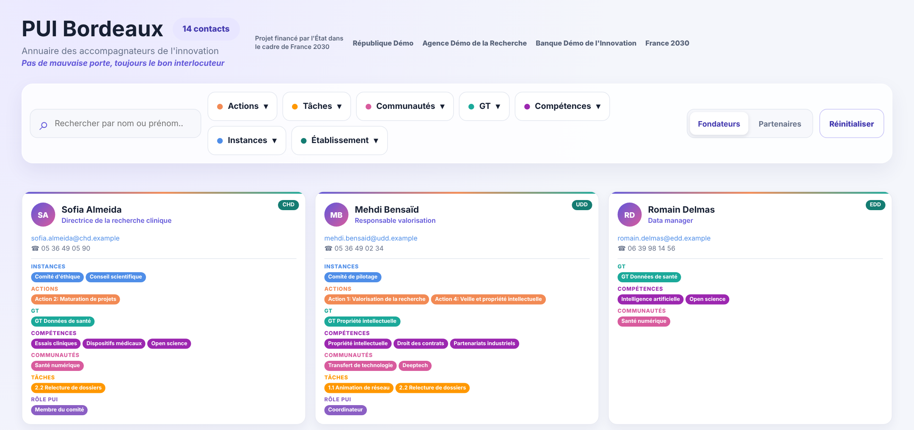
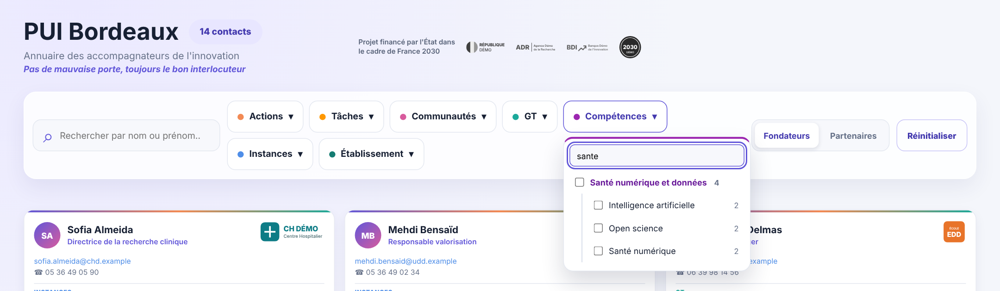
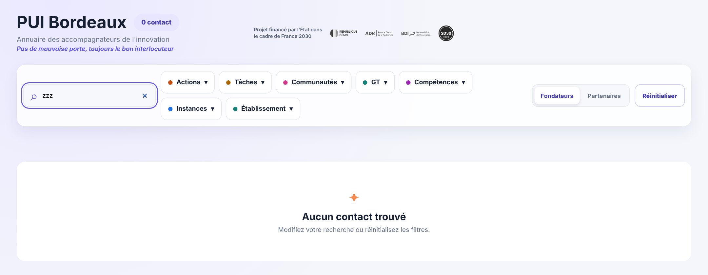
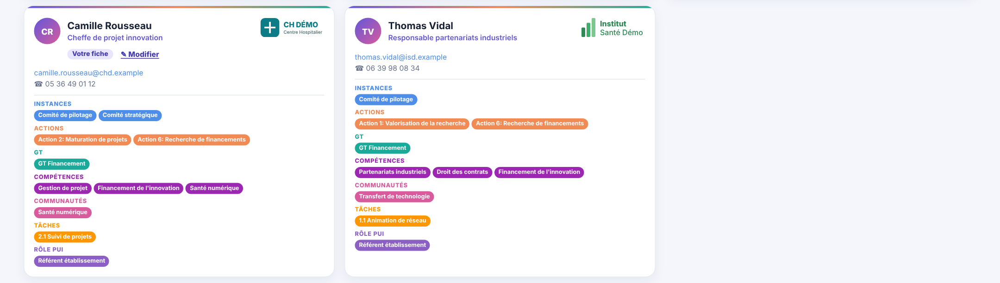
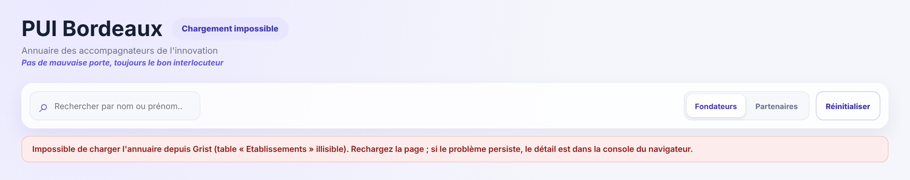

# Guide utilisateur

Ce guide s'adresse aux personnes qui consultent l'annuaire du Pôle universitaire d'innovation (PUI) de Bordeaux. Il explique comment retrouver quelqu'un, comment lire une carte, comment modifier sa propre fiche et que faire quand un contact n'apparaît pas. Toutes les captures utilisent des **données fictives** : les personnes, les établissements, les adresses et les numéros sont inventés.

Pages liées : [README](../README.md), [sécurité et confidentialité](securite.md), [maintenance](maintenance.md), [documentation développeur](developpeurs.md).

## Sommaire

- [L'annuaire en bref](#lannuaire-en-bref)
- [Lexique du PUI](#lexique-du-pui)
- [Découvrir l'écran](#découvrir-lécran)
- [Lire une carte](#lire-une-carte)
- [Les logos et le bandeau du bas](#les-logos-et-le-bandeau-du-bas)
- [Rechercher une personne](#rechercher-une-personne)
- [Filtrer](#filtrer), dont [Domaines et compétences](#domaines-et-compétences) et [Actions et tâches](#actions-et-tâches)
- [Gagner du temps : cliquer sur une étiquette](#gagner-du-temps--cliquer-sur-une-étiquette)
- [Fondateurs et Partenaires](#fondateurs-et-partenaires)
- [Réinitialiser](#réinitialiser)
- [Ma présence : apparaître ou non](#ma-présence--apparaître-ou-non)
- [Modifier ma fiche](#modifier-ma-fiche), dont [Quand l'enregistrement échoue](#quand-lenregistrement-échoue), [Pas de validation, pas d'historique](#pas-de-validation-pas-dhistorique) et [Pour les administrateurs](#pour-les-administrateurs)
- [Pourquoi une personne n'apparaît-elle pas ?](#pourquoi-une-personne-napparaît-elle-pas-)
- [Messages du bandeau rouge](#messages-du-bandeau-rouge)
- [Questions fréquentes](#questions-fréquentes)

## L'annuaire en bref

L'annuaire rassemble les accompagnateurs de l'innovation du PUI de Bordeaux. Sa promesse : *pas de mauvaise porte, toujours le bon interlocuteur*.

- Chaque personne est une **carte** : coordonnées, établissement et tout ce à quoi elle participe (instances, actions, groupes de travail ou GT, communautés, tâches, compétences, rôle).
- On retrouve quelqu'un par son **nom** ou, grâce aux **filtres**, par ce qu'il fait.
- L'annuaire porte les **logos** du PUI : celui de chaque établissement sur ses cartes, ceux des financeurs au centre de l'en-tête et ceux des établissements fondateurs dans un bandeau tout en bas ([Les logos et le bandeau du bas](#les-logos-et-le-bandeau-du-bas)).
- L'annuaire s'ouvre dans Grist et **s'adapte à la place qu'on lui donne** : trois colonnes de cartes sur un grand écran, une seule sur un téléphone ou dans un panneau étroit. Les captures de ce guide sont prises sur un grand écran.
- **Chacun décide s'il y figure.** Une personne n'apparaît que si elle a accepté d'apparaître. Si vous ouvrez l'annuaire depuis votre compte Grist et que votre fiche porte l'adresse e-mail de ce compte, un bandeau **Ma présence** vous dit où vous en êtes et vous laisse changer d'avis d'un clic ([Ma présence](#ma-présence--apparaître-ou-non)).
- **Chacun corrige sa propre fiche.** Quand l'annuaire vous reconnaît, un bouton **✎ Modifier** apparaît sur votre carte et un bouton **Modifier mon profil** dans le bandeau : vous changez votre nom, votre fonction, votre téléphone, votre rôle et vos listes, vous relisez votre carte avant et après, puis vous validez ([Modifier ma fiche](#modifier-ma-fiche)). L'enregistrement est direct : aucun administrateur ne valide et l'annuaire ne tient aucun historique. L'adresse e-mail, l'établissement et le périmètre ne se changent pas sur sa propre fiche : adressez-vous à l'administrateur des données, c'est-à-dire la personne qui gère le contenu du document Grist. Les administrateurs, eux, allument un **mode admin** pour modifier la fiche des autres, e-mail et établissement compris.

## Lexique du PUI

<!-- Les lignes « À compléter » attendent une phrase de définition, à écrire directement ici. -->

| Mot | Sens |
|---|---|
| **PUI** | Pôle universitaire d'innovation de Bordeaux |
| **GT** | Groupe de travail |
| **Établissement fondateur** | L'un des 16 établissements qui ont fondé le PUI |
| **Établissement partenaire** | Un partenaire du PUI |
| **Structure « autres »** | Une structure extérieure au PUI, qui a collaboré à certaines tâches. Son statut est « autres » : ses contacts n'apparaissent pas dans l'annuaire |
| **Domaine (compétences macro)** | Un regroupement de compétences. Le menu Compétences range les compétences par domaine ([Domaines et compétences](#domaines-et-compétences)) |
| **Action d'une tâche** | L'action dont une tâche porte le numéro : « 2.1 Suivi de projets » est une tâche de l'« Action 2 ». Le menu Tâches range les tâches par action ([Actions et tâches](#actions-et-tâches)) |
| **Accord d'apparaître** | Le choix de chaque personne de figurer ou non dans l'annuaire. Sans son accord, une personne n'apparaît pas, même si son établissement a validé son apparition |
| **Instances** | *À compléter* |
| **Actions** | *À compléter* |
| **Communautés** | *À compléter* |
| **Tâches** | *À compléter* |
| **Rôle PUI** | *À compléter* |
| **Périmètre** | *À compléter.* Pour qu'une personne apparaisse, au moins un périmètre doit être renseigné (colonne `perimetre`) |

## Découvrir l'écran

| Élément | À quoi il sert |
|---|---|
| **Titre et compteur** (en haut à gauche, « PUI Bordeaux » et « 14 contacts ») | Le compteur indique combien de cartes sont affichées avec la recherche et les filtres actuels |
| **Financeurs** (au centre de l'en-tête) | La phrase de financement et les logos des financeurs ([Les logos](#les-logos-et-le-bandeau-du-bas)) |
| **Bandeau « Ma présence »** (à droite de l'en-tête, seulement si l'annuaire vous reconnaît) | Dit si vous apparaissez et vous laisse changer d'avis ([Ma présence](#ma-présence--apparaître-ou-non)). Son bouton **Modifier mon profil** ouvre le formulaire de votre fiche ([Modifier ma fiche](#modifier-ma-fiche)). Les administrateurs y trouvent aussi le bouton **Mode admin** ([Pour les administrateurs](#pour-les-administrateurs)). Si aucune fiche ne porte l'adresse de votre compte, il le dit et n'a ni interrupteur ni bouton « Modifier mon profil » |
| **Rechercher par nom ou prénom** | Cherche une personne par son nom ou son prénom |
| **Actions, Tâches, Communautés, GT, Compétences, Instances, Établissement** | Sept filtres : chaque bouton ouvre un menu de valeurs à cocher. Le menu **Compétences** range ses valeurs par domaine, et le menu **Tâches** par action |
| **Fondateurs / Partenaires** | Choisit les établissements affichés, selon leur statut |
| **Réinitialiser** | Efface la recherche et décoche tous les filtres |
| **Cartes** | Une carte par personne, trois par ligne, triées par nom de famille puis par prénom (ordre alphabétique) |
| **Bandeau des fondateurs** (tout en bas de la page, sous les cartes) | Les logos des établissements fondateurs, le rond « France 2030 » et la phrase de financement ([Les logos](#les-logos-et-le-bandeau-du-bas)) |
| **Bouton « ✎ Modifier »** et mention **« Votre fiche »** (sous la fonction d'une carte, seulement si vous pouvez modifier cette fiche ; un administrateur en mode admin lit « ✎ Modifier la fiche » sur les cartes des autres) | Ouvre le formulaire de modification de la fiche ([Modifier ma fiche](#modifier-ma-fiche)). La capture ci-dessus est celle d'un annuaire consulté sans être reconnu : elle n'a ni bandeau ni bouton |

## Lire une carte

1. **Initiales** de la personne.
2. **Prénom et nom** de la personne.
3. **Fonction**, si elle est renseignée.
4. **Établissement** (en haut à droite) : son logo, seul, ou sa pastille s'il n'a pas de logo dans Grist ([Les logos](#les-logos-et-le-bandeau-du-bas)). Un clic filtre sur cet établissement.
5. **Adresse e-mail** : c'est un lien, et un clic ouvre un nouveau message dans votre messagerie, si votre navigateur le permet. Une adresse saisie sous une forme inhabituelle (plusieurs destinataires, paramètres) reste affichée en texte, sans lien.
6. **Téléphone**, s'il est renseigné, présenté par paires de chiffres.
7. **Titres de section** : Instances, Actions, GT, Compétences, Communautés, Tâches, Rôle PUI. Une section n'apparaît que si la personne y a au moins une valeur.
8. **Étiquettes colorées** : un clic filtre sur cette valeur (voir [Gagner du temps](#gagner-du-temps--cliquer-sur-une-étiquette)).
9. **Rôle PUI** : affiché, mais sans filtre associé, donc non cliquable.

Sur une carte que vous pouvez modifier, une ligne s'ajoute sous la fonction : la mention **Votre fiche** (sur la vôtre) et le bouton **✎ Modifier** ([Modifier ma fiche](#modifier-ma-fiche)) ; sur la carte d'une autre personne, un administrateur en mode admin lit **✎ Modifier la fiche**.

Une information absente n'est pas remplacée par une ligne vide : elle n'apparaît simplement pas. Les **domaines** de compétences et les **actions des tâches** ne figurent pas sur la carte, qui garde le détail des compétences et des tâches : ils rangent les menus Compétences et Tâches et permettent de filtrer par domaine ou par action (voir [Domaines et compétences](#domaines-et-compétences) et [Actions et tâches](#actions-et-tâches)).

## Les logos et le bandeau du bas

Le PUI est le consortium de tous ses établissements fondateurs : il n'a pas d'identité graphique propre, ce sont **leurs logos** qui l'habillent. Ils viennent du document Grist, il n'y a rien à installer.

- **Au centre de l'en-tête : les financeurs.** La phrase « Projet financé par l'État dans le cadre de France 2030 » et les logos des financeurs, dans l'ordre choisi dans Grist. Discrets (affichés en niveaux de gris), ils ne sont pas cliquables.
- **Sur chaque carte : le logo de l'établissement**, en haut à droite, **seul**, sans le nom dessous. Un clic dessus filtre sur cet établissement, comme la pastille avant lui ([Gagner du temps](#gagner-du-temps--cliquer-sur-une-étiquette)). Le nom de l'établissement ne s'affiche, dans une pastille, que lorsque Grist n'a pas de logo pour lui.
- **Tout en bas : le bandeau des fondateurs.** Les logos des établissements fondateurs qui ont validé leur apparition, dans l'ordre choisi dans Grist, puis le rond « France 2030 » et une phrase de financement dont le nom du Pôle universitaire d'innovation Bordeaux est un lien vers la page du projet. En survolant un logo, on lit le nom complet de l'établissement.

Les logos de toutes ces captures sont **inventés**, comme le reste du jeu de démonstration.

**Quand un logo manque.** Le nom prend sa place : l'acronyme dans la pastille des cartes, le nom de la structure dans le bandeau du bas et chez les financeurs. L'annuaire reste utilisable. Cela arrive quand le fichier n'a pas été ajouté dans Grist, quand il a été supprimé ou n'est pas une image lisible, ou quand Grist ne donne pas accès aux pièces jointes : ce dernier cas touche **tous** les logos à la fois.

Un logo absent ou mal affiché se corrige dans Grist, par l'administrateur des données ([`GRIST_SETUP.md`](../GRIST_SETUP.md), étape 5, et [maintenance](maintenance.md#les-logos-et-le-bandeau-du-bas)). Les tables de logos ne préviennent pas l'annuaire quand on les modifie : après un changement de logo, rechargez la page.

## Rechercher une personne

Tapez dans **Rechercher par nom ou prénom…** : les cartes se mettent à jour dès que vous marquez une courte pause dans la frappe (une fraction de seconde), et réapparaissent toutes aussitôt que vous videz le champ.

- La recherche ignore les **majuscules** et les **accents** : « elise » trouve « Élise ».
- Elle porte sur le **prénom et le nom**, pas sur la fonction ni sur l'établissement (pour l'établissement, utilisez le filtre Établissement). Tapez l'un, l'autre ou les deux, dans l'ordre que vous voulez : « Élise », « Marchetti », « Élise Marchetti » et « Marchetti Élise » trouvent tous la carte, et quelques lettres de chaque mot suffisent (« eli mar »). Chaque mot tapé doit se trouver dans le prénom ou dans le nom : « Élise Garnier » ne trouve personne si nul ne porte ces deux mots.
- Les **tirets, les apostrophes et les points** ne comptent pas, et « œ » s'écrit comme on le tape : « marie christine » trouve « Marie-Christine », « darcy » trouve « D'Arcy » et « coeur » trouve « Cœur ».
- Elle se combine avec les filtres : seules les personnes qui satisfont les deux restent affichées.
- **Réinitialiser** vide le champ.

## Filtrer

Un clic sur un bouton de filtre ouvre son menu ; ouvrir un menu referme les autres, et un clic en dehors le referme.

- **Cochez** une ou plusieurs valeurs : les cartes se mettent à jour immédiatement.
- Dans un **même** menu, les valeurs s'additionnent (**ou**) : cocher deux instances affiche les personnes qui sont dans l'une *ou* l'autre.
- Entre **plusieurs** menus, les critères se cumulent (**et**) : cocher une instance et un établissement ne garde que les personnes qui ont les deux.
- Le **nombre à droite** de chaque option est le nombre de cartes qui portent cette valeur, compte tenu de la recherche, des interrupteurs et des autres menus (pas du menu lui-même). Cocher une valeur de plus **ajoute** donc ses cartes à celles déjà affichées. Une option à **0** n'a aucune carte avec le reste des critères : par exemple, un établissement partenaire tant que Partenaires est désactivé.
- Le **champ de recherche** en haut du menu réduit la liste d'options (sans tenir compte des accents ni des majuscules). Il ne coche rien.
- Les valeurs cochées **remontent en tête** du menu, et un **chiffre** sur le bouton indique combien de valeurs sont cochées.

Ici, la communauté « Santé numérique » **et** l'établissement « CHD » sont cochés : seules les trois personnes du CHD qui font partie de la communauté Santé numérique restent affichées, et le compteur passe à « 3 contacts ».

### Domaines et compétences

Le menu **Compétences** range les compétences par **domaine** (on parle aussi de *compétences macro*) et se cherche à deux niveaux : par domaine, quand on ne connaît pas chaque compétence, ou par compétence, quand on sait laquelle on veut. Un seul bouton sert aux deux : il n'y a pas de filtre « Domaines » à part.

- Chaque ligne en violet est un **domaine**. Le nombre à sa droite est celui des cartes qui ont **au moins une compétence** dans ce domaine : une personne qui en a deux n'est comptée qu'une fois.
- **Cocher un domaine** coche d'un coup toutes ses compétences : les personnes qui ont l'une d'elles restent affichées, sans avoir à connaître chacune.
- La **flèche** à droite d'un domaine déplie ses compétences. Cochez-en une, et la case du domaine passe à moitié cochée (un tiret) : seules les personnes qui ont cette compétence comptent. Un clic sur la case d'un domaine à moitié coché le complète, un clic de plus décoche tout.
- Tout s'additionne (**ou**), comme dans tout menu : avec « Recherche clinique » et « Open science » cochés, on voit les personnes de l'un ou de l'autre. Le chiffre du bouton compte un domaine coché en entier pour **un**, quel que soit le nombre de ses compétences.
- Les domaines et les compétences cochés **remontent en tête** quand on rouvre le menu, et un domaine coché en partie s'ouvre de lui-même, pour montrer lesquelles.
- Une compétence dont le domaine n'est pas renseigné dans Grist est rangée sous **Autres**, en fin de liste : ses personnes restent ainsi trouvables.

**La recherche du menu trouve un domaine comme une compétence.** Tapez quelques lettres, sans souci des accents ni des majuscules : le menu ne garde que ce qui correspond, et déplie les domaines concernés.

- Si le mot figure dans le **nom d'un domaine**, le domaine reste avec **toutes** ses compétences : « sante » garde « Santé numérique et données » et ses trois compétences, dont deux ne contiennent pas le mot.
- Si le mot figure dans le **nom d'une compétence**, elle reste sous son domaine : « contrat » garde « Droit des contrats » sous « Valorisation et partenariats », sans les autres compétences du domaine.
- La recherche ne coche rien : il faut cocher ensuite. Videz le champ pour retrouver la liste complète.

### Actions et tâches

Le menu **Tâches** range lui aussi ses valeurs par groupe, ici par **action**. Il fonctionne comme le menu Compétences ([Domaines et compétences](#domaines-et-compétences)) : par action, quand on ne connaît pas chaque tâche, ou par tâche, quand on sait laquelle on veut. Un seul bouton sert aux deux.

- Chaque ligne en brun orangé est une **action**. Le nombre à sa droite est celui des cartes qui ont **au moins une tâche** de cette action : une personne qui en a deux n'est comptée qu'une fois.
- **Cocher une action** coche d'un coup toutes ses tâches. La **flèche** déplie ses tâches : cochez-en une, et la case de l'action passe à moitié cochée (un tiret). Un clic sur la case d'une action à moitié cochée la complète, un clic de plus décoche tout.
- Tout s'additionne (**ou**) : avec « Action 2 » et « 1.1 Animation de réseau » cochées, on voit les personnes de l'une ou de l'autre. Le chiffre du bouton compte une action cochée en entier pour **un**, quel que soit le nombre de ses tâches.
- **Le numéro d'une tâche donne son action.** Une tâche dont le libellé commence par « 2.1 » est rangée sous l'action dont le libellé commence par « Action 2 » : le chiffre avant le point est celui de l'action.
- Une tâche sans numéro, ou dont le numéro ne correspond à aucune action, est rangée sous **Sans action**, en fin de liste : ses personnes restent ainsi trouvables. Une action qui n'a aucune tâche ne figure pas dans le menu.
- Si aucune tâche ne peut être rangée (aucune n'a de numéro, ou aucun de ces numéros n'est celui d'une action), le menu reste une simple liste de tâches, sans actions.

**La recherche du menu trouve une action comme une tâche, et un numéro aussi.** Elle se comporte comme celle du menu Compétences : le nom d'une action garde l'action avec **toutes** ses tâches, le nom d'une tâche garde cette tâche sous son action, et « 2.1 » retrouve la tâche qui porte ce numéro.

**Le filtre Actions ne change pas.** Il reste la liste de toutes les actions, avec le nombre de cartes de chacune, et se cumule (**et**) avec le menu Tâches : cocher une action dans le menu Tâches ne coche pas le filtre Actions, et inversement. Les deux ne disent pas la même chose : le filtre Actions retrouve les personnes qui participent à une action, le menu Tâches celles qui ont une tâche de cette action.

## Gagner du temps : cliquer sur une étiquette

Cliquer sur une étiquette de carte, sur le logo ou la pastille d'établissement **coche le filtre correspondant** ; cliquer à nouveau le décoche. C'est le même résultat que cocher la case dans le menu, sans l'ouvrir.

Seul le **Rôle PUI** n'est pas cliquable : il s'affiche mais n'a pas de filtre.

## Fondateurs et Partenaires

Deux interrupteurs choisissent les établissements dont les contacts sont affichés, selon leur statut : fondateur du PUI ou partenaire (voir le [lexique](#lexique-du-pui)).

- Au départ, **Fondateurs** est activé et **Partenaires** ne l'est pas : vous voyez les personnes des établissements fondateurs.
- Activez **Partenaires** pour ajouter celles des établissements partenaires. Désactivez **Fondateurs** pour ne voir que les partenaires.
- Si vous désactivez les deux, aucune carte ne s'affiche : réactivez-en au moins un.
- **Réinitialiser** ne touche pas à ces interrupteurs : votre choix reste en place jusqu'à ce que vous le changiez ou que vous rechargiez la page, qui rétablit l'état de départ (Fondateurs activé, Partenaires désactivé).

## Réinitialiser

Le bouton **Réinitialiser** efface la recherche, décoche tous les filtres et vide les champs de recherche des menus. Il laisse en l'état les interrupteurs Fondateurs et Partenaires.

Quand rien ne correspond, l'annuaire affiche « Aucun contact trouvé » : modifiez la recherche ou réinitialisez les filtres.

## Ma présence : apparaître ou non

Chaque personne décide elle-même si elle figure dans l'annuaire. Une personne n'apparaît que si elle a **accepté d'apparaître** et si son établissement a validé son apparition (voir [Pourquoi une personne n'apparaît-elle pas ?](#pourquoi-une-personne-napparaît-elle-pas-)).

Si vous ouvrez l'annuaire depuis votre compte Grist et que votre fiche porte l'adresse e-mail de ce compte, un bandeau **Ma présence** s'affiche à droite de l'en-tête. Il porte votre nom, une phrase qui dit où vous en êtes, un interrupteur et, quand une seule fiche porte votre adresse, le bouton **Modifier mon profil** ([Modifier ma fiche](#modifier-ma-fiche)). Si vous êtes administrateur, le bouton **Mode admin** s'y ajoute ([Pour les administrateurs](#pour-les-administrateurs)).

**Changer d'avis.** Cliquez sur l'interrupteur « Apparaître dans l'annuaire ». S'il était activé, il se désactive : votre carte disparaît de l'annuaire et le compteur perd une unité. S'il était désactivé, il s'active et votre carte revient, si rien d'autre ne vous masque. Pendant l'enregistrement, l'interrupteur est gelé et le bandeau indique « Enregistrement… » ; l'annuaire est ensuite relu, si bien que ce que vous voyez est ce que Grist a vraiment enregistré.

**Ce que dit le bandeau**

| Message | Ce que cela veut dire | Que faire |
|---|---|---|
| « Vous apparaissez dans l'annuaire. » | Vous avez donné votre accord et rien ne vous masque | Rien. Désactivez l'interrupteur pour vous retirer |
| « Vous apparaissez dans l'annuaire (visible avec l'interrupteur « Partenaires »). » | Votre établissement est partenaire : votre carte s'affiche quand **Partenaires** est activé | Rien |
| « Vous n'apparaissez pas dans l'annuaire. » | Vous n'avez pas donné votre accord, ou vous l'avez retiré | Activez l'interrupteur pour apparaître |
| « Vous avez accepté d'apparaître, mais votre fiche reste masquée : … Contactez un administrateur. » | Votre accord est donné, mais une autre condition manque. La raison suit les deux-points (voir plus bas) | Transmettez le message à l'administrateur des données : cela se corrige dans Grist |
| « Vous n'avez accepté d'apparaître que sur une partie de vos fiches. » | Plusieurs fiches portent votre adresse, et seules certaines ont votre accord | Un clic sur l'interrupteur donne votre accord à toutes ; prévenez l'administrateur des données pour qu'il supprime les doublons |
| « 2 fiches portent votre adresse : votre choix s'applique à toutes. » | Plusieurs fiches portent votre adresse (le chiffre varie). Votre choix, dans un sens comme dans l'autre, vaut pour chacune | Prévenez l'administrateur des données pour qu'il supprime les doublons |
| « Connecté avec … : cette adresse ne figure pas dans l'annuaire, il n'y a donc pas de fiche à modifier. » (titre « Compte absent de l'annuaire ») | Aucune fiche ne porte l'adresse de votre compte Grist : le bandeau n'a ni interrupteur ni bouton « Modifier mon profil ». Un administrateur y lit « Administrateur » et garde son bouton **Mode admin** | Rien, si vous n'avez pas de fiche. Sinon, prévenez l'administrateur des données : l'adresse de votre fiche n'est pas celle de votre compte |
| « Le widget ne peut pas retrouver votre fiche : la colonne « email » n'existe pas dans BDD. Contactez un administrateur. » (titre « Fiche introuvable ») | La table `BDD` du document n'a pas de colonne `email` : l'annuaire ne peut relier personne à sa fiche | Prévenez l'administrateur des données : c'est un réglage du document Grist |

Quand votre fiche reste masquée alors que vous avez accepté d'apparaître, le message donne la ou les raisons, séparées par des points-virgules :

- « votre fiche n'a ni prénom ni nom » ;
- « votre fiche n'a pas de périmètre » ;
- « votre fiche n'a pas d'établissement » ;
- « votre établissement n'est pas reconnu » ;
- « votre établissement n'a pas encore été validé » ;
- « votre établissement n'est ni fondateur ni partenaire » (une structure « autres »).

**Quand l'enregistrement échoue.** L'interrupteur reste dans son état réel et rien n'a changé. Le message s'affiche sous le bandeau :

| Message | Ce que cela veut dire | Que faire |
|---|---|---|
| « Grist a refusé la modification : vos droits ne permettent pas de changer cette information. Contactez un administrateur. » | Les droits de votre compte ne vous permettent pas de modifier votre fiche | Contactez l'administrateur des données |
| « Modification enregistrée ; l'annuaire n'a pas pu être rechargé. » | Votre choix est bien enregistré, mais l'annuaire n'a pas pu être relu | Rechargez la page |
| « La modification n'a pas pu être enregistrée. Réessayez ; si le problème persiste, le détail est dans la console du navigateur. » | Une panne passagère, ou un réglage à revoir | Réessayez ; si cela persiste, prévenez l'administrateur des données |
| « La colonne Accepte_apparaitre est une colonne à formule : elle doit être une colonne de données (case à cocher). Voir GRIST_SETUP.md. » | Un réglage du document Grist est à revoir | Prévenez l'administrateur des données |

**Ce que l'interrupteur change, et ce qu'il ne change pas**

- Il ne change que **votre accord d'apparaître**, sur **votre** fiche. Pour corriger une autre information (fonction, téléphone, listes…), utilisez [Modifier ma fiche](#modifier-ma-fiche). Pour l'adresse e-mail, l'établissement et le périmètre, adressez-vous à l'administrateur des données.
- Vous retirer **masque** votre carte, cela **n'efface pas** vos données : elles restent dans le document Grist, lisibles par les personnes qui y ont accès. Pour demander leur suppression, adressez-vous à l'administrateur des données.
- Vous pouvez changer d'avis à tout moment. Personne ne devrait changer votre choix à votre place : le formulaire de modification ne le touche jamais, et un administrateur ne coche votre case, dans Grist, qu'avec votre accord.

**Pas de bandeau ?** C'est normal quand l'annuaire ne peut pas vous reconnaître : vous n'êtes pas connecté à Grist, votre compte ne peut que consulter le document (rôle Lecteur), ou l'annuaire n'a pas encore été réglé pour cela. L'annuaire s'affiche alors comme d'habitude, sans bandeau ni bouton « Modifier mon profil » (voir la question **Pourquoi n'ai-je pas de bouton Modifier ?** des [Questions fréquentes](#questions-fréquentes)). Pour apparaître ou ne plus apparaître, ou pour corriger votre fiche, adressez-vous à l'administrateur des données.

**Un bandeau sans interrupteur ?** C'est le cas quand l'annuaire reconnaît votre compte mais qu'aucune fiche ne porte son adresse : le bandeau s'intitule « Compte absent de l'annuaire » et dit « Connecté avec … : cette adresse ne figure pas dans l'annuaire, il n'y a donc pas de fiche à modifier. » Il n'a ni interrupteur ni bouton « Modifier mon profil ». Si vous pensez avoir une fiche, son adresse n'est sans doute pas celle de votre compte : prévenez l'administrateur des données. Un administrateur y lit « Administrateur » et garde son bouton **Mode admin**. Si la table `BDD` n'a pas de colonne `email`, le bandeau s'intitule « Fiche introuvable » et dit que le widget ne peut pas retrouver votre fiche : c'est un réglage du document Grist, à signaler à l'administrateur des données.

## Modifier ma fiche

Vous pouvez corriger vous-même votre fiche : votre nom, votre fonction, votre téléphone, votre rôle dans le PUI et les listes qui forment votre carte (instances, actions, GT, compétences, communautés, tâches). Les modifications **s'appliquent directement** dans Grist : aucun administrateur ne les valide et l'annuaire n'en tient aucun historique ([Pas de validation, pas d'historique](#pas-de-validation-pas-dhistorique)). Mais rien n'est écrit avant une **relecture** : une fenêtre vous montre votre carte **Avant** et votre carte **Après**, avec ce qui change repéré, et c'est vous qui cliquez sur « Valider ».

### Où cliquer

*Où cliquer : sur la carte de la personne connectée, la mention « Votre fiche » et le bouton « ✎ Modifier » sous la fonction (les cartes étant triées par nom, celle de Camille Rousseau est ici sur la dernière rangée). Les autres cartes n'ont pas de bouton. Quant au bouton « Modifier mon profil », c'est celui du bandeau « Ma présence », en haut à droite de la page ([Ma présence](#ma-présence--apparaître-ou-non)).*

- **Sur une carte.** Le bouton **✎ Modifier** se trouve sous la fonction, sur les cartes que vous avez le droit de modifier. Sur la vôtre, la mention **Votre fiche** l'accompagne. Un administrateur qui a allumé son mode admin a un bouton sur toutes les cartes affichées ([Pour les administrateurs](#pour-les-administrateurs)).
- **Dans le bandeau « Ma présence ».** Le bouton **Modifier mon profil** ouvre le même formulaire. Il est proposé même si votre carte n'apparaît pas dans l'annuaire (par exemple parce que vous avez retiré votre accord d'apparaître) : c'est alors le seul moyen d'ouvrir votre fiche. Si plusieurs fiches portent votre adresse, le bandeau ne le propose pas, car il ne saurait pas laquelle ouvrir : chaque carte garde alors son propre bouton.
- **Pas de bouton ?** C'est normal quand l'annuaire ne peut pas vous reconnaître (vous n'êtes pas connecté à Grist, votre compte ne peut que consulter le document, l'annuaire n'a pas été réglé pour cela) ou quand l'adresse de votre compte ne figure sur aucune fiche. Voir la question **Pourquoi n'ai-je pas de bouton Modifier ?** des [Questions fréquentes](#questions-fréquentes).

### Ce qu'on peut changer, et ce qu'on ne peut pas

| Information | Dans ce formulaire ? |
|---|---|
| Prénom, nom, fonction, téléphone | Oui, en saisissant le texte |
| Rôle dans le PUI | Oui, dans une liste déroulante (une valeur, ou « Non renseigné ») |
| Instances, Actions, GT, Compétences, Communautés, Tâches | Oui, en cochant ou en décochant des pastilles. Les compétences sont rangées par domaine et les tâches par action, mais seules les compétences et les tâches se cochent |
| Adresse e-mail | **Non, pas sur votre propre fiche** : c'est elle qui relie votre compte à votre fiche. Un administrateur la change sur la fiche d'une autre personne, avec le mode admin ([Pour les administrateurs](#pour-les-administrateurs)) ; sinon c'est à l'administrateur des données de la corriger dans Grist |
| Établissement | **Non, pas sur votre propre fiche** : il décide de qui apparaît dans l'annuaire. Même règle que pour l'adresse e-mail |
| Périmètre | **Non** : à demander à l'administrateur des données |
| Le choix d'apparaître | **Non**, pas ici : c'est l'interrupteur « Apparaître dans l'annuaire » du bandeau [Ma présence](#ma-présence--apparaître-ou-non) |

### Remplir le formulaire

*Le formulaire de modification : l'identité verrouillée, les champs de texte, le rôle et les six listes à cocher (la fenêtre défile pour atteindre les dernières). Le pied de fenêtre compte les champs modifiés.*

Le formulaire s'ouvre avec les valeurs actuelles de la fiche. Sous le titre, une phrase rappelle ce qui va se passer : « Vous relisez vos modifications avant de les valider : elles s’appliquent ensuite tout de suite à votre fiche. » En haut, un bloc rappelle qui vous êtes (initiales, nom, adresse, et à droite l'établissement : son logo, ou sa pastille (son sigle) quand il n'a pas de logo ou que son fichier ne se charge pas) et ce qui est verrouillé : « Verrouillé : l’e-mail et l’établissement sont liés à votre compte. Pour les corriger, contactez un administrateur. » (Un administrateur qui ouvre sa propre fiche lit « Verrouillé sur votre propre fiche : l’e-mail et l’établissement sont liés à votre compte. ») Dessous :

- **Prénom, Nom, Fonction, Téléphone** : des zones de texte.
- **Rôle dans le PUI** : une liste déroulante.
- **Instances, Actions, GT, Compétences, Communautés, Tâches** : toutes les valeurs que Grist propose, en pastilles. Un clic coche ou décoche une pastille, et chaque liste dit combien de valeurs sont sélectionnées. Au-delà de douze valeurs, une zone de recherche aide à retrouver une pastille.
- **Ce qui va changer** : sous les listes, un encadré apparaît dès que vous modifiez quelque chose et dit, champ par champ, ce qui change.

**Les règles de saisie**

- Dans un **texte** (prénom, nom, fonction), les retours à la ligne et les espaces en trop sont retirés. Un texte ne peut pas commencer par = + - ou @ (un tableur y verrait une formule) ni dépasser 200 caractères.
- **Prénom et nom** : l'un des deux au moins doit rester renseigné.
- **Téléphone** : un numéro français à 10 chiffres, écrit comme vous voulez : « 05 56 78 90 12 », « 05.56.78.90.12 », « 0556789012 », « +33 5 56 78 90 12 » ou « 0033 5 56 78 90 12 ». Quand vous quittez le champ, un numéro valide est remis en forme (« 05 56 78 90 12 »). Pour effacer le numéro, videz le champ.
- Un champ laissé tel quel n'est pas une modification.

Un champ refusé est signalé sous le champ :

| Message sous le champ | Pourquoi |
|---|---|
| « Ne peut pas commencer par = + - ou @. » | Le texte commence par l'un de ces signes |
| « 200 caractères au plus. » | Le texte dépasse 200 caractères |
| « Un numéro français compte 10 chiffres, par exemple 05 56 78 90 12. » | Le téléphone n'est pas un numéro français à 10 chiffres |
| « Indiquez au moins un prénom ou un nom. » | Le prénom et le nom seraient tous deux vides (le message s'affiche sous le ou les champs que vous avez vidés) |

En bas de la fenêtre, un résumé dit où vous en êtes : « Aucune modification », le nombre de champs modifiés (par exemple : 2 champs modifiés) ou ce qu'il faut corriger : « Indiquez au moins un prénom ou un nom », « Corrigez le numéro de téléphone » ou « Corrigez les champs signalés ». Le bouton **Relire mes modifications** reste grisé tant qu'il n'y a rien à relire ou qu'un champ est refusé.

### Relire avant d'enregistrer

*La relecture : une légende rappelle les repères, puis la carte « Avant », la carte « Après » avec ce qui change repéré, et le « Détail des changements ».*

Cliquez sur **Relire mes modifications**. Le bouton indique « Préparation… » le temps que l'annuaire relise la fiche dans Grist ; **rien n'est écrit**. La fenêtre « Relire avant de valider » montre deux cartes côte à côte (l'une sous l'autre sur un écran étroit) :

- **Avant**, « telle qu’elle est aujourd’hui » : la fiche telle qu'elle est maintenant dans Grist ;
- **Après**, « telle qu’elle apparaîtra » : exactement ce qui sera écrit, présenté comme l'annuaire l'affichera ensuite.

Une légende au-dessus des cartes rappelle les repères : « ajouté ou modifié : contour vert et pastille » et « retiré : barré en rouge ». Dans la carte « Après », ce qui change est repéré, et jamais par la seule couleur :

- une ligne de texte modifiée (nom, fonction, téléphone, adresse e-mail) est mise en relief en vert, avec la pastille **modifié** ; si la ligne était vide, la pastille dit **ajouté** ;
- une ligne vidée garde son ancienne valeur, barrée, avec la pastille **supprimé** ;
- un établissement changé (c'est l'affaire d'un administrateur) voit son badge entouré d'un anneau, avec la pastille **modifié** dessous ;
- une étiquette ajoutée est entourée d'un anneau et porte un **+** ; une étiquette retirée reste visible, barrée sur un fond rouge pâle et précédée d'un −. Les lecteurs d'écran entendent « ajouté » ou « retiré » après chaque étiquette.

Sous les cartes, le **Détail des changements** donne une ligne par champ modifié. Pour un texte, un téléphone, le rôle ou l'établissement : l'ancienne valeur barrée, une flèche, puis la nouvelle (« non renseigné » si le champ était vide, « supprimé » s'il est vidé). Pour une liste : les valeurs ajoutées (+) et retirées (−).

**Si la fiche ne figure pas dans l'annuaire.** La carte « Après » n'est pas une promesse que la carte sera visible. Quand la fiche reste hors de l'annuaire, un avis le dit en haut de la relecture, avec la raison. Par exemple : « Votre fiche est masquée de l’annuaire : vous n’avez pas accepté d’apparaître (interrupteur en haut de page). » Ou, si vous avez accepté d'apparaître mais que l'établissement n'a pas validé sa présence : « Votre établissement n’a pas validé sa présence : votre fiche reste masquée dans l’annuaire. » Les raisons possibles sont celles du bandeau [Ma présence](#ma-présence--apparaître-ou-non). Vos modifications s'enregistrent quand même : la carte apparaîtra quand rien d'autre ne la masquera plus.

### Valider, revenir en arrière ou abandonner

*Après « Valider » : la fenêtre se ferme, la carte est à jour et un message confirme l'enregistrement.*

- **Valider** écrit les modifications dans Grist. Pendant l'écriture, le bouton indique « Enregistrement… » et « Retour » comme la croix ✕ sont grisés : un double clic n'écrit qu'une fois. L'annuaire est ensuite relu, ce qui met la carte à jour, la fenêtre se ferme et un message est posé en bas de l'écran : « Vos modifications sont enregistrées. » (pour la fiche d'une autre personne : « La fiche de … est enregistrée. »). Il disparaît de lui-même au bout de quelques secondes ; les lecteurs d'écran l'annoncent. La fenêtre ne reste ouverte, sur l'écran **Fiche enregistrée**, que si quelque chose reste à lire : Grist n'a pas tout gardé, ou l'annuaire n'a pas pu se recharger ([Quand l'enregistrement échoue](#quand-lenregistrement-échoue)).
- **Retour** ramène au formulaire avec votre brouillon intact : vous pouvez continuer à le modifier.
- **Annuler** (sur le formulaire) et la croix **✕** ferment la fenêtre tout de suite, sans rien enregistrer.
- **Échap** prévient avant d'abandonner : s'il y a des modifications non enregistrées, un premier appui affiche « Des modifications ne sont pas enregistrées. Appuyez encore sur Échap pour les abandonner. » et un second ferme la fenêtre. Sans modification, Échap ferme tout de suite. Pendant l'enregistrement, Échap ne ferme rien.
- **Sur un téléphone** ou dans un panneau étroit, la fenêtre occupe l'écran et les deux cartes sont l'une sous l'autre. Cet affichage a été vérifié dans un navigateur de bureau, dans des cadres de 280, 320 et 360 px de large, pas encore sur un téléphone.

### Si quelqu'un a modifié la même fiche entre-temps

L'annuaire relit la fiche dans Grist à deux moments : quand vous cliquez sur « Relire mes modifications », puis juste avant d'écrire.

- **Avant la relecture.** Si une information que vous modifiez a changé dans Grist depuis l'ouverture de la fenêtre, un avis le dit (« Ces informations ont changé dans Grist depuis l'ouverture de la fenêtre : … », suivi du nom des champs), et la carte « Avant » montre leur état actuel.
- **Pendant que vous relisez.** Si les champs que vous modifiez ont changé dans Grist depuis la relecture, **rien n'est écrit**. La fenêtre revient à la relecture avec ce que Grist contient maintenant et l'avis « La fiche a changé dans Grist pendant la relecture. Relisez ce qui suit, puis validez à nouveau. » Relisez, puis cliquez de nouveau sur « Valider ».
- **Les autres champs ne sont jamais écrasés.** Ce que quelqu'un d'autre a changé dans des champs que vous n'avez pas touchés est conservé. Pour une liste, l'annuaire ne fait que retirer et ajouter ce que vous avez décoché et coché : une étiquette ajoutée entre-temps par une autre personne n'est pas perdue.

### Quand l'enregistrement échoue

Un échec n'est jamais muet : un message apparaît en haut de la fenêtre. Pour les neuf premiers messages du tableau, **rien n'a été modifié** et votre brouillon reste dans la fenêtre : vous pouvez réessayer, ou cliquer sur « Retour ». Pour les deux derniers, l'enregistrement a bien eu lieu : la fenêtre reste alors ouverte sur l'écran **Fiche enregistrée** (« Vos modifications sont enregistrées », ou « La fiche de … est enregistrée » pour la fiche d'une autre personne, puis « Elles s'appliquent tout de suite dans Grist, sans validation. » et la liste **Ce qui a changé**), sans le message de confirmation, avec un bouton « Fermer ».

| Message | Ce que cela veut dire | Que faire |
|---|---|---|
| « La fiche n'a pas pu être relue dans Grist : rien n'a été modifié. Réessayez ; si le problème persiste, le détail est dans la console du navigateur. » | Grist n'a pas répondu quand l'annuaire a voulu relire la fiche, à la relecture ou au moment de « Valider » | Réessayez ; si cela persiste, prévenez l'administrateur des données |
| « Cette fiche n'existe plus dans Grist : rien n'a été modifié. » | La fiche a été supprimée pendant que vous la modifiiez | Fermez la fenêtre, rechargez la page et prévenez l'administrateur des données |
| « Grist a refusé la modification : vos droits ne permettent pas de changer cette fiche. Contactez un administrateur. » | Une règle d'accès de Grist refuse l'écriture sur cette fiche. La relecture reste ouverte | Contactez l'administrateur des données |
| « Une colonne de la fiche est une colonne à formule : elle ne peut pas être modifiée depuis le widget. Voir GRIST_SETUP.md. » | Un réglage du document Grist est à revoir | Prévenez l'administrateur des données |
| « La modification n'a pas pu être enregistrée. Réessayez ; si le problème persiste, le détail est dans la console du navigateur. » | Une panne passagère, ou un réglage à revoir | Réessayez ; si cela persiste, prévenez l'administrateur des données |
| « Ces modifications sont déjà dans la fiche : il n'y a rien à enregistrer. » | Quelqu'un a déjà enregistré les mêmes valeurs | Rien à faire : fermez la fenêtre |
| « Ces modifications ne peuvent pas être enregistrées : … » | La suite du message dit pourquoi : par exemple une liste de la fiche contient autre chose que des identifiants de ligne, ou la fiche n'aurait plus ni prénom ni nom | Selon la suite du message : à corriger dans Grist par l'administrateur des données, ou remettez un prénom ou un nom |
| « Cette adresse e-mail est maintenant celle d'une autre fiche : rien n'a été modifié. Revenez à la fiche et choisissez-en une autre. » | Cas d'un administrateur : pendant la relecture, une autre fiche a pris l'adresse choisie | Cliquez sur « Retour » et choisissez une autre adresse |
| « L'opération n'a pas pu aboutir. Le détail est dans la console du navigateur. » | Une erreur inattendue | Réessayez ; si cela persiste, prévenez l'administrateur des données |
| « Grist n'a pas gardé tout ce qui était demandé (…). Vérifiez la fiche dans Grist ou contactez un administrateur. » | L'écriture a abouti, mais, en relisant la fiche, l'annuaire constate que Grist n'a pas retenu certains champs (ils sont nommés entre parenthèses) | Vérifiez la fiche ; prévenez l'administrateur des données |
| « Les modifications sont enregistrées, mais l'annuaire n'a pas pu être rechargé. Rechargez la page pour les voir. » | Vos modifications sont bien enregistrées ; l'annuaire n'a simplement pas pu se relire | Rechargez la page |

### Pas de validation, pas d'historique

- **Aucune validation.** Personne ne relit ni n'approuve vos modifications : elles s'appliquent dès que vous cliquez sur « Valider ». Il n'y a pas d'attente.
- **Aucun historique tenu par l'annuaire.** L'annuaire ne garde ni l'ancienne valeur, ni la date, ni l'auteur d'une modification, et il ne crée aucune table dans le document Grist. On ne peut donc pas lui demander qui a changé quoi.
- **Ce que Grist garde de son côté.** Le document Grist garde sans doute une trace de la modification dans son propre journal ; l'annuaire ne l'a pas vérifié, ne la lit pas et ne la montre pas. Selon [`GRIST_SETUP.md`](../GRIST_SETUP.md), le bouton « Annuler » de Grist défait la dernière modification faite par l'annuaire, ce qui n'a pas été constaté.
- **Pour revenir en arrière,** rouvrez la fiche et remettez l'ancienne valeur : le « Détail des changements » de la relecture l'a rappelée avant que vous validiez. Le mieux reste de bien relire avant de valider.

### Pour les administrateurs

Un administrateur est une personne dont la case `admin` est cochée dans la table `ACL` du document Grist (c'est l'administrateur des données qui la coche, voir [`GRIST_SETUP.md`](../GRIST_SETUP.md)). Pour modifier la fiche d'une autre personne, il allume le **mode admin**.

*Le mode admin allumé : le bouton « Mode admin » du bandeau, le bandeau qui le rappelle, et un bouton sur chaque carte.*

- **Un bouton dans le bandeau.** Seuls les administrateurs voient **Mode admin** dans le bandeau « Ma présence ». Un administrateur qui n'a pas de fiche le voit aussi : son adresse ne figure pas dans l'annuaire, le bandeau le dit, et le mode admin lui reste. Le mode est **éteint à chaque ouverture** de l'annuaire : un administrateur modifie sa propre fiche comme tout le monde tant qu'il ne l'a pas allumé.
- **Allumé,** il affiche un bandeau qui rappelle le mode et dit que vos changements sont relus avant d'être validés, et il ajoute le bouton **✎ Modifier la fiche** sur toutes les cartes affichées. Sa propre carte garde **✎ Modifier**. Un second clic sur **Mode admin** l'éteint, le bandeau disparaît et les boutons des autres cartes aussi.

*La fenêtre d'un administrateur sur la fiche d'une autre personne : l'e-mail et l'établissement sont des champs à modifier, et rien n'est verrouillé.*

Sur la fiche d'une autre personne, la fenêtre s'intitule « Modifier la fiche de … », son bouton « Relire les modifications », et son introduction dit : « Mode admin : vous modifiez la fiche d’une autre personne. Vous relisez les modifications avant de les valider, elles s’appliquent ensuite tout de suite. » Le formulaire, les règles de saisie et la relecture sont ceux de tout le monde, avec **deux champs de plus** :

- **E-mail.** C'est l'adresse qui relie la fiche au compte Grist de la personne : elle doit être une adresse valide, qu'aucune autre fiche ne porte déjà. Sous le champ, le message dit « Indiquez une adresse e-mail valide. » ou « Cette adresse est déjà utilisée par … » : le nom de la personne quand sa fiche figure dans l'annuaire, « une autre fiche » sinon (le nom d'une fiche masquée ne se dévoile pas) ; le pied de la fenêtre dit alors « Corrigez l’adresse e-mail ». La relecture prévient d'une conséquence : « L’adresse change dans BDD, pas dans la table ACL : si cette personne est administratrice ou responsable d’un établissement, ses droits restent attachés à son ancienne adresse. »
- **Établissement.** Une liste de tous les établissements, par leur nom complet, qu'ils aient validé leur présence ou non. Une personne a toujours un établissement : la liste n'a pas d'option vide, sauf si la fiche n'en avait pas encore. Si l'établissement choisi n'a pas validé sa présence, une mise en garde se lit sous le champ (« Cet établissement n’a pas validé sa présence : la fiche ne sera pas visible dans l’annuaire. ») et la relecture le redit (« Son établissement n’a pas validé sa présence : après cette modification, la fiche ne sera plus visible dans l’annuaire. », où « Son établissement » est remplacé par le nom de l'établissement) : après « Valider », la carte quitte l'annuaire.

Pour la fiche d'une autre personne, la relecture dit aussi quand la fiche ne figure pas dans l'annuaire, par exemple, après le choix d'un établissement qui n'est ni fondateur ni partenaire : « Cette fiche reste masquée de l'annuaire : son établissement n'est ni fondateur ni partenaire. »

Ce que cela implique, et pourquoi rester prudent :

- La modification s'applique tout de suite à la fiche d'une autre personne, sans qu'elle soit prévenue et sans qu'aucun autre administrateur la valide.
- Le widget ne garde aucun historique : lisez la carte « Avant » et le « Détail des changements » avant de cliquer sur « Valider ».
- Un administrateur ne modifie **pas** les fiches masquées de l'annuaire (elles n'ont pas de carte, donc pas de bouton), ni le périmètre d'une fiche, ni le choix d'apparaître d'une personne : cela se fait dans Grist. Sur sa propre fiche, même avec le mode admin, l'e-mail et l'établissement restent verrouillés : un administrateur ne se coupe pas de son propre compte par mégarde.
- Le mode admin n'est qu'un verrou d'interface. Ce qu'un administrateur peut réellement écrire dans le document est décidé par les règles d'accès de Grist ([`GRIST_SETUP.md`](../GRIST_SETUP.md)).

## Pourquoi une personne n'apparaît-elle pas ?

**D'abord, côté écran**

1. Une **recherche** ou un **filtre** est actif : cliquez sur **Réinitialiser**.
2. L'interrupteur qui correspond au statut de son établissement est **désactivé** : vérifiez Fondateurs et Partenaires.
3. Le nom est mal orthographié (les accents et les majuscules, eux, sont sans effet).
4. La donnée vient d'être modifiée dans Grist, dans une table autre que la liste des contacts (par exemple la validation d'un établissement) : **rechargez la page**. Grist ne prévient l'annuaire que des changements de la liste des contacts.
5. Si c'est de **vous** qu'il s'agit, regardez le bandeau [Ma présence](#ma-présence--apparaître-ou-non) : il dit si vous apparaissez et, sinon, pourquoi.

**Ensuite, côté données** (informations à transmettre à l'administrateur des données). Une personne n'est affichée que si **toutes** ces conditions sont réunies :

- elle a un **nom ou un prénom** ;
- elle a au moins une valeur de **périmètre** (colonne `perimetre`) ;
- elle a **accepté d'apparaître** (case `Accepte_apparaitre` cochée : par elle-même avec « Ma présence », ou dans Grist avec son accord) ;
- elle est rattachée à un établissement (colonne `Etablissement`, qui renvoie à une ligne de la table `Etablissements`) ;
- cet établissement a **validé** son apparition (`ok_pour_apparaitre` coché) ;
- cet établissement est **fondateur ou partenaire** (une structure « autres », extérieure au PUI, n'apparaît jamais).

Quelques cas, avec des personnes fictives du jeu de démonstration :

| Personne fictive | Situation | Résultat |
|---|---|---|
| Sarah Colin | A accepté d'apparaître, mais son établissement fondateur n'a pas validé son apparition | Jamais affichée (son bandeau « Ma présence » le lui dit) |
| Lucas Mercier | N'a pas accepté d'apparaître | Jamais affiché, tant qu'il n'active pas l'interrupteur de « Ma présence » |
| Gabriel Noël | Établissement de statut « autres » | Jamais affiché |
| Alice Bertin | Aucun établissement renseigné | Jamais affichée |
| Victor Lambert | Aucun périmètre renseigné | Jamais affiché |
| Clara Dubois | Établissement partenaire validé | Affichée seulement avec l'interrupteur Partenaires |

Les deux accords sont indépendants : celui de l'établissement ne remplace pas celui de la personne, et celui de la personne ne contourne pas l'établissement. La page [maintenance](maintenance.md#pourquoi-un-contact-est-visible-ou-non) détaille ces règles pour l'administrateur des données.

## Messages du bandeau rouge

Un bandeau rouge apparaît sous la barre d'outils quand l'annuaire n'a pas pu être lu entièrement. Son but : qu'un annuaire incomplet ne soit jamais pris pour un annuaire vide.

| Message | Signification | Que faire |
|---|---|---|
| « Impossible de charger l'annuaire depuis Grist (table “…” illisible) » ou « Impossible de charger l'annuaire depuis Grist (colonne “…” absente de la table …) » | Une donnée indispensable n'a pas pu être lue. Les cartes déjà affichées restent en place | Rechargez la page. Si le message persiste, notez-le et transmettez-le à l'administrateur des données |
| « Tables illisibles (…) : des libellés ou des tags peuvent manquer » | Les cartes s'affichent, mais certains libellés ou « tags » (les étiquettes colorées des cartes) et certaines valeurs de filtre peuvent manquer | Rechargez la page, puis prévenez l'administrateur des données si le message revient |
| « Colonne de libellé introuvable : … Les tags et le filtre correspondants restent vides » | Une table de référence se lit, mais la colonne qui porte les libellés n'existe plus (renommée ou supprimée) | À corriger dans Grist par l'administrateur des données |
| « Acronymes en double dans Etablissements (…) avec des statuts différents » | Cas rare : deux établissements portent le même acronyme avec des statuts contradictoires et Grist a transmis l'établissement sous forme de texte. Le statut le plus strict est retenu : leurs contacts sont masqués s'il ne les rend plus éligibles | À corriger dans Grist par l'administrateur des données |
| « perimetre est vide… », « Etablissement est vide… », « Aucun contact affichable… » | Les données sont présentes mais aucune ne remplit les conditions d'affichage | À vérifier dans Grist par l'administrateur des données |
| « Personne n'a accepté d'apparaître : Accepte_apparaitre n'est coché pour aucun contact… » | Personne n'a donné son accord d'apparaître (ou la case n'est plus renseignée) : l'annuaire est vide faute d'accord, pas faute de données | À vérifier dans Grist par l'administrateur des données. Que quelques personnes seulement aient refusé n'est pas une anomalie : aucun bandeau ne le signale |

Le bandeau ne signale pas « aucun résultat pour ma recherche » : c'est le rôle de l'écran « Aucun contact trouvé ».

## Questions fréquentes

**Puis-je modifier mes informations ?**

Oui, vos informations personnelles : votre nom, votre fonction, votre téléphone, votre rôle et vos listes (instances, actions, GT, compétences, communautés, tâches). Cliquez sur **✎ Modifier** sur votre carte, ou sur **Modifier mon profil** dans le bandeau : vous relisez votre carte avant et après, puis vous validez, et c'est enregistré tout de suite ([Modifier ma fiche](#modifier-ma-fiche)). Décider d'apparaître ou non se fait avec l'interrupteur de [Ma présence](#ma-présence--apparaître-ou-non). L'adresse e-mail et l'établissement sont modifiés par un administrateur (depuis l'annuaire, avec le mode admin, ou dans Grist) ; le périmètre ne se change que dans Grist, par l'administrateur des données. Aucun administrateur ne valide vos modifications et l'annuaire n'en garde aucun historique.

**Pourquoi n'ai-je pas de bouton Modifier ?**

Le bouton **✎ Modifier** n'apparaît que sur les cartes que vous avez le droit de modifier : la vôtre, ou toutes les cartes affichées si vous êtes administrateur et que vous avez allumé le **mode admin** (le bouton se lit alors « ✎ Modifier la fiche » sur les cartes des autres). Vous n'en avez donc aucun quand l'annuaire ne peut pas vous reconnaître : vous n'êtes pas connecté à Grist, votre compte ne peut que consulter le document (rôle Lecteur), l'annuaire n'a pas été réglé pour cela, ou l'adresse de votre compte ne figure sur aucune fiche. Si plusieurs fiches portent votre adresse, le bandeau ne propose pas **Modifier mon profil**, mais chaque carte garde son bouton. Si votre carte n'apparaît pas dans l'annuaire, le bouton du bandeau reste le seul moyen d'ouvrir votre fiche. Voir [Où cliquer](#où-cliquer) et [Pas de bandeau ?](#ma-présence--apparaître-ou-non).

**Quelqu'un d'autre peut-il changer ma fiche ?**

Les administrateurs, oui : avec le mode admin allumé, ils peuvent modifier les fiches affichées de tout le monde, votre e-mail et votre établissement compris ([Pour les administrateurs](#pour-les-administrateurs)). Les autres personnes n'ont pas de bouton sur votre carte. Ce verrou est cependant dans l'annuaire : seules les règles d'accès de Grist protègent vraiment votre fiche, et celles que propose [`GRIST_SETUP.md`](../GRIST_SETUP.md) (étape 4) n'ont pas été essayées dans un vrai Grist. Aucun administrateur ne valide les modifications et l'annuaire n'en garde aucun historique ; Grist en garde sans doute une trace de son côté.

**D'où viennent les informations ?**

D'un document Grist, qui sert de base de données à l'annuaire, logos compris : ce sont des fichiers joints à ce document, que votre navigateur télécharge chez Grist avec une autorisation de lecture qui expire en quelques minutes ([sécurité](securite.md#les-logos-et-le-jeton-daccès-aux-pièces-jointes)). L'annuaire n'enregistre rien dans votre navigateur, hormis ce que celui-ci garde de lui-même des images affichées. Dans le document Grist, il n'écrit que dans trois cas : à l'ouverture, une ligne de service qui sert à vous reconnaître (ajoutée puis supprimée aussitôt) ; votre choix d'apparaître ou non, quand vous cliquez sur l'interrupteur ; une fiche, quand vous cliquez sur « Valider » après une relecture : la vôtre, ou celle d'une autre personne si vous êtes administrateur et avez allumé le mode admin.

**J'ai changé une information dans Grist et je ne la vois pas.**

Une modification de la liste des contacts apparaît d'elle-même, après un court instant. Une modification d'une autre table (établissements, valeurs des listes de filtres) demande de **recharger la page**.

**Le téléphone ou la fonction d'une personne ne s'affiche pas.**

Ils ne s'affichent que s'ils sont renseignés dans Grist.

**Pourquoi vois-je le nom d'un établissement au lieu de son logo ?**

Parce que Grist n'a pas de logo lisible pour cet établissement (fichier absent, supprimé ou qui n'est pas une image), ou parce que Grist n'a pas donné à l'annuaire l'accès aux pièces jointes : ce dernier cas touche tous les logos à la fois. L'annuaire fonctionne normalement, avec les noms. Prévenez l'administrateur des données : un logo se remplace dans la colonne `logo` de la table `Etablissements` ([Les logos et le bandeau du bas](#les-logos-et-le-bandeau-du-bas)).

**Pourquoi un établissement fondateur ne figure-t-il pas dans le bandeau du bas ?**

Le bandeau ne montre que les établissements **fondateurs** qui ont **validé** leur apparition, comme pour les cartes : un établissement qui n'a pas validé n'apparaît nulle part, et un établissement partenaire n'y figure jamais. L'ordre des logos est celui de la colonne `ordre_bandeau`, choisi dans Grist.

**Puis-je utiliser l'annuaire sur mon téléphone ?**

Oui : l'annuaire s'adapte à la largeur de la zone que Grist lui donne. Sur un petit écran ou dans un panneau étroit, les cartes passent sur une colonne, la recherche et les filtres s'empilent, le texte est plus grand et les boutons sont plus faciles à toucher. Cet affichage a été vérifié dans un navigateur de bureau avec un écran tactile simulé, pas encore sur un téléphone : signalez à l'administrateur des données ce qui s'afficherait mal.

**Puis-je utiliser l'annuaire au clavier, ou avec un lecteur d'écran ?**

Oui, en grande partie. La touche **Tab** passe d'un contrôle au suivant (l'interrupteur de « Ma présence », la recherche, les boutons de filtre, Fondateurs et Partenaires, Réinitialiser, puis les étiquettes et les boutons de chaque carte) et **Maj+Tab** revient en arrière ; **Entrée** ou **Espace** active le contrôle, y compris le bouton d'un filtre, qui ouvre ou referme son menu. Un **anneau violet** entoure le contrôle sur lequel on se trouve. Le champ de recherche est annoncé « Rechercher par nom ou prénom ». Ces points sont vérifiés par des tests automatiques dans un navigateur de bureau, pas encore avec un lecteur d'écran réel. Deux limites connues : la touche Échap ne referme pas encore un menu de filtre (cliquez ailleurs, ou appuyez de nouveau sur son bouton), et un lecteur d'écran relit toute la liste des cartes à chaque changement de recherche. Signalez à l'administrateur des données ce qui vous gênerait.

**Mes coordonnées sont-elles visibles par tout le monde ?**

L'annuaire n'affiche une personne que si elle a accepté d'apparaître, et si son établissement a validé son apparition et est fondateur ou partenaire. Cette règle ne concerne que l'affichage : les contacts masqués, y compris celles et ceux qui se sont retirés, restent lisibles dans le document Grist par toute personne qui y a accès. L'annuaire lui-même est visible par les personnes qui ont accès à la page Grist qui l'héberge ; les droits d'accès au document se gèrent dans Grist. Voir [sécurité et confidentialité](securite.md).

**Puis-je retirer mes coordonnées de l'annuaire ?**

Oui : désactivez l'interrupteur de [Ma présence](#ma-présence--apparaître-ou-non), votre carte disparaît aussitôt. Cela **masque** votre fiche sans l'effacer : vos données restent dans le document Grist. Pour qu'elles soient supprimées, adressez-vous à l'administrateur des données.

**Pourquoi n'ai-je pas de bandeau « Ma présence » ?**

L'annuaire ne vous propose rien quand il ne peut pas vous reconnaître : compte qui ne peut que consulter (rôle Lecteur), ou réglage manquant dans Grist. Quand l'adresse de votre compte ne figure sur aucune fiche, un bandeau « Compte absent de l'annuaire » le dit, sans interrupteur. Voir [Ma présence](#ma-présence--apparaître-ou-non).

**L'annuaire utilise-t-il l'intelligence artificielle ?**

Pas quand vous l'utilisez : l'annuaire n'appelle aucune IA et n'envoie vos informations nulle part. Le PUI indique qu'aucune IA ne traite le document Grist en temps réel. Les compétences, elles, sont traitées par une IA au moment de leur export depuis Résana, hors de l'annuaire, via un service tiers (Mammouth AI), sans aucune donnée personnelle d'après le PUI. Voir [L'intelligence artificielle dans ce projet](securite.md#lintelligence-artificielle-dans-ce-projet).

**Que sait l'annuaire de moi quand je l'ouvre ?**

Pour savoir qui vous êtes, l'annuaire demande à Grist l'adresse de votre compte : il ajoute puis supprime une ligne de service dans le document, qui porte cette adresse. Elle n'est ni conservée dans votre navigateur ni envoyée ailleurs, mais cette ligne peut rester visible dans l'historique du document Grist. Voir [sécurité et confidentialité](securite.md#écritures-et-règles-daccès). Quand vous modifiez votre fiche, l'annuaire relit votre ligne dans Grist puis y écrit, en une seule action, les champs que vous avez relus ; il n'en garde ni copie ni historique.
